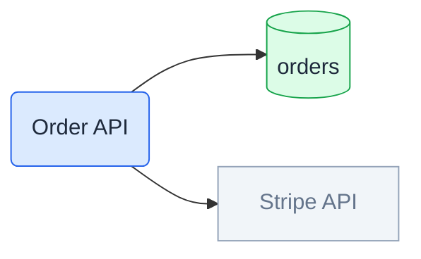
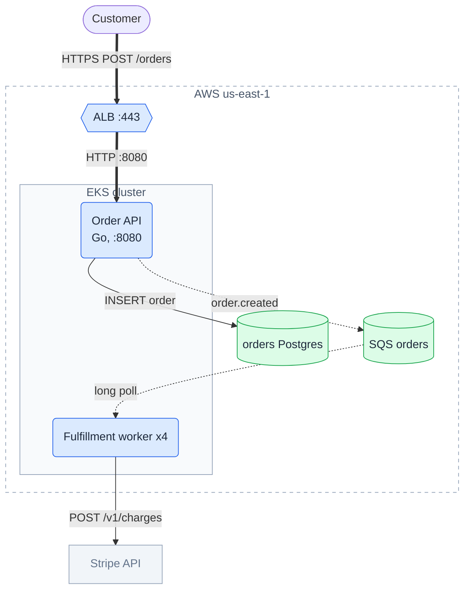
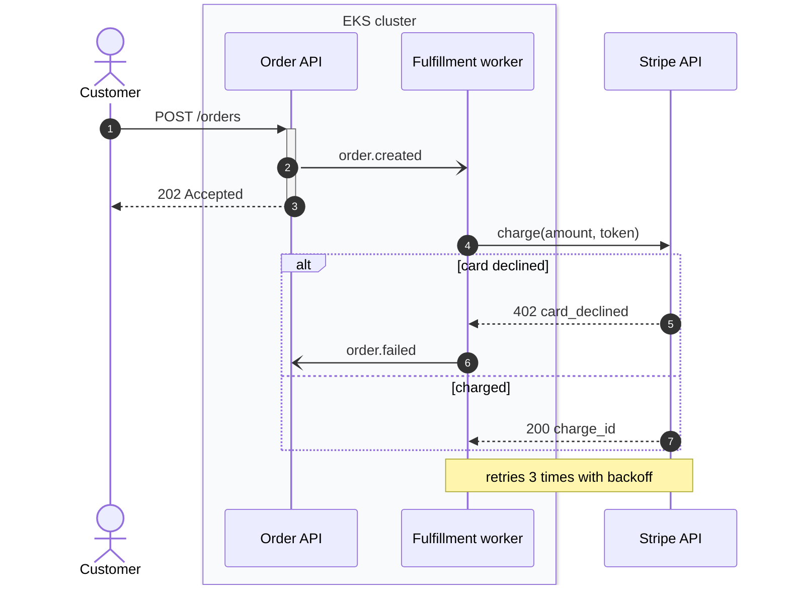
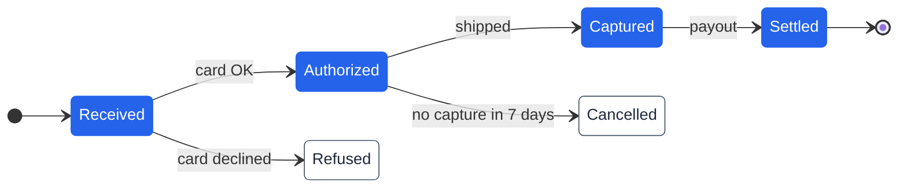
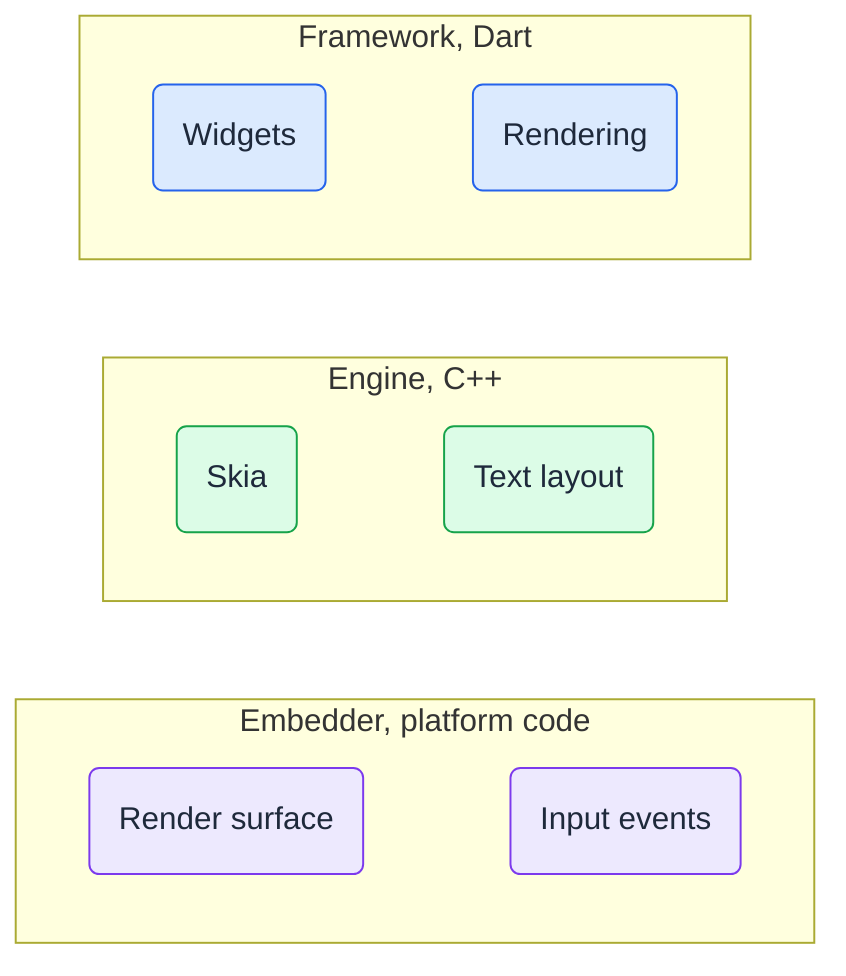
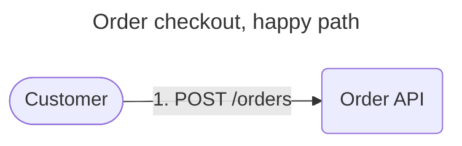

# Mermaid Reference

How to write this skill's diagrams in Mermaid. The syntax comes from the Mermaid docs at [mermaid.js.org](https://mermaid.js.org/syntax/flowchart.html) (flowchart, sequence, and state pages, read 2026-11-13). Every example, and every row of section 8 but one, was run through Mermaid 10 and Mermaid 11 that day. The direction rule in section 2 was measured in both on 2026-11-15, when the architecture example moved to `TB` and was run again. The style rules are the same as for Excalidraw: read `style-guide.md` first, and take colors from `color-palette.md`.

## Contents

- 1. Write for the oldest Mermaid in use
- 2. Pick the type
- 3. Flowchart shapes
- 4. Edges
- 5. Colors
- 6. Examples
- 7. Title, caption, and legend
- 8. Syntax that breaks

---

## 1. Write for the oldest Mermaid in use

GitHub does not document which Mermaid it runs. A `mermaid` block whose only line is `info` prints the version. Use only the classic syntax in this file, which works in Mermaid 10 and 11. Do not use these Mermaid 11 additions:

| Syntax | What Mermaid 10 does with it |
|--------|------------------------------|
| `id@{ shape: cyl }` node shapes | Fails to parse |
| `participant D@{ "type": "database" }` in a sequence | Fails to parse |
| `A<<->>B` two-way sequence arrows | Parses, but draws a participant named `A<<` |

Wrap the diagram in a fenced block whose language is `mermaid`. The first line inside is the diagram type.

---

## 2. Pick the type

| Diagram kind | Type | How |
|--------------|------|-----|
| System architecture | `flowchart`, direction below | One `subgraph` per boundary. Point edges from clients toward stores, so clients come first and stores last. |
| Request or message flow | `sequenceDiagram` | `autonumber` numbers every message. For a flow drawn over the architecture, use `flowchart` and start each edge label with its step: `1. POST /orders`. |
| Data pipeline | `flowchart`, direction below | Stages as nodes, stores as cylinders, the payload or tool on every edge. |
| Sequence | `sequenceDiagram` | One participant per actor; `box` groups the actors that share a boundary. |
| Layered stack | `flowchart TB` | One subgraph per layer, top layer first, linked with invisible `~~~` edges so they stack. |
| State machine or workflow | `stateDiagram-v2` | `direction LR` for the main path; main states filled, side states outlined. |
| Comparison or before/after | `flowchart LR` | Two subgraphs with the same nodes; prefix ids `before_` and `after_`; only the changed nodes get a hue. |
| Concept or algorithm | `flowchart` | Pick the layout pattern from style guide section 12; a cycle needs an edge back to the start. |

**Pick the flowchart direction by the longest chain.** In a `flowchart`, count the nodes on the longest path of edges. Use `LR` when it has at most 4 nodes, and `TB` when it has more, or split the diagram. In `LR`, each labeled hop adds about 250 to 280 px. Mermaid gives the SVG `width="100%"` and a `max-width` of its natural width, so on a narrower page it scales down, text included. State diagrams draw smaller nodes: the state example below, 6 nodes with `[*]`, is 910 to 914 px in `LR`. Measured in Mermaid 10 and 11, with edge labels of 12 to 24 characters:

| Longest chain | `LR` width | `TB` width |
|---------------|------------|------------|
| 3 nodes | 744 to 789 px | 207 px |
| 4 nodes | 1012 to 1072 px | 207 px |
| 5 nodes | 1282 to 1357 px | 207 px |
| 6 nodes, the architecture example below | 1530 to 1609 px | 631 to 638 px |
| 7 nodes, a pipeline with subgraphs | 2573 to 2613 px | 308 to 321 px |

---

## 3. Flowchart shapes

| Thing | Syntax |
|-------|--------|
| Service, process, component | `api(Order API)` |
| Database, cache, store | `db[(orders Postgres)]` |
| Human user or actor | `user([Customer])` |
| External system or SaaS | `stripe[Stripe API]:::external` |
| The Internet, an external network | `net((Internet)):::external` |
| Proxy, load balancer, router | `lb{{ALB :443}}` |
| Decision | `valid{Valid?}` |
| Input or output data | `csv[/orders.csv/]` |
| Many instances | `worker(Fulfillment worker x4)` |
| Start or end of a workflow | `start((Start))`, `done(((Done)))` |
| Two-tier label (name, then tech) | `api("Order API Go, :8080")` |

- **Ids** name the node; the text in brackets is its label. Use short descriptive ids (`orders_db`) and give every node a label, so a renamed label never breaks an edge.
- **Many instances:** there is no stacked shape. Write "×N" in the label.
- **Code, payloads, config:** there is no code block shape. Put a fenced code block next to the diagram, and name the node it belongs to.
- **Boundaries** are subgraphs: `subgraph vpc [VPC us-east-1]`, then the members, then `end`. Nest at most 3 levels.

---

## 4. Edges

| Meaning (palette line styles) | Syntax |
|-------------------------------|--------|
| Request, call, or data flow | `api -->|INSERT order| db` |
| Async event, control, or config | `api -.->|order.created| queue` |
| The main or critical path | `lb ==>|HTTP :8080| api` |
| A link with no direction | `a --- b` |
| Layout only, not drawn | `a ~~~ b` |
| A flow step | `user -->|1. POST /orders| api` |

- Use the `-->|label|` form on every edge, so one diagram reads one way.
- `a --> b & c` draws two edges from `a`. Avoid it when the edges need different labels.
- To color one edge, use `linkStyle`. Its index counts edges from 0 in the order written, invisible `~~~` edges included: `linkStyle 3 stroke:#2563eb,color:#2563eb`.

---

## 5. Colors

Turn each palette category into a `classDef` with `fill`, `stroke`, and `color`. Always set `color`: viewers with a dark theme draw default text in a light color, which disappears on a light fill.

- Apply a class with `id:::name` on first use, or with `class id1,id2 name` at the end.
- Style a boundary with `style <subgraph id> fill:#f8fafc,stroke:#94a3b8,stroke-dasharray:5 5,color:#475569`.
- Mermaid has no hatch fill. External systems get the solid external fill.
- Sequence diagrams take no classes: `classDef` and `:::` fail to parse there. Color a `box` or `rect` with a color name or `rgb()`; hex drops the box label (section 8).

---

## 6. Examples

### System architecture

### Request flow as a sequence

- `->>` is a call, `-->>` a reply, and `-)` an async message. `+` and `-` on the arrow start and end an activation bar.
- `autonumber` is the step badge. The classic syntax cannot color one message, so name the sender in the participant and skip a color legend.
- `rect rgb(241,245,249)` and `end` around messages shades one phase.

### State machine

### Layered stack

---

## 7. Title, caption, and legend

Write them in Markdown around the block: the title as a heading or sentence above it, then the block, then the caption and legend as a short list. If the title must be inside the picture, for example because the user loads the block into Excalidraw, put front matter before the type line. Mermaid 10 and 11 both draw it:

---

## 8. Syntax that breaks

Each row was run in Mermaid 10 and 11, except the `[*]` row, which is from the Mermaid docs. Check every diagram against all of them.

| Breaks | What happens | Write instead |
|--------|--------------|---------------|
| `start --> end` in a flowchart | Parse error | `End`, or a quoted label: `done["end"]` |
| `dev---ops` | Draws a circle edge to a node named `ps` | `dev --- ops`; `x` makes a cross edge the same way |
| `api[Order API (v2)]` | Parse error | Quote the label: `api["Order API (v2)"]` |
| A `"` inside a quoted label | Ends the label | `#quot;`, as in `a["say #quot;hi#quot;"]` |
| `a --> b %% note` | Parse error | Put `%%` comments on their own line |
| `A->>B: one; two` in a sequence | Parse error; `;` ends a statement | `#59;`, as in `A->>B: one#59; two` |
| `box #f8fafc Cluster` in a sequence | Draws the box with no label | `box rgb(248,250,252) Cluster` |
| `classDef` or `:::` in a sequence | Parse error | Color a `box` or `rect` instead |
| A misspelled id, `apl --> db` | Draws a new node named `apl` | Check every edge id against the declared nodes |
| `direction TB` in a subgraph whose nodes link outside it | The subgraph takes the outer direction | Accept it, or move the outside edge to the subgraph id |
| `classDef` on `[*]` or on a composite state | Not applied | Style only simple states |
| Any syntax in section 1's table | Fails or misdraws in Mermaid 10 | The classic form |

Quote any label that holds brackets, braces, or parentheses. Colons, slashes, dots, `×`, and a leading `1.` are safe unquoted in node and edge labels.
