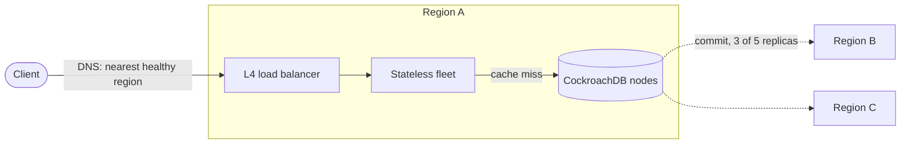

# Deck spec

## Contents

- The format: front matter, slides, notes, what renders
- The slide budget
- Storylines: design review, team walkthrough, interview, concept note
- Slide rules
- Diagrams: which to draw, and how
- Pictures, tables and code
- Example slides

This file is the contract for the decks `/make-deck` writes. `scripts/check_deck.py`
enforces the limits marked **(checked)**; the rest is judgment.

## The format

A deck is one Markdown file. It opens with front matter, then slides separated by a line
that is exactly `---`:

```markdown
---
title: URL Shortener
source: design-doc/url-shortener/rfc.md
slides: 12
author: "@author"
date: 11/18/26
---

# URL Shortener

Durable across regions before it's returned

---

## A returned link must survive a region and resolve everywhere at once

- NFR6: a region's loss loses no returned link
- NFR3: redirects answer in 100 ms at p99

Notes: Problem Statement. The forcing question: how to make a link durable
across regions before it's returned, yet resolvable locally everywhere.
```

- **Front matter.** `title` and `source` are required **(checked)**: `source` is the
  repository-relative path of the doc the deck presents. `slides` is the budget for main
  slides (default 13, for 20 minutes). `author` and `date` print on the title slide; the author is the
  user (`git config user.name`), never invented.
- **Title slide.** The first slide opens with one `# ` heading, then at most two lines: the
  one-sentence thesis, and the occasion if the user gave one **(checked)**.
- **Every other slide** has exactly one `## ` title **(checked)**, and no `# `.
- **Notes.** A line starting `Notes:` begins the speaker notes, which run to the end of the
  slide. They never print on the slide; `--notes` prints them on their own pages. Every main
  slide has notes that name the source section it comes from (a warning when missing).
- **Backup.** A slide whose title starts with `Backup` or `Appendix` begins the backup
  slides. They come after the closing slide and don't count toward the budget.

What renders: `#`, `##` and `###` headings; paragraphs; `-` and `1.` lists, two levels
deep; `**bold**`, `*emphasis*` and `` `code` ``; pipe tables; fenced code; a `mermaid`
fence, drawn by Mermaid 11 and scaled to fill the space the slide leaves; and an image
alone on its line, ``, with the path relative to the deck. A link prints as
its text. Nothing else: no HTML, no columns, no themes, no colors.

## The slide budget

About one main slide per 1.5 minutes of talk, the title slide included: 10 minutes is 7
slides, 20 minutes 13, 30 minutes 20, 45 minutes 30. Write that number in `slides:`. Over
budget is an error **(checked)**: cut, merge, or move to Backup. Under is fine; time spent
on questions is time well spent.

## Storylines

Each outline is an order of slides, not a quota: skip a slide the doc gives nothing to.

**Design review** (the default). The audience will approve or object, so lead to the
decision and arm them to attack it.

1. Title, with the thesis: the design in one sentence.
2. The problem and the forcing question (Problem Statement).
3. The requirements that shape the design: three to five rows, quoted with their IDs, not
   the whole table.
4. The estimates that drive a decision, each with the decision it drives.
5. The architecture, as a picture: the embedded drawing if there is one, else a
   high-level Mermaid flowchart drawn from the RFC's `*Diagram:` brief (Diagrams, below).
   Its claims go on the slide before or after it, or in its notes.
6. One slide per risky component: the mechanism as a diagram (a sequence for a request
   path, a state diagram for a lifecycle), with a bullet slide for the rules it can't show.
7. Alternatives that lost, and the mechanism that killed each (a table).
8. Failure modes: what fails, what it takes down, how it recovers.
9. Risks and open questions: the review's residual risks and the doc's Open Questions,
   each with its `Current design: assumed` default.
10. The ask: the decision wanted from this room, and the first tasks of the Work Breakdown.

**Team walkthrough.** The audience will build or run it, so explain how it works.
Problem, then the architecture diagram, then a request's path end to end as a sequence
diagram, then each component's contract (API, and the data model as an ER diagram), then
failure handling and what to watch, then the work plan. Alternatives go to Backup.

**Interview.** The audience is grading reasoning under time, so follow the order a
system-design interview runs in: requirements and scope, estimates, the API, the high-level
design, one or two deep dives on the riskiest parts, then trade-offs and what changes at
10x. Every deep dive ends on its trade-off.

**Concept note.** What it is, the problem it solves, how it works (the note's diagram),
the trade-offs and variants, where real systems use it, then the note's
check-your-understanding questions as the closing slide.

## Slide rules

- **The title is a claim,** a sentence the slide proves: "Random codes beat a counter
  because codes must not be guessable", not "Code generation". Read the titles alone, in
  order: they are the talk.
- **One idea per slide.** A slide that needs "and" in its title is two slides.
- **Limits** **(checked)**: at most 6 bullets; at most 45 words outside code and tables;
  code blocks of at most 14 lines; tables of at most 7 rows and 4 columns.
- **Numbers and IDs come from the source, verbatim** **(checked)**: every number of two or
  more digits, and every FR, NFR and LLD ID, must appear in the source. Round only as the
  source rounds. A number the doc derives in its Appendix is fair; a number you derive is
  not. An assumed figure says so on the slide ("assumed 80% hit rate").
- **Requirement IDs go inline** where a bullet serves one, as the RFC does.
- **Bold** names the lead term of a bullet, nothing else.
- **No em or en dashes** **(checked)**: a period, comma, colon or parentheses instead.
- **Notes carry the detail** the slide leaves out: the derivation, the caveat, the answer to
  the question the slide will draw. A caveat that changes the claim belongs on the slide.

## Diagrams: which to draw, and how

A design talk is mostly pictures of boxes and arrows. In a design review or walkthrough,
about a third of the main slides are diagrams: at least the architecture, and the riskiest
path. Every label on a diagram comes from the doc: its component, store and table names,
its numbers (**checked**, as on any slide) and its requirement IDs.

| Show | Mermaid | From the doc |
| --- | --- | --- |
| The architecture: boundaries, components, stores, what flows | `flowchart LR` with a `subgraph` per boundary | the `*Diagram:` brief, the Overview, the components |
| A request's path, with its branches | `sequenceDiagram` | the RFC's own sequence diagrams, trimmed |
| A lifecycle | `stateDiagram-v2` | a `| State | Meaning |` table, or the states a component names |
| The data model, two or three entities | `erDiagram` | the schema sketch |
| A failover or a decision | `flowchart TD` | Failure Modes, a component's steps |
| A timeline | `timeline` | an Example, a disable's or a drain's budget |
| Two to six numbers to compare | `xychart-beta` with `bar` | Estimates, the Appendix |

**The high-level architecture,** when the RFC has no drawing yet, is yours to draw from its
`*Diagram:` line, which says what the drawing must show:

- One `subgraph` per real boundary (region, cluster, trust zone), labeled. Show one region
  in full and the others as one node each when they repeat it: say "×3" in the label.
- One shape per kind, held: a service is `[Name]`, a store is a cylinder `[(Name)]`, an
  outside actor is `([Name])`. No other shapes, no colors, no `classDef`, no `style`.
- Every edge says what moves: `-->|GET /code|`. The main path is `-->`; a fallback,
  an async or a control path is `-.->`.
- At most about 12 nodes and 24 source lines (**checked**). More means two diagrams: the
  overview, then a zoom into one part.
- A slide is wide, so draw wide: `flowchart LR`. Use `TD` only for at most three layers.
  An `erDiagram` always lays out top to bottom, and `direction` there draws two extra
  entities: keep it to two or three entities, or show the schema as SQL. A tall diagram is scaled down until its text is
  too small to read.
- Keep edge labels to a few words: a long one wraps and widens the diagram.

**Trim a sequence diagram** to the path its slide claims: at most about 10 messages, the
`alt` branches the slide is about, the participant names unchanged.

**Syntax that breaks.** A `;` in a sequence message ends the statement: write a comma. A
`:` in a timeline separates a period from its events, so a clock time can't be a period:
write offsets (`t + 90 s`). Quote any label that holds `()`, `[]`, `{}` or `#`.

**A diagram slide** is its `## ` claim, the diagram, and at most one short line under it:
20 words in all (**checked**), one diagram, no table or code beside it (**checked**). The
explanation goes to the notes, or to a bullet slide next to it.

**Render and look.** The renderer reports a diagram that doesn't parse (an error), one that
printed as source because Mermaid didn't load (a warning), and one drawn below 0.6 of its
size, whose text is then too small to read (a warning: cut nodes or shorten labels). Then
look at the page: a diagram that parses can still cross its own lines or bury its point.

## Pictures, tables and code

- **The architecture drawing.** If the RFC embeds
  `diagrams/architecture.excalidraw.svg`, show it, alone on its slide, with the path
  relative to the deck (`../diagrams/architecture.excalidraw.svg`), in place of the
  Mermaid architecture. Any other picture the repository holds for the doc (an SVG or
  PNG under its `diagrams/`) goes in the same way. Never invent a picture: no stock
  images, no hand-written SVG art. For a richer drawing than Mermaid gives, the hand-over
  points the user to `/draw-diagram`, whose Excalidraw file they export and the deck
  embeds.
- **Tables** suit alternatives (option, advantage, why it loses) and estimates (quantity,
  average, peak). Shorten cells; keep the numbers whole.
- **Code** is a type or interface sketch from the RFC, trimmed to what the slide claims.
  Never a function body.

## Example slides

```markdown
## Creation is one transaction, so equal URLs share one code (FR3)

1. Look up the URL key; found means return the existing code
2. Insert the fresh code; a duplicate retries, at most 5 times
3. Claim the URL key; losing the race returns the winner's code

Notes: Link Creation, phases 1 to 3. A code collision has p <= 0.00167,
so retries are rare. Phase 4 is the commit across two regions (NFR6).
```

A high-level architecture, drawn from a `*Diagram:` brief:

~~~markdown
## Three regions share one cluster that survives a region



Notes: Overview, and the Diagram brief. Replicas sit 2+2+1 across the regions (NFR6).
~~~
