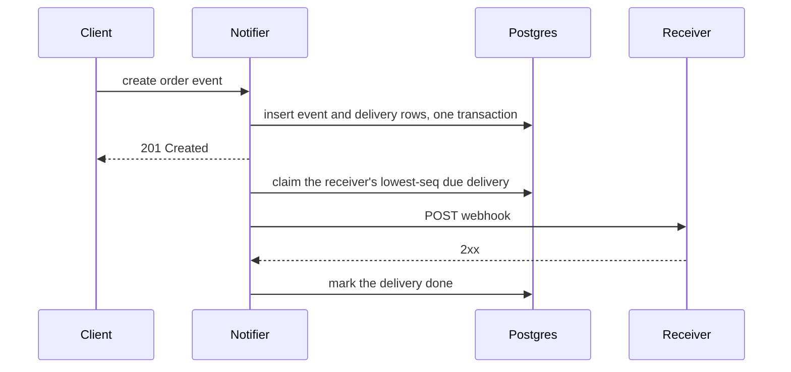

# RFC Exemplar

## Contents

- How to use this file
- The fictional RFC, in one fenced block: header block, Background,
  Terminologies, Problem Statement, Requirements (with Out of Scope
  and Use cases), Estimates, Proposed Solution (Overview, API, Data
  model and storage, Delivery Log, Retry Scheduler, Replay, Example),
  Alternatives Considered, Failure Modes and Observability, Open
  Questions, Work Breakdown, Appendix, References, then the loop
  state below the marker: Evidence, Revision log, Objection responses

## How to use this file

This is one fictional RFC that shows every section of `rfc-spec.md`
in the house voice, inside the default 4,000-word budget. The service,
people, code paths, pages, and numbers are invented. Use it for
shape and voice only: never cite it for a claim about any real system,
and never copy its content into a design. Where it and `rfc-spec.md`
differ, the spec wins.

Its brief had FR1 to FR3, NFR1 to NFR3, and one Low-level Design
Preference: `LLD1`, use the existing Postgres database and add no new
infrastructure. That is why `LLD1` appears in the body with no section
of its own.

The RFC is fenced so its headings and its loop-state marker are not
read as this file's own.

````markdown
# RFC: Durable Retries for Outbound Webhooks

**Status:** Draft · **Author:** @author-example · **Related:** [RFC: Notifier Event Model](https://docs.example.com/rfcs/notifier-event-model)

| Name | Sign-off | Comments |
| --- | --- | --- |
| @reviewer-example | - [ ] approved | |
| @TBD | - [ ] approved | |

## Background

Notifier sends a webhook to every subscribed receiver when an order
event is created. Today's `send_webhook` makes one HTTP POST per
receiver, inline in the request that created the event, and logs a
failure without retrying. A receiver that is down for a deploy misses
every event in that window, and nothing records which events it
missed.

Support rebuilds missed events by hand from the orders table. That
works for one receiver and one short outage; it doesn't work when a
receiver is down overnight.

## Terminologies

| Term | Meaning |
| --- | --- |
| **Delivery** | One event sent to one receiver. An event with three receivers is three deliveries. |
| **Attempt** | One HTTP POST for a delivery. |
| **Dead delivery** | A delivery whose retry window closed without a success. |

## Problem Statement

Notifier can't promise a receiver that it will see an event, because
a delivery lives only in the memory of the request that made it.
Retrying inline would hold the request open for as long as the
receiver is down, and a crash between the event write and the POST
would still lose the delivery. The forcing question is how to make
each delivery outlive the request and the process that created it,
without letting one slow receiver hold up the others.

## Requirements

### Functional Requirements

| ID | Requirement |
| --- | --- |
| FR1 | A delivery that fails with a 5xx status or a timeout is retried until it succeeds or 24 hours pass. |
| FR2 | A dead delivery is kept, and an operator can replay it. |
| FR3 | Each receiver gets its deliveries in the order the events were created. |

### Non-functional Requirements

| ID | Requirement |
| --- | --- |
| NFR1 | **Durability.** No accepted event loses a delivery when a Notifier process restarts. |
| NFR2 | **Isolation.** A receiver that is down delays no other receiver's deliveries. |
| NFR3 | **Scale.** Notifier sustains 20 events per second at peak, with 3 receivers per event on average (assumed). |

### Out of Scope

- Retrying on a 4xx status. A 4xx means the receiver rejected the
  payload, and resending the same bytes can't fix that (FR1 names 5xx
  and timeouts only).
- Payload signing. It stays as it is; the Notifier Event Model RFC
  owns it.
- Exactly-once delivery. Receivers already dedupe on `event_id`, so
  at-least-once is enough.

### Use cases

**Use cases:**

- A receiver is down for a short deploy. Its deliveries wait, then
  arrive in order once it's back (FR1, FR3, NFR2).
- A Notifier process restarts mid-retry. Another process picks up the
  pending deliveries (NFR1).
- A receiver's endpoint is misconfigured for two days. Its deliveries
  go dead, and an operator replays them after the fix (FR2).

## Estimates

Both numbers start from NFR3, whose inputs are assumed, so both are
assumed.

- **Delivery writes.** 20 events/s × 3 receivers = 60 delivery rows/s
  at peak. Three inserts ride in each event's transaction, so the
  write path needs no batching and no separate ingest service.
- **Table size.** 60 rows/s × 86,400 s = 5,184,000 rows a day if peak
  held all day, an upper bound. At 200 bytes a row (assumed), that is
  about 1.04 GB a day, and 7.3 GB for 7 days of `done` rows. The
  table needs a retention job (Task 4), and 7 days of rows fits the
  existing database.

## Proposed Solution

### Overview

This RFC adds durable retries to Notifier: one `deliveries` table
that records every delivery before its first attempt, and a scheduler
that sends from that table. The request path writes the delivery rows
in the same transaction as the event and returns; it no longer makes
the POST itself. Once this ships, a receiver outage costs latency,
not events.

*Diagram: the request path writing the event and its deliveries in
one transaction, the scheduler claiming due deliveries per receiver,
and Replay resetting dead ones.*

This section covers the API and the data model, then the three parts
in data-flow order: the Delivery Log, the Retry Scheduler, and Replay.

### API

- `POST /admin/receivers/{id}/replay` replays a receiver's dead
  deliveries (FR2). Calling it twice is safe: the second call finds no
  dead deliveries and changes nothing.
- `GET /admin/receivers/{id}/deliveries?state=&after=` lists one
  receiver's deliveries, oldest first, 100 to a page. `after` takes
  the last `seq` of the previous page.

The endpoints that create events keep their signatures: the delivery
rows are written behind them.

### Data model and storage

Three access patterns shape the table. The scheduler claims a
receiver's lowest-`seq` due delivery, Replay finds a receiver's dead
deliveries, and retention deletes old `done` rows. All three start
from `receiver_id`, so the table is keyed and indexed by receiver. It
lives in the existing Postgres database (LLD1), which is also what
lets a delivery commit in its event's transaction (NFR1).

Sketch of the row and its states:

```python
class DeliveryState(Enum):
    PENDING = "pending"      # waits for next_attempt_at
    IN_FLIGHT = "in_flight"  # claimed by one scheduler worker
    DONE = "done"
    DEAD = "dead"            # FR1's 24-hour window closed

@dataclass
class Delivery:
    id: int
    event_id: str            # receivers dedupe on this
    receiver_id: int
    seq: int                 # per-receiver order (FR3)
    state: DeliveryState
    attempts: int
    created_at: datetime
    next_attempt_at: datetime
    claimed_until: datetime | None  # lease; an expired lease is claimable again
```

`(receiver_id, seq)` is unique and carries FR3's order. A partial
index on `(receiver_id, next_attempt_at)` over `pending` rows serves
the claim.

### Delivery Log

Today's `send_webhook` keeps the delivery only in memory, so a crash
after the event commits loses it. The Delivery Log writes one
`deliveries` row per receiver in the same transaction as the event
(NFR1), before any attempt is made. The write adds inserts to a
transaction that already exists, so the request path gains no network
call.



**Pros:** a delivery is durable the moment its event is, with no new
infrastructure. **Cons:** every event writes one row per receiver, so
the table grows with fan-out and needs a retention job (Task 4).

### Retry Scheduler

The scheduler is a loop in each Notifier process. It claims due
deliveries, sends them, and records the result.

**Claim per receiver, not per row.** FR3 forbids sending a receiver's
`seq` 8 while its `seq` 7 is unsent, so a worker locks a receiver
before it picks a delivery, rather than taking any due row:

```text
Phase 1, claim:  lock one receiver row FOR UPDATE SKIP LOCKED, among
                 receivers with a due PENDING delivery and no unexpired
                 IN_FLIGHT one; mark its lowest-seq PENDING delivery
                 IN_FLIGHT, claimed_until = now + 60s; commit.
Phase 2, send:   POST with a 10s timeout.
Phase 3, record: 2xx: DONE. 5xx or timeout: PENDING, attempts + 1,
                 next_attempt_at = now + backoff(attempts).
                 Past created_at + 24h: DEAD.
```

`SKIP LOCKED` lets several processes share the table without two of
them claiming the same receiver. A down receiver holds only its own
head-of-line delivery, so every other receiver keeps flowing (NFR2).

**MVP choice: exponential backoff, capped at 30 minutes.** A fixed
interval either hammers a down receiver or delays recovery from a
short blip; the cap keeps attempts frequent enough late in FR1's
window to matter. The rival, a per-receiver circuit breaker, is in
Alternatives Considered.

| State | Meaning |
| --- | --- |
| `pending` | Waiting for `next_attempt_at`. |
| `in_flight` | Claimed; the lease ends at `claimed_until`. |
| `done` | The receiver returned 2xx. |
| `dead` | FR1's window closed; waits for Replay. |

**Error handling.** A worker that dies mid-send leaves its delivery
`in_flight`. Once `claimed_until` passes, the claim treats that
receiver as free again, so the delivery is sent again. Receivers
dedupe on `event_id`, which makes the resend safe.

**Pros and cons.** The scheduler needs no queue service and survives
restarts by construction. It costs one claim query per polling cycle
per process, and head-of-line blocking is the price of FR3: one
delivery that keeps failing stalls its receiver until the delivery
goes dead.

### Replay

The replay endpoint sets a receiver's dead deliveries back to
`pending` with `attempts = 0` and a fresh 24-hour window (FR2). Replay
keeps each delivery's `seq`, so they go out in their original order.

### Example

Receiver 42 goes down at 02:00. Its `seq` 7 fails, backs off, and
fails again; `seq` 8 and 9 wait behind it, while receiver 43's
deliveries go out on time. At 02:20 receiver 42 is back: `seq` 7
succeeds on its next attempt, and 8 and 9 follow in the next polling
cycles.

## Alternatives Considered

### Delivery Log

- **A message queue, one topic per receiver.** Pro: ordering and
  retries come built in, and throughput scales past one database.
  Con: it is new infrastructure, which LLD1 rules out, and writing the
  event to Postgres and the message to the queue is a dual write: a
  crash between the two loses the delivery (NFR1).
- **Retry inline in the request.** Pro: no table and no scheduler.
  Con: the request stays open while the receiver is down, and a
  process crash still loses the delivery (NFR1).

### Retry Scheduler

- **A per-receiver circuit breaker instead of backoff.** Pro: it
  stops every attempt to a dead receiver at once, which saves the
  most requests. Con: the breaker state must be shared across
  processes, which is one more table with its own race, for a saving
  the backoff cap already bounds.

## Failure Modes and Observability

Four failure modes matter for this design; each below names the
mode, then what to measure for it.

- **A receiver stalls.** Its head-of-line delivery keeps failing, and
  the receiver's queue grows. No other receiver is delayed (NFR2), and
  the queue drains in order once the receiver answers.
- **The scheduler falls behind.** Due deliveries pile up faster than
  workers send them, across all receivers. Each Notifier process runs
  the loop, so adding processes adds workers.
- **Postgres is slow or down.** Events can't be created either, so no
  delivery is lost. Attempts pause, and resume from the table.
- **Deliveries go dead.** FR1's window closes for a receiver. Nothing
  detects this today: failures are only logged. An operator replays
  them once the receiver is fixed (FR2).

Metrics that track:

- `deliveries_pending` per receiver, and the age of its oldest
  pending delivery.
- `delivery_attempts_total` by status class.
- `deliveries_dead_total` per receiver.

Debug endpoints that:

- Show one receiver's pending and dead deliveries: the listing in API.

## Open Questions

1. **Should Replay refuse deliveries older than 7 days?** An old
   payload may describe an order that has changed since. Current
   design: assumed no age limit. If that is wrong, Replay gains an
   age filter, and the retention job keeps dead rows at least that
   long.

## Work Breakdown

| # | Task | Description | Depends on |
| --- | --- | --- | --- |
| 1 | Delivery Log | Add `deliveries` and write its rows in the event transaction (NFR1, LLD1). | none |
| 2 | Retry Scheduler | The claim, send, and record loop, with leases and backoff (FR1, FR3, NFR2). | Task 1 |
| 3 | Replay | The replay endpoint for dead deliveries (FR2). | Task 1 |
| 4 | Retention | Delete `done` rows after 7 days (NFR3). | Task 1 |
| 5 | Metrics | The metrics and the delivery listing. | Task 2 |

## Appendix

**Backoff schedule.** The wait before attempt n+1 is `min(2^n, 1800)`
seconds:

```text
attempts so far:  1   2   3   ...  10     11 and later
wait (s):         2   4   8   ...  1024   1800
```

## References

- [RFC: Notifier Event Model](https://docs.example.com/rfcs/notifier-event-model), the parent RFC that defines events and receivers.
- [PostgreSQL: The Locking Clause](https://www.postgresql.org/docs/current/sql-select.html#SQL-FOR-UPDATE-SHARE), the `SKIP LOCKED` behavior the claim relies on.

<!-- loop state below: not part of the RFC -->

## Evidence

| Claim | Source | Label |
| --- | --- | --- |
| `send_webhook` makes one POST per receiver and only logs a failure | `notifier/send.py:31` | observed |
| The event insert already runs in a transaction | `notifier/events.py:58` | observed |
| Receivers dedupe on `event_id` | Receiver integration guide, https://docs.example.com/receivers/integration, read 01/15/26 | observed |
| 60 delivery rows a second at peak | NFR3: 20 events/s × 3 receivers | assumed |
| 7.3 GB for 7 days of `done` rows | 60 rows/s × 86,400 s × 200 B × 7 days; the row size is none yet, measure with `pg_column_size` after Task 1 | assumed |
| One claim query per polling cycle per process is cheap at current load | none yet; measure with `pg_stat_statements` after Task 2 | assumed |

## Revision log

- R0: first draft.
- R1: claims moved from per row to per receiver (R1-1); deliveries gained a `claimed_until` lease (R1-2).
- editorial: adopted

## Objection responses

- R1-1 | accepted | Per-row claims let `seq` 8 go out before 7; the claim now locks the receiver first.
- R1-2 | accepted | A crashed worker left its delivery `in_flight` forever; the lease makes it claimable again.
- R1-3 | rebutted | "Use a queue for throughput": no requirement asks for throughput past one database, and LLD1 rules out new infrastructure.
````
