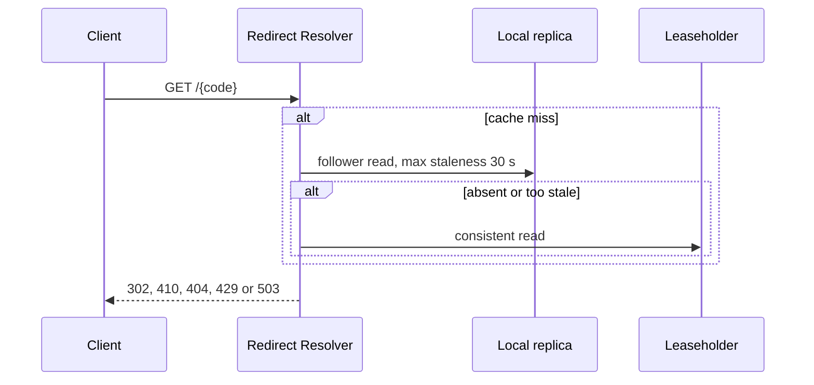

# URL Shortener

Write each link across regions before returning it; answer each redirect locally

Design review

---

## A returned link must survive a region and resolve everywhere at once

- **NFR6**: a returned link survives a region's loss
- **NFR11**: every server resolves it once it's returned
- **NFR3**: redirects answer in 100 ms at p99, so no cross-region read per redirect
- **FR3**: equal URLs share one code, even under a race

Notes: Problem Statement. The forcing question is how to make a link durable across regions before it's returned, yet resolvable locally and consistently everywhere. NFR4 adds that redirects outlive creation failures.

---

## Peak load is 116,000 redirects and 11,600 creations a second

| Rate | Average | Peak |
| --- | --- | --- |
| Creations a second | 1,157 | 11,600 |
| Redirects a second | 11,574 | 116,000 |

- Each region is sized for half the peak: 58,000 redirects a second
- One server's step 4 confirms only 1,280 a second (assumed), so a slow replica drains the region

Notes: Estimates, from NFR1's 100 million links a day and 10 redirects per link. A drain moves a region's third onto two, raising each by half. At an 80% hit rate, 11,600 reach the store. The step 4 figure assumes 50 ms per consistent read.

---

## Eight random base62 characters stay unguessable at 365 billion links

| Alphabet | Space | Fraction live |
| --- | --- | --- |
| base36 | 2.82 × 10^12 | 12.9% |
| base62 | 2.18 × 10^14 | 0.167% |

- base62 leaves one live code per 598 probes; base36, one per 8
- Inserts rarely retry: a fresh code collides with p <= 0.00167

Notes: Estimates and Appendix, alphabet against density. NFR12 caps codes at 8 characters, and NFR8 says a code can't be predicted from another. Base62 is forced.

---

## One CockroachDB cluster across three regions owns the invariants

- 5 replicas placed 2+2+1 outlive any one region (NFR6)
- A transaction makes both inserts atomic (FR3)
- Follower reads serve redirects locally (NFR3, NFR4)
- A leaseholder read settles a local miss (NFR11)
- **Cost**: self-operated, a cross-region write, 5× storage

Notes: Overview, and Data model and storage. The MVP choice is SURVIVE REGION FAILURE with REGIONAL BY TABLE. The fatal invariants, NFR6, NFR7 and FR3, are the database's job. The architecture drawing is still to be drawn; the RFC's Diagram line says what it shows.

---

## Creation is one transaction, so equal URLs always share one code (FR3)

1. **Look up** the URL key; found returns its code
2. **Insert** a fresh random code; a duplicate retries, at most 5 times
3. **Claim** the URL key; losing a race reruns the lookup
4. **Commit** on 3 of 5 replicas in two regions (NFR6)

Notes: Link Creation, phases 1 to 4. An aborted transaction leaves no rows. Phase 1 also rejects a disabled URL (FR9) and raises Integrity if the stored URL canonicalizes to another key (NFR7). The cost: each creation pays cross-region round trips, and NFR5 is assumed until Task 2's load test.

---

## A redirect leaves its region only on a local miss



Notes: Redirect Resolver, steps 1 to 4. Step 1 checks the cool-off and miss count first. Cache entries live T = 60 s; the local read times out at 20 ms; the consistent read at 100 ms, at most F = 64 in flight per server. A local miss is never final or cached, because a code returned a moment ago may not be on this replica yet (NFR11). NFR3 assumes the cache and the local replica answer 99% of redirects.

---

## Staleness can hide a link, never misdirect it

- URLs never change (FR5): stale reads only miss
- Servers honor a disable in 90 s: 30 s lag plus 60 s cache
- Browsers add 60 s: 150 s against FR6's 300 s
- A tracker pages past 90 s (NFR9)

Notes: Estimates, disable budget; Redirect Resolver, staleness; Disables. Expiry alone meets FR6, so there's no push invalidation. Cache-Control is private, max-age=60, and a 302 isn't cached heuristically.

---

## Abuse limits hold a prober to 14.4 live codes a day

- 50 misses per 10 minutes, then an hour's cool-off
- IPv6 counts /64, /56 and /48 at 1, 4 and 16 times
- A /48 holder finds 104.7 live codes a day
- **Cost**: a cool-off on a carrier's /48 blocks 65,536 phones

Notes: Abuse Limiter, Edge and client identity, and Appendix, enumeration under the limits. The 14.4 assumes r = 1,000 probes a second. Counting stays regional, since a global counter would put a cross-region write on every miss. The review's last round noted this bound is slightly optimistic (R5-1, a nit).

---

## Random codes and CockroachDB beat the simpler rivals

| Rival | Advantage | Why it loses |
| --- | --- | --- |
| Base62 counter | Never collides | Predictable codes (NFR8), hot range |
| Keyed permutation | No collisions | A ten-year secret; a leak inverts every code |
| DynamoDB global tables | Managed | Consistent reads cross regions (NFR3) |
| CockroachDB `GLOBAL` tables | Local consistent reads | Commit-wait on 11,600 inserts a second (NFR5) |
| CDN caching redirects | Absorbs viral links | Edge hits skip the cool-off (NFR8) |

Notes: Alternatives Considered. Also rejected: a truncated hash, since anyone can compute a URL's code, and one primary region with async replicas, which can lose a returned link (NFR6).

---

## A region failure costs a 90 s drain, not data

- One region down: 3 of 5 replicas remain (NFR6)
- A partition: uncached lookups get `503` until the drain, about 120 s
- Two regions down is beyond NFR6: creation and disables stop
- A slow local replica drains its region

Notes: Failure Modes and Observability. NFR4's 99.99% allows 3,154 s of failed lookups a year, about 78 drains (assumed even traffic split, clients honoring the 60 s DNS TTL). A break-glass flag lifts S if two regions fail, suspending FR6 and NFR11.

---

## The open risks are abuse and unmeasured load

- A wide botnet can fill step 4 and fail fresh codes with `503`
- One prober's cool-off blocks a carrier prefix for an hour
- Assumed: 80% hit rate, 50 ms step 4 reads, half-peak sizing
- The RFC is at its word budget

Notes: Residual risks from review round 5, approve-with-risks. Triggers: step 4 rejections over F, shed-limit 503s, the page on a /56 or /48 cool-off, and the Task 2 and Task 3 load tests and the Task 6 region-isolation drill.

---

## The ask: approve, pick regions, build creation first

- **Decide**: which three regions
- **Decide**: whether the limits and load figures stand
- **Build**: the canonicalizer, then creation with a peak load test
- **Then**: resolver, limiter, disables, deployment

Notes: Open Questions 1 and 2, and the Work Breakdown, riskiest first. Task 2 depends on a three-region CockroachDB cluster. Open Question 4 asks whether one cluster sustains 11,600 two-range transactions a second plus step 4.

---

## Backup: equal URLs are found by a frozen canonical form

1. **Convert** non-ASCII hosts with UTS #46 (FR10)
2. **Validate**: http or https, RFC 3986, at most 2,048 characters (FR7)
3. **Normalize**: case, escapes, dot-segments, default port (FR4)
4. **Reject** userinfo and the service's own domain (FR9), then hash

Notes: Canonicalizer. Any change to step 3 re-keys old URLs and gives them second codes, so v1 is frozen behind golden tests; a change is a v2 with a backfill.

---

## Backup: the schema keys links by code and URLs by hash

```sql
CREATE TABLE links (
  code        STRING(8) PRIMARY KEY,
  url         STRING NOT NULL,
  created_at  TIMESTAMPTZ NOT NULL,
  disabled_at TIMESTAMPTZ NULL
);
CREATE TABLE url_index (
  url_key BYTES PRIMARY KEY,  -- SHA-256 of canonicalize_v1
  code    STRING(8) NOT NULL
);
```

Notes: Data model and storage. Rows of 124 B and 40 B total 299 TB with 5 replicas at Xu's assumed 100 B URL, 3.85 PB at FR7's maximum. disables and cooloffs are the other two tables.

---

## Backup: creation as a sequence

```mermaid
sequenceDiagram
    participant C as Client
    participant H as Create Handler
    participant DB as CockroachDB
    C->>H: POST /v1/links {url}
    H->>DB: BEGIN; read url_index[key]
    alt key found
        DB-->>H: code c
        H-->>C: 200 {c}
    else key absent
        H->>DB: insert links, url_index; COMMIT
        H-->>C: 201 {fresh}
    end
```

Notes: Link Creation's sequence diagram, trimmed: the Abuse Limiter charge (FR8) and canonicalize_v1 come before BEGIN.
