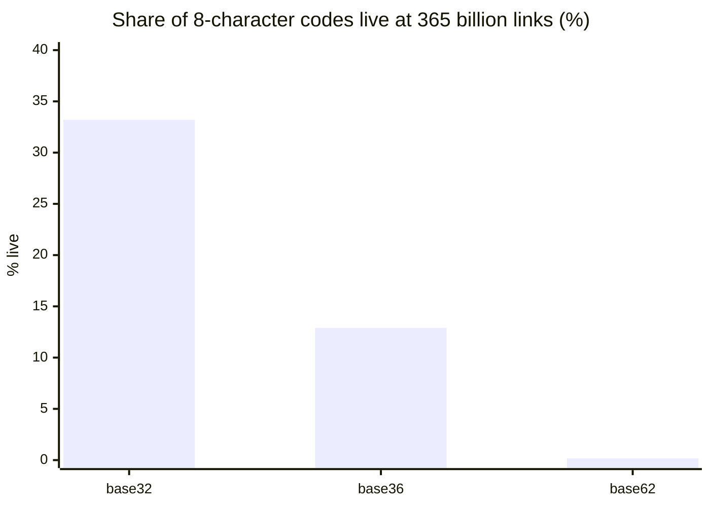
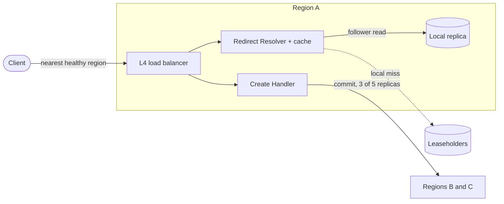
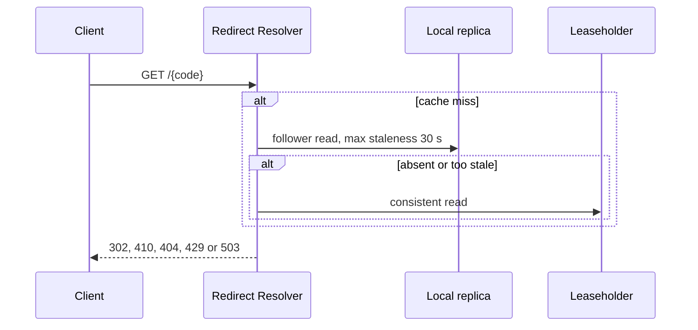
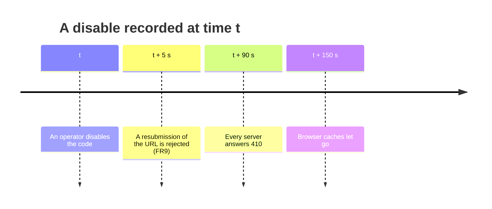
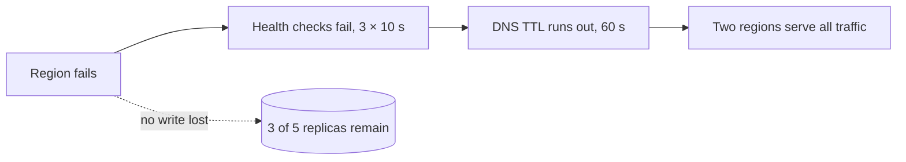
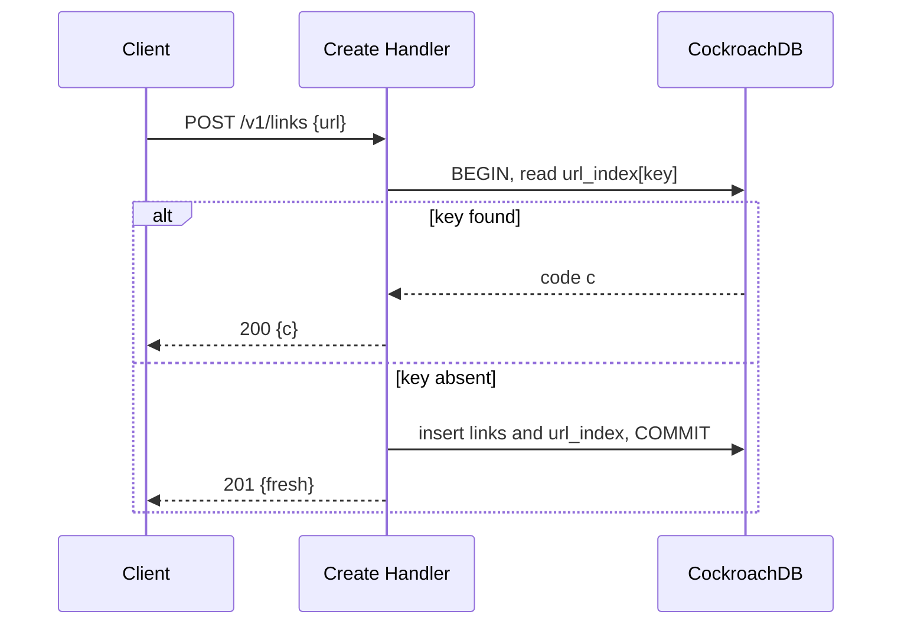

# URL Shortener

Write each link across regions before returning it; answer each redirect locally

Design review

---

## A returned link must survive a region and resolve everywhere at once

- **NFR6**: a returned link survives a region's loss
- **NFR11**: every server resolves it once it's returned
- **NFR3**: redirects answer in 100 ms at p99, so no cross-region read per redirect
- **FR3**: equal URLs share one code, even under a race

Notes: Problem Statement. The forcing question is how to make a link durable across regions before it's returned, yet resolvable locally and consistently everywhere. NFR4 adds that redirects outlive creation failures.

---

## Peak load is 116,000 redirects and 11,600 creations a second

| Rate | Average | Peak |
| --- | --- | --- |
| Creations a second | 1,157 | 11,600 |
| Redirects a second | 11,574 | 116,000 |

- Each region is sized for half the peak: 58,000 redirects a second
- One server's step 4 confirms only 1,280 a second (assumed), so a slow replica drains the region

Notes: Estimates, from NFR1's 100 million links a day and 10 redirects per link. A drain moves a region's third onto two, raising each by half. At an 80% hit rate, 11,600 reach the store. The step 4 figure assumes 50 ms per consistent read.

---

## Eight random base62 characters stay unguessable at 365 billion links



One live code per 598 probes for base62, against 8 for base36

Notes: Estimates and Appendix, alphabet against density. NFR8 allows base36 too; base62 is chosen for enumeration yield: 49.5 live codes an hour under base36 against 17.1 a day. The cost: codes are case-sensitive, so a mis-cased printed link is another code, and a QR code can't use alphanumeric mode. Inserts rarely retry: a fresh code collides with p <= 0.00167.
---

## Three regions share one CockroachDB cluster that survives a region



Regions B and C run the same fleet

Notes: Overview, and the RFC's Diagram brief: the drawing itself is still to come. The MVP choice is SURVIVE REGION FAILURE with REGIONAL BY TABLE: 5 replicas placed 2+2+1 outlive any one region (NFR6), a transaction makes both inserts atomic (FR3), follower reads serve redirects locally (NFR3, NFR4), and a leaseholder read settles a local miss (NFR11). Each region also runs a counter store for the Abuse Limiter, and a Disable Tracker probes the servers (NFR9). The cost: a self-operated cluster, a cross-region write, 5× storage, and an assumed Enterprise Free license.

---

## Creation is one transaction, so equal URLs always share one code (FR3)

1. **Look up** the URL key; found returns its code
2. **Insert** a fresh random code; a duplicate retries, at most 5 times
3. **Claim** the URL key; losing a race reruns the lookup
4. **Commit** on 3 of 5 replicas in two regions (NFR6)

Notes: Link Creation, phases 1 to 4. An aborted transaction leaves no rows. Phase 1 also rejects a disabled URL (FR9) and raises Integrity if the stored URL canonicalizes to another key (NFR7). The cost: each creation pays cross-region round trips, and NFR5 is assumed until Task 2's load test.

---

## A redirect leaves its region only on a local miss



Notes: Redirect Resolver, steps 1 to 4. Step 1 checks the cool-off and miss count first. Cache entries live T = 60 s; the local read times out at 20 ms; the consistent read at 100 ms, at most F = 64 in flight per server. A follower serves reads only at or below its closed timestamp, about 3 s behind, so it lacks younger codes: a local miss is never final or cached (NFR11). NFR3 assumes the cache and the local replica answer 99% of redirects, given an assumed share of lookups within 3 s of creation; Task 3's create-then-open load test checks it.

---

## A disable stops every redirect in 90 s, inside FR6's 300 s



Notes: Example, Estimates (disable budget) and Disables. In the RFC's Example, a code disabled at 10:00:00 stops redirecting everywhere by 10:01:30, and a resubmission at 10:00:05 fails. Servers honor a disable within S + T = 30 + 60 = 90 s, and browsers add M = 60 s: 150 s against FR6's 300 s, so expiry alone meets FR6. Staleness can hide a link but never misdirect it, because a URL never changes (FR5). The Disable Tracker measures each disable and pages past 90 s (NFR9).
---

## Abuse limits hold a prober to about 17.1 live codes a day

- 50 misses per 10 minutes, then an hour's cool-off
- IPv6 counts /64, /56 and /48 at 1, 4 and 16 times
- A /48 holder finds 107.4 live codes a day
- **Cost**: a cool-off on a carrier's /48 blocks 65,536 phones

Notes: Abuse Limiter, Edge and client identity, and Appendix, enumeration under the limits. A fast prober's cycle gives 14.4 at r = 1,000 probes a second; a prober pinned to one server can shed up to 22 lookups before its first miss, so the bound is about 17.1. Counting stays regional, since a global counter would put a cross-region write on every miss.

---

## Random codes and CockroachDB beat the simpler rivals

| Rival | Advantage | Why it loses |
| --- | --- | --- |
| Base62 counter | Never collides | Predictable codes (NFR8), hot range |
| Keyed permutation | No collisions | A ten-year secret |
| DynamoDB global tables | Managed | Consistent reads cross regions (NFR3) |
| CockroachDB `GLOBAL` tables | No step 4 | 800 ms commit-wait (NFR5) |
| CDN caching redirects | Absorbs viral links | Edge hits skip the cool-off (NFR8) |

Notes: Alternatives Considered. A keyed permutation's leaked secret inverts every code. The `GLOBAL` rival would delete step 4, its slots and shed counting; the commit-wait figure is assumed until Task 2's load test, and the choice flips if a `GLOBAL` creation fits NFR5. Also rejected: a truncated hash, since anyone can compute a URL's code, and one primary region with async replicas, which can lose a returned link (NFR6).

---

## A region failure costs a 90 s drain, not data



Notes: Failure Modes and Observability, and the Appendix. A partition first waits S = 30 s before its reads fail, so it drains in about 120 s, serving 503 to uncached lookups meanwhile. Two regions down is beyond NFR6: creation and disables stop. A slow local replica fails the health check, so its region drains too. NFR4's 99.99% allows 3,154 s of failed lookups a year, about 78 drains. The region's leases move too, pausing creation and step 4 on them.
---

## Every standing risk has a trigger that shows it

| Risk | Trigger |
| --- | --- |
| A botnet fails fresh codes | Step 4 rejections |
| A cool-off blocks a carrier | /56 or /48 cool-off page |
| Creation load or a bad deploy | Creation over 11,600 a second |
| Unsized home region | Task 2 load test |
| No node tolerance after a region loss | Task 6 drill |
| A lapsed Free license | License age, telemetry gap |

Notes: Residual risks from review rounds 5, Review 1 and Review 2, all approve-with-risks, from Failure Modes and Versioning. Also standing: canonicalizer v2 has no cutover plan, triggered by the first change failing a v1 test. Assumed until load-tested: the 80% hit rate, 50 ms step 4 reads, half-peak sizing, and the share of lookups within 3 s of creation. The RFC is at its word budget.

---

## The ask: approve, pick regions, build creation first

- **Decide**: which three regions
- **Decide**: whether the limits and load figures stand
- **Decide**: whether FR7 and FR9 reject own-domain URLs
- **Build**: the canonicalizer, then creation with a peak load test
- **Then**: resolver, limiter, disables, deployment

Notes: Open Questions 1, 2 and 5, and the Work Breakdown, riskiest first. Task 2 depends on a three-region CockroachDB cluster. Open Question 4 asks whether one cluster sustains 11,600 two-range transactions a second plus step 4.

---

## Backup: the cluster owns the invariants

- 5 replicas placed 2+2+1 outlive any one region (NFR6)
- A transaction makes both inserts atomic (FR3)
- Follower reads serve redirects locally (NFR3, NFR4)
- A leaseholder read settles a local miss (NFR11)
- **Cost**: self-operated, a cross-region write, 5× storage, a license

Notes: Overview, and Data model and storage. The MVP choice is SURVIVE REGION FAILURE with REGIONAL BY TABLE. The fatal invariants, NFR6, NFR7 and FR3, are the database's job. The architecture drawing is still to be drawn; the RFC's Diagram line says what it shows.

---

## Backup: equal URLs are found by a frozen canonical form

1. **Convert** non-ASCII hosts with UTS #46 (FR10)
2. **Validate**: http or https, RFC 3986, at most 2,048 characters (FR7)
3. **Normalize**: case, escapes, dot-segments, default port (FR4)
4. **Reject** userinfo and the service's own domain (FR9), then hash

Notes: Canonicalizer. Any change to step 3 re-keys old URLs and gives them second codes, so v1 is frozen behind golden tests; a change is a v2 with a backfill.

---

## Backup: the schema keys links by code and URLs by hash

```sql
CREATE TABLE links (
  code        STRING(8) PRIMARY KEY,
  url         STRING NOT NULL,
  created_at  TIMESTAMPTZ NOT NULL,
  disabled_at TIMESTAMPTZ NULL
);
CREATE TABLE url_index (
  url_key BYTES PRIMARY KEY,  -- SHA-256 of canonicalize_v1
  code    STRING(8) NOT NULL
);
```

Notes: Data model and storage. url_key is the SHA-256 of canonicalize_v1's output. Rows of 124 B and 40 B total 299 TB with 5 replicas at Xu's assumed 100 B URL, 3.85 PB at FR7's maximum. cooloffs is the fourth table.
---

## Backup: creation as a sequence



Notes: Link Creation's sequence diagram, trimmed: the Abuse Limiter charge (FR8) and canonicalize_v1 come before BEGIN.
