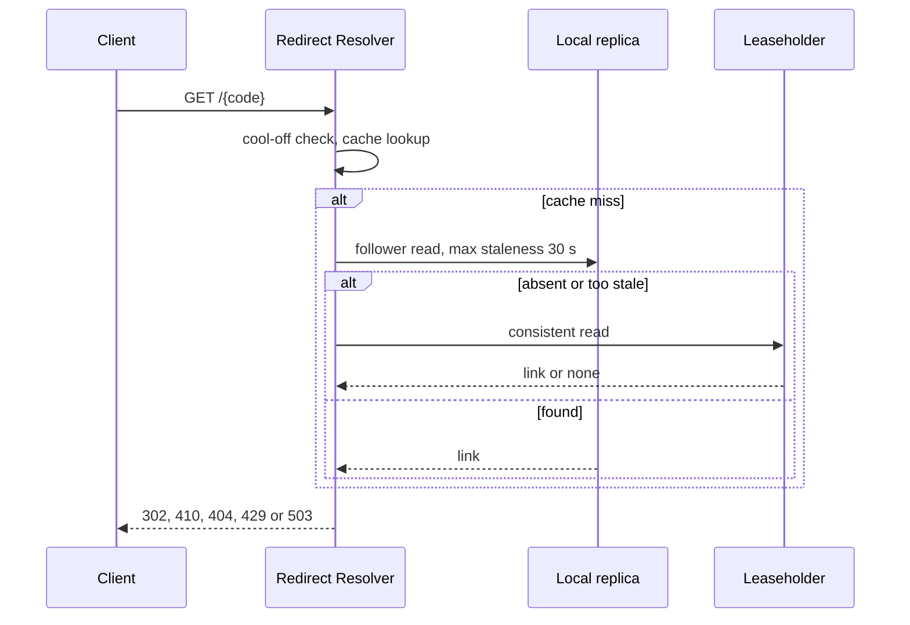

# RFC: URL Shortener

**Status:** Draft · **Author:** @LambdaNotFound

| Name | Sign-off | Comments |
| --- | --- | --- |
| @TBD | - [ ] approved | |

## Background

People share links in text messages, print, QR codes and character-limited posts, where a long URL gets truncated or mistyped. Public shorteners such as bit.ly store the long URL under a short code and redirect whoever opens it. Xu's reference design returns the existing code for a URL already shortened and Hello Interview's makes that optional; the brief takes Xu's side (FR3) and adds what neither carries: no loss on region failure, read-after-create everywhere, and bounded takedown.

## Terminologies

| Term | Meaning |
| --- | --- |
| **Code** | The 8-character path of a short URL, `https://s.example/<code>`; `s.example` stands for the service's domain. |
| **Submitted URL** | The long URL after FR10's conversion: what is stored and redirected to. |
| **Canonical form** | The submitted URL after FR4's normalization; its SHA-256 is the **URL key**. |
| **Staleness** | How far behind the present a local replica serves a read. |

## Problem Statement

A link must survive a whole region's loss the moment it's returned (NFR6), which forces a cross-region write before the reply. It must then resolve in every serving region at once (NFR11), while redirects answer within 100 ms at p99 (NFR3) and stay up while creation fails (NFR4), which forbids a cross-region round trip on every redirect. Equivalent URLs must share one code even under a race (FR3), codes must be unguessable at 365 billion links within 8 characters (NFR2, NFR8, NFR12), and a disable must reach every server and honoring cache within 5 minutes (FR6).

The forcing question is how to make a link durable across regions before it's returned, yet resolvable locally and consistently everywhere, with a bounded path for taking it down.

## Requirements

### Functional Requirements

| ID | Requirement |
| --- | --- |
| FR1 | Any caller, with no account, can submit a long URL and receive a short URL for it, within the limits of FR7, FR8 and FR9. |
| FR2 | Opening a short URL that is not disabled (FR6), from a client IP that is not in an NFR8 cool-off, redirects the caller to the long URL exactly as it was submitted (FR10) in the request that created the short URL. |
| FR3 | Submitting a long URL that was already shortened returns the existing short URL to every caller, including when the first submissions of that URL arrive at the same moment, unless FR7, FR8 or FR9 rejects the submission. |
| FR4 | Two long URLs count as the same URL throughout this doc when they are equal after RFC 3986 syntax-based and scheme-based normalization (https://www.rfc-editor.org/rfc/rfc3986#section-6.2), and as different otherwise. |
| FR5 | A short URL never expires during the service's 10-year life and never changes its target, and no caller can edit or delete it. |
| FR6 | Only an operator can disable a short URL, and within 5 minutes of the disable being recorded the service stops redirecting it, and so does every cache that honors the service's cache headers. |
| FR7 | Only http and https URLs (the scheme in any case) that are valid under RFC 3986 and at most 2,048 characters long, both judged on the submitted URL as FR10 defines it, are accepted, and any other submission is rejected with the reason (assumed: 2,048 is a common practical limit, not a sourced one). |
| FR8 | Each client IP can submit only a limited number of URLs per hour, repeats of already-shortened URLs included, and submissions over that limit are rejected with the reason (assumed: the design sets the number). |
| FR9 | A submission is rejected with the reason when its host, after FR4 normalization, is the service's own domain or a subdomain of it, when it contains a user or password part (even an empty one), or when it is the same URL (FR4) as one whose short URL is disabled, from the moment the disable is recorded. |
| FR10 | A submitted URL containing non-ASCII characters is converted to a standard URL, with a punycode host and every other non-ASCII character percent-encoded as UTF-8, before any other rule applies, and the converted form counts as the submitted URL throughout this doc. |

### Non-functional Requirements

| ID | Requirement |
| --- | --- |
| NFR1 | **Scale.** The service absorbs 100 million new short URLs a day and an average of 10 redirects per link created, about 1,160 creations and 11,600 redirects a second (https://bytebytego.com/courses/system-design-interview/design-a-url-shortener), with peaks of 10 times those rates. |
| NFR2 | **Capacity.** Every short URL created over the service's 10-year life, about 365 billion, stays stored, and resolvable unless disabled (FR6). |
| NFR3 | **Redirect latency.** A redirect is answered within 100 ms at the 99th percentile, measured at the service (https://www.hellointerview.com/learn/system-design/problem-breakdowns/bitly). |
| NFR4 | **Redirect availability.** Redirects are available 99.99% of the time, with lookups rejected under NFR8 counted as available, and keep working while creating new short URLs is failing. |
| NFR5 | **Creation.** Creating a short URL completes within 1 second at the 99th percentile and is available 99.9% of the time. |
| NFR6 | **Durability.** A short URL that has been returned to a caller, and a disable that has been recorded, are never lost, even when a whole region fails. |
| NFR7 | **Correctness.** A short URL never redirects to a long URL that is not the same, per FR4, as the one it was created for. |
| NFR8 | **Security.** A short code cannot be predicted from any other short code, and a client IP that looks up too many codes that do not exist within a window has every lookup rejected for a cool-off period (assumed: the design sets the window, the limit and the cool-off). |
| NFR9 | **Operability.** Operators can see redirect and creation latency and error rates against NFR3, NFR4 and NFR5, are alerted when a target is breached, and can see how long each disable took to take effect across the service. |
| NFR10 | **Compatibility.** A short URL, once issued, keeps the same domain and code for the service's whole 10-year life, and resolves at them unless disabled (FR6). |
| NFR11 | **Read-after-create.** From the moment a short URL is returned to the caller, every server that is serving redirects resolves it with no replication delay, unless it is disabled (FR6). |
| NFR12 | **Length.** Every short code is at most 8 characters long. |

### Out of Scope

- Accounts and authentication for people who create or open links, which makes FR3's reuse global. Operators still authenticate (Open Question 3).
- Custom aliases: every code is random (NFR8).
- Expiry, and editing or deleting by callers: FR5 forbids them.
- Click analytics: the redirect path records NFR9's metrics only.
- Scanning or classifying URLs for spam or malware: operators are the only abuse control.
- Legal erasure: a disable stops redirects but keeps the row.

## Estimates

- **Rates.** NFR1: 100,000,000 / 86,400 s = 1,157 creations and 11,574 redirects a second on average, 11,600 and 116,000 at peak, 10:1 reads to writes. At 11,600 inserts a second, a key that grows with time puts every insert on the newest range, so codes and URL keys are uniformly random.
- **Code space.** 62^8 = 2.18 × 10^14 codes; at NFR2's 365 × 10^9 links that's 0.167% full, one live code in 598. An insert collides with probability at most 0.00167, so random codes need only a rare retry, and base62 is forced: base36 would be 12.9% full and base32 33.2% (Appendix), handing an enumerator a live link every few probes (NFR8).
- **Storage (assumed).** With Xu's assumed 100 B URL, a `links` row is about 124 B and a `url_index` row 40 B: 164 B × 365 × 10^9 = 59.9 TB, × 5 replicas = 299 TB; at FR7's 2,048 characters, 3.85 PB. No node holds this, so the store is range-sharded, and the index stores a 32 B hash rather than the canonical form, saving 124 TB at the average.
- **Disable budget.** FR6 allows 300 s. Replica staleness S + server cache TTL T + browser `max-age` M = 30 + 60 + 60 = 150 s, so expiry alone meets FR6 and no push invalidation is needed.

## Proposed Solution

### Overview

This RFC defines a three-region service where each link is written by one cross-region transaction before it's returned, and each redirect is answered from a server cache or the region's local replica, with a consistent read only when that replica lacks the code. The store is CockroachDB, set to survive a region failure. Codes are 8 random base62 characters, unique by insert. Disables reach every server through cache expiry within 90 s, and a tracker measures each one. Redirects stay up while creation or the write quorum fails, except for codes the local replica hasn't seen. NFR3 and NFR5 rest on cache hit rates and round trips that are assumed until load-tested.

*Diagram: three regions, each with an L4 load balancer, a stateless fleet (Redirect Resolver with cache, Create Handler, Admin API), a counter store, and CockroachDB nodes forming one cluster, 2+2+1 replicas per range, leaseholders in the home region. Arrows: DNS to a healthy region; redirect to cache, local replica, then dashed to the leaseholders; create as one transaction committed across two regions; the Disable Tracker probing every server. Label S, T and M.*

### API

- `POST /v1/links` `{"url"}` returns `201 {"code", "short_url"}`, or `200` with the existing code (FR3), so a retry is safe, though it counts against FR8 again. Rejections: `400` with `bad_scheme`, `invalid_url`, `too_long`, `own_domain`, `userinfo` or `disabled`; `429 rate_limited` with `Retry-After`; `503`.
- `GET /{code}` returns `302` with `Location` and `Cache-Control: private, max-age=60` (FR2). Disabled is `410`, unknown `404`, both `no-store`; cool-off `429` (NFR8); unconfirmable `503`. Any other path is an unknown code; a query string is ignored.
- `POST /admin/v1/links/{code}/disable` `{"reason"}` returns `disabled_at`, on the internal admin host only. A repeat returns the first `disabled_at`.
- `GET /admin/v1/disables/{code}` returns `disabled_at` and `server_effective_at` (NFR9).

`/v1/links` can't collide with a code, which has no second `/`. Nothing paginates.

### Data model and storage

Access patterns: a point read by code per redirect (116,000 a second at peak, mostly cached); a point read by URL key, then a read or two inserts, per creation (11,600); rare disables and tracker scans. All are point operations on random keys, and FR3 needs two of them atomic across ranges.

```sql
CREATE TABLE links (
  code        STRING(8) PRIMARY KEY,  -- random base62 (NFR8, NFR12)
  url         STRING NOT NULL,        -- submitted URL, never updated (FR5)
  created_at  TIMESTAMPTZ NOT NULL,
  disabled_at TIMESTAMPTZ NULL        -- set once by an operator (FR6)
);
CREATE TABLE url_index (
  url_key BYTES PRIMARY KEY,          -- SHA-256 of canonicalize_v1 output
  code    STRING(8) NOT NULL
);
CREATE TABLE disables (
  code STRING(8) PRIMARY KEY, disabled_at TIMESTAMPTZ NOT NULL,
  operator STRING NOT NULL, reason STRING NOT NULL,
  server_effective_at TIMESTAMPTZ NULL  -- set by the Disable Tracker (NFR9)
);
```

**MVP choice: CockroachDB in three regions, `SURVIVE REGION FAILURE`, `REGIONAL BY TABLE`.** Each requirement names a property:

- NFR6: the survival goal places 5 replicas as 2+2+1; a commit needs 3, and no region holds more than 2, so every commit outlives any one region.
- FR3: a transaction makes the two inserts atomic.
- NFR3, NFR4: bounded-staleness follower reads serve a single-row primary-key read from the nearest replica, even under a partition.
- NFR11: a consistent read at the leaseholder settles a local miss.

**Pros:** the fatal invariants (NFR6, NFR7, FR3) are the database's job. **Cons:** a self-operated cluster, a cross-region round trip on every write, and 5× storage.

### Edge and client identity

DNS latency records with health checks send clients to the nearest healthy region. The L4 load balancer passes the peer address by PROXY protocol, and that address is the client IP for FR8 and NFR8; client-sent `X-Forwarded-For` is ignored. IPv6 counts by /64, since one subscriber usually holds a whole /64.

### Canonicalizer

```rust
pub struct SubmittedUrl(String); // ASCII, FR7-valid; stored and sent in Location
pub struct UrlKey([u8; 32]);     // SHA-256 of the canonical form
pub enum Reject { BadScheme, InvalidUrl, TooLong, OwnDomain, Userinfo }

/// Frozen: url_index keys depend on its output for the service's life.
pub fn canonicalize_v1(raw: &str) -> Result<(SubmittedUrl, UrlKey), Reject>;
```

1. **Convert (FR10).** The host goes through UTS #46 ToASCII, nontransitional, which maps case and applies NFC; other non-ASCII characters are percent-encoded as UTF-8, and ASCII is untouched, so a space stays invalid.
2. **Validate (FR7).** Scheme `http` or `https` in any case, RFC 3986 grammar, at most 2,048 characters.
3. **Normalize (FR4).** Lowercase scheme and host, uppercase percent-encoding hex, decode unreserved escapes, remove dot-segments, drop the default port, and make an empty path `/`.
4. **Reject (FR9), then hash.** Any `@` in the authority rejects. The normalized host, with one trailing dot removed for this check only, must not be `s.example` or end in `.s.example`. The canonical form is then hashed into the URL key.

**Versioning.** Any change to step 3, a bug fix included, gives old URLs new keys, and FR3 would issue them second codes. So v1 is frozen behind golden tests, and a change is a v2 with a backfill that re-keys `url_index` from `links`. **Cons:** the parser and IDNA tables become part of the data format for ten years.

### Link Creation

The Create Handler charges FR8 first, so rejected submissions count, then canonicalizes and runs one transaction:

```rust
pub struct Code([u8; 8]); // base62 ASCII from a CSPRNG
pub enum Created { New(Code), Existing(Code) }
pub enum CreateError { Disabled, Integrity, CodeTaken, KeyTaken, Store(StoreError) }

pub trait LinkStore {
    fn create(&self, key: &UrlKey, url: &SubmittedUrl, fresh: Code) -> Result<Created, CreateError>;
}
```

```text
Phase 1, look up: read url_index[key]. Found code c: read links[c].
                  disabled_at set: Disabled (FR9).
                  canonicalize_v1(links.url) yields another key: Integrity,
                  alert, never return c (NFR7). Otherwise Existing(c) (FR3).
Phase 2, insert:  insert links[fresh]. Duplicate code (p <= 0.00167): CodeTaken;
                  the handler draws a new code and retries, at most 5 times.
Phase 3, claim:   insert url_index[key] = fresh. Duplicate key or a serialization
                  conflict: a concurrent first submission won; KeyTaken, and the
                  handler reruns Phase 1 (FR3).
Phase 4, commit:  3 of 5 replicas across two regions (NFR6), then New(fresh).
```

The `url_index` primary key is the race's arbiter: one transaction commits it, every other caller reads its code, in any region. An aborted transaction leaves no rows, so nothing is orphaned or misdirected, and the stored spelling is the winner's, which FR2 calls the creating request.

```mermaid
sequenceDiagram
    participant C as Client
    participant H as Create Handler
    participant L as Abuse Limiter
    participant DB as CockroachDB
    C->>H: POST /v1/links {url}
    H->>L: charge client IP (FR8)
    H->>H: canonicalize_v1
    H->>DB: BEGIN; read url_index[key]
    alt key found
        DB-->>H: code c, links[c]
        H-->>C: 200 {c}, or 400 disabled
    else key absent
        H->>DB: insert links[fresh], url_index[key]; COMMIT
        DB-->>H: committed on 3 of 5 replicas
        H-->>C: 201 {fresh}
    end
```

**Pros:** FR3, NFR6 and NFR7 hold by construction, and a code reveals nothing about other codes (NFR8). **Cons:** each creation pays cross-region round trips; fitting NFR5 is assumed until Task 2's load test.

### Redirect Resolver

```rust
pub enum Cached { Live(Arc<str>), Disabled } // positive entries only (NFR11)

pub trait LinkReader {
    /// Follower read, nearest replica only; errors if it can't be within max_staleness.
    fn read_local(&self, code: &Code, max_staleness: Duration) -> Result<Option<Link>, StoreError>;
    /// Consistent read at the leaseholder.
    fn read_consistent(&self, code: &Code) -> Result<Option<Link>, StoreError>;
}
```

```text
Step 1, guard:   not a code: 404, counted as a miss. IP in cool-off: 429 (NFR8).
Step 2, cache:   entry younger than T = 60 s: 302 or 410.
Step 3, local:   read_local(code, S = 30 s), 20 ms timeout. Found: fill, answer.
Step 4, confirm: absent, error or timeout: read_consistent(code), at most
                 F = 64 in flight per server. Found: fill, answer. Absent: 404,
                 a miss. Error, timeout or over F: 503.
```

**Why each tier.** The cache answers skew: a viral code's reads would otherwise all hit one range's replicas, while single-flight fill limits it to one read per server per T. Step 3 keeps the common path in-region (NFR3) and off the write quorum (NFR4). Step 4 exists for NFR11: a code returned a moment ago may not have reached this replica, so a local miss is never final, and misses are never cached.

**Staleness (FR6).** An entry filled at t reflects the store at t − S or later and serves until t + T; a browser keeps the `302` M = 60 s more. So a disable recorded at D stops every server by D + 90 s and every honoring cache by D + 150 s. `private` keeps shared caches out, and `302` rather than `301` avoids heuristic caching with no expiry.

**Partitions.** A region cut off can't read locally within S or consistently at all, so it answers `503`. Its health check is a step 3 read of a sentinel code, which fails too, and DNS moves its clients elsewhere: a stale region leaves service rather than serve a disabled or unseen code (FR6, NFR11).

**Latency.** Step 4 adds a round trip to the home region, only for codes younger than the replica's lag of a few seconds and for unknown codes. NFR3 assumes steps 2 and 3 answer at least 99% of redirects.



**Pros:** staleness can only hide a code or a disable, never misdirect, because a URL never changes (FR5). **Cons:** a fresh code's first lookups cross regions, and enumeration reaches the leaseholders up to F per server.

### Abuse Limiter

A regional in-memory counter store keeps two counters per client IP: every submission charges `(ip, hour)`, rejected past 100 (FR8), and every `404` charges `(ip, 10 minutes)`, which past 50 starts a 1-hour cool-off (NFR8). Servers pull the cool-off set every second, so step 1 is local. The Appendix shows a persistent prober finds about 1.7 live codes a day.

Counters are per region, so a client reaching all three regions gets three times each limit; a global counter would put a cross-region write on every miss (NFR3, NFR4). If the store is down or exceeds a 5 ms timeout, servers fall back to in-process counters with the same limits, and alert. **Cons:** one IP is treated as one caller, so carrier-grade NAT users share a quota and a botnet multiplies it, a residual risk the scoping record accepted.

### Disables

One transaction sets `links.disabled_at` and inserts the `disables` row (FR6), committed like a creation (NFR6). The next creation for that URL reads it in Phase 1 and is rejected from that moment (FR9). Disables share creation's write quorum but not its handler, so losing the quorum blocks both, but a creation bug blocks only creation.

**Disable Tracker (NFR9).** A singleton job polls every serving server's `GET /internal/lookup/{code}`, which runs steps 2 to 4 without filling the cache, every 5 s for each disable without `server_effective_at`. When all answer `410` it records the time; the browser tail adds M, computed rather than observed. A disable not in effect everywhere within 90 s pages an operator.

### Example

At 09:00:00 a caller in region B submits `HTTPS://Example.com:443/a/../b`. It's stored as is, with canonical form `https://example.com/b`. No key exists; code `q7Xk2PzA` commits on replicas in regions A and B. At 09:00:01 a caller in region C opens it: C's replica lacks it, step 4 finds it, and the `302` goes to `HTTPS://Example.com:443/a/../b`. Disabled at 10:00:00, it stops redirecting on every server by 10:01:30, and a resubmission at 10:00:05 is rejected (FR9).

## Alternatives Considered

### Code generation

- **A counter in base62 (Xu).** Pro: never collides. Con: a code predicts its neighbors (NFR8), and every insert lands on the newest range, a hotspot at 11,600 a second.
- **A counter through a keyed permutation of 62^8.** Pro: no collisions, random-looking codes. Con: it needs a counter that survives region loss (a reissued range breaks NFR7) and a secret whose leak exposes ten years of codes (NFR8) and which can't rotate without colliding. Random codes cost one retry in 598 and no secret.
- **A truncated hash of the canonical form.** Pro: reuse without an index. Con: at 47.6 bits, n² / 2N = 3.05 × 10^8 URL pairs collide, so a collision path is needed anyway, and anyone can compute a URL's code (NFR8).

### Store

- **One primary region, asynchronous replicas.** Pro: local writes, simplest operations. Con: a region loss drops unreplicated writes, so a returned link can vanish (NFR6).
- **DynamoDB global tables, multi-Region strong consistency.** Pro: managed, RPO zero across three regions, conditional writes, and both local and strongly consistent reads. Con: these tables reject transactions, so FR3's two-item insert becomes an application protocol (claim the URL key as pending, write the code item, repair dangling claims), and NFR7 rests on every writer and repairer getting the pending state right. If running a cluster outweighs that, this flips.
- **CockroachDB `GLOBAL` tables.** Pro: consistent local reads everywhere, so step 4 disappears. Con: writes pay a commit-wait, and the docs aim them at rarely updated data; at 11,600 inserts a second that risks NFR5.

### Read path

- **A CDN caching redirects.** Pro: absorbs viral links, cuts user latency. Con: edge hits never reach the service, so an IP in cool-off still gets redirects (NFR8).
- **Push invalidation.** Pro: takedown in seconds. Con: a pub/sub fleet that falls back to expiry anyway, which already meets FR6.
- **No server cache.** Pro: removes T from FR6's budget. Con: a viral code's reads concentrate on one range's replicas.

## Failure Modes and Observability

Six failure modes matter; metrics follow.

- **A region fails.** Each range keeps 3 of 5 replicas, so reads and writes continue (NFR6); health checks drain the region, and if it was home, leases move and step 4 and creation pay extra round trips.
- **A region is partitioned.** It answers `503` and is drained (Redirect Resolver).
- **Two regions fail.** Beyond NFR6's scope: creation and disables stop, and redirects fail once cache entries expire and local reads pass S. With every region unhealthy, DNS serves them all anyway. The break-glass is an operator flag lifting S, suspending FR6 and NFR11, logged.
- **The store is slow.** Step 3's timeout falls to step 4, bounded by F, so slowness costs uncached lookups only. Creation retries a timed-out transaction once, safe under FR3.
- **A botnet enumerates.** Per-IP limits don't bind; step 4 absorbs up to F per server. Gap: only the miss rate shows it.
- **The canonicalizer drifts.** A changed v1 splits keys and breaks FR3 silently; the NFR7 check sees only resubmissions, so golden tests are the guard.

Metrics that track:

- Redirect and creation latency by region and status, and availability (non-`5xx` over all, `429` good), with burn-rate alerts at 99.99% and 99.9% (NFR3, NFR4, NFR5, NFR9).
- Follower staleness, step 3 timeouts, step 4 rate and rejections over F, cache hit rate.
- Misses, active cool-offs and counter-store fallback per region.
- `server_effective_at − disabled_at` per disable (NFR9), and `Integrity` aborts, which should be zero.

Debug endpoints that:

- Resolve one code through one server's tiers without filling its cache: `/internal/lookup/{code}`.

## Open Questions

1. **Which three regions?** Creation and step 4 latency scale with their round trips. Current design: assumed three regions on one continent. If wider, measure creation p99 first and consider routing creation to the home region.
2. **Are the limits right?** Current design: assumed 100 creations an hour, 50 misses in 10 minutes, a 1-hour cool-off, F = 64. If they block real users, raise them; the Appendix prices each.
3. **How do operators authenticate?** Current design: assumed the admin host sits behind existing single sign-on. If none exists, the Admin API needs its own credentials.
4. **Does one cluster sustain 11,600 two-range transactions a second plus step 4?** Current design: assumed yes, scaled by nodes. If not, DynamoDB is next.

## Work Breakdown

| # | Task | Description | Depends on |
| --- | --- | --- | --- |
| 1 | Canonicalizer | `canonicalize_v1` with UTS #46, RFC 3986 normalization, own-domain and userinfo checks, frozen golden tests (FR4, FR7, FR9, FR10). | none |
| 2 | Link creation | Schema, the four-phase transaction, code generation, and a load test at peak (FR1, FR3, FR5, NFR1, NFR2, NFR5, NFR6, NFR7, NFR8, NFR12). | Task 1, **CockroachDB cluster** (external, three regions) |
| 3 | Redirect Resolver | Tiers, single-flight cache, bounded fallback, headers (FR2, FR6, NFR3, NFR4, NFR11). | Task 2 |
| 4 | Abuse Limiter | Regional counters, cool-off pull, fallback (FR8, NFR8). | Task 3 |
| 5 | Disables | Admin API, disable transaction, internal lookup, tracker (FR6, FR9, NFR9). | Task 3 |
| 6 | Deployment | DNS health checks, PROXY protocol, the fixed domain (NFR4, NFR10). | Task 3 |
| 7 | Metrics and alerts | The metrics and alerts above (NFR9). | Tasks 3, 4, 5 |

## Appendix

**Alphabet against density** at 365 × 10^9 links of 8 characters:

```text
alphabet  space           fraction live  one live code per
base32    1.10 × 10^12    33.2%          3 probes
base36    2.82 × 10^12    12.9%          8 probes
base62    2.18 × 10^14    0.167%         598 probes
```

**Enumeration under the limits.** 50 misses, then a 1-hour cool-off: at most 50 probes per 70 minutes, 1,440 / 70 × 50 = 1,029 probes a day, so 1.7 live codes a day per IP at 1 in 598, three times that across three regions.

**Storage rows.** `links`: 8 B code + 100 B URL + 16 B timestamps = 124 B; `url_index`: 32 B + 8 B = 40 B. Worst case: (2,072 + 40) B × 365 × 10^9 × 5 = 3.85 PB. Hash saving: (100 − 32) B × 365 × 10^9 × 5 = 124 TB.

## References

- *System Design Interview*, vol. 1, Alex Xu, "Design a URL Shortener" ([course page](https://bytebytego.com/courses/system-design-interview/design-a-url-shortener)), NFR1's rates and the counter rival.
- [Hello Interview: Design a URL Shortener like Bit.ly](https://www.hellointerview.com/learn/system-design/problem-breakdowns/bitly), NFR3 and NFR4's targets.
- [CockroachDB: Multi-Region Survival Goals](https://docs.cockroachlabs.com/docs/stable/multiregion-survival-goals), the 2+2+1 placement behind NFR6.
- [CockroachDB: Follower Reads](https://docs.cockroachlabs.com/docs/stable/follower-reads), the bounded-staleness reads of step 3.
- [CockroachDB: Global Tables](https://docs.cockroachlabs.com/docs/stable/global-tables), the rejected locality.
- [Amazon DynamoDB: How global tables work](https://docs.aws.amazon.com/amazondynamodb/latest/developerguide/V2globaltables_HowItWorks.html), the managed rival.
- [Amazon Route 53: How Route 53 chooses records when health checking is configured](https://docs.aws.amazon.com/Route53/latest/DeveloperGuide/health-checks-how-route-53-chooses-records.html), DNS behavior when regions are unhealthy.
- [RFC 9111: HTTP Caching](https://www.rfc-editor.org/rfc/rfc9111), `max-age`, `private` and `no-store`.
- [RFC 3986: URI Generic Syntax](https://www.rfc-editor.org/rfc/rfc3986), FR4's normalization and the userinfo grammar.
- [UTS #46: Unicode IDNA Compatibility Processing](https://www.unicode.org/reports/tr46/), FR10's host conversion.
- *Designing Data-Intensive Applications*, Martin Kleppmann, chapter 5 (reading your own writes) and chapter 9 (linearizability), the theory behind step 4.

<!-- loop state below: not part of the RFC -->

## Evidence

| Claim | Source | Label |
| --- | --- | --- |
| The repo has no prior design, concept note or crate for a URL shortener | `design-doc/url-shortener/scoping.md:85`; `concepts/`, `src/` listings this session (only README.md in each) | observed |
| Xu looks the long URL up first and returns the existing code; assumes 100-byte URLs and a base62 counter | `design-doc/url-shortener/scoping.md:91`, `:93` (Xu, accessed 11/15/26 by scoping) | observed |
| Hello Interview treats reuse as optional and recommends 302 | `design-doc/url-shortener/scoping.md:86`, `:90` | observed |
| 1,157 creations/s, 11,574 redirects/s average; 10× at peak | NFR1: 100,000,000 / 86,400; python run this session | inferred |
| 62^8 = 218,340,105,584,896; 0.167% full; 1 in 598; base36 12.9%; base32 33.2% | NFR2, NFR12; python run this session | inferred |
| 59.9 TB logical, 299 TB with 5 replicas; 3.85 PB worst case; 124 TB saved by hashing | NFR2, FR7, Xu's 100 B URL (assumed), row sizes (assumed); python run this session | assumed |
| SHA-256 collision probability across 365 × 10^9 keys is about 5.8 × 10^-55 | n² / 2^257; python run this session | inferred |
| Truncated 47.6-bit hash gives about 3.05 × 10^8 colliding pairs | n² / 2N with N = 62^8 | inferred |
| SURVIVE REGION FAILURE needs 3 regions, places 5 replicas 2+2+1, stays available for reads and writes through a region outage, write latency rises by at least the RTT to the nearest region | CockroachDB, "Multi-Region Survival Goals", https://docs.cockroachlabs.com/docs/stable/multiregion-survival-goals, read 11/15/26 | observed |
| Every commit has a replica outside any one region | 3-of-5 quorum with at most 2 replicas per region (above) | inferred |
| Bounded-staleness follower reads serve from local replicas under partitions, become increasingly stale, `nearest_only` errors rather than leave the region, and require a single-row primary or covering index read in an implicit transaction | CockroachDB, "Follower Reads", https://docs.cockroachlabs.com/docs/stable/follower-reads, read 11/15/26 | observed |
| GLOBAL tables read a consistent local replica, writes incur commit-wait, suited to read-mostly rarely updated data; lead override guidance of 800 ms and up when RTT exceeds 150 ms | CockroachDB, "Global Tables", https://docs.cockroachlabs.com/docs/stable/global-tables, read 11/15/26 | observed |
| GLOBAL table writes risk NFR5 at 11,600/s | from the commit-wait note above; no latency number published | assumed |
| DynamoDB MRSC: exactly three regions, RPO zero, conditional writes on the latest version, strongly consistent reads on any replica, transactions not supported | AWS, "How DynamoDB global tables work", https://docs.aws.amazon.com/amazondynamodb/latest/developerguide/V2globaltables_HowItWorks.html, read 11/15/26 | observed |
| A response with `max-age` may be stored whatever its status; `private` forbids shared caches; `no-store` forbids all caches | RFC 9111 §3, §5.2.2.1, §5.2.2.5, §5.2.2.7, https://www.rfc-editor.org/rfc/rfc9111, read 11/15/26 (fetch summary with quotes) | observed |
| 301 and 308 are heuristically cacheable; 302 is not | RFC 9110 §15.1, §15.4 via `design-doc/url-shortener/scoping.md:95` | observed |
| RFC 3986 normalization steps (case, percent-encoding, dot-segments, default port, empty path) | `design-doc/url-shortener/scoping.md:96` (RFC 3986 §6, accessed 11/15/26 by scoping) | observed |
| Userinfo grammar, `user:password` deprecated; a DNS FQDN may end in one trailing dot | RFC 3986 §3.2.1, §3.2.2, https://www.rfc-editor.org/rfc/rfc3986, read 11/15/26 | observed |
| UTS #46 maps case, applies NFC, and recommends nontransitional processing | UTS #46 v18.0.0, https://www.unicode.org/reports/tr46/, read 11/15/26 | observed |
| FR6 worst case 150 s with S = 30, T = 60, M = 60 | FR6; the three bounds are design choices; arithmetic in Estimates | inferred |
| Normal follower-read lag is a few seconds, well under S = 30 s | Follower Reads page suggests reads at least 4.2 s in the past; per-range lag not measured | assumed; measure follower staleness per server after Task 3 |
| Steps 2 and 3 serve at least 99% of redirects within 100 ms | none yet; measure with the latency histogram and cache hit rate under load after Task 3 | assumed |
| Creation transaction completes well under 1 s at p99 across three same-continent regions | none yet; load test in Task 2 | assumed |
| One cluster sustains 11,600 two-range transactions a second | none yet; load test in Task 2 | assumed |
| Enumeration yield of 1.7 live codes per IP per day | Appendix arithmetic from assumed limits and NFR2 density | assumed |
| One IPv6 subscriber usually holds a /64 | memory, not read this session | assumed |
| DNS latency records with health checks route to a healthy region, and treat all records as healthy when none is | AWS, "How Amazon Route 53 chooses records when health checking is configured", https://docs.aws.amazon.com/Route53/latest/DeveloperGuide/health-checks-how-route-53-chooses-records.html, read 11/15/26 | observed |
| Limits and timeouts: 100 creations/h, 50 misses per 10 min, 1 h cool-off, F = 64, step 3 timeout 20 ms, counter store timeout 5 ms | design choices under FR8 and NFR8's (assumed) tags; none yet, tune from Task 3 and 4 load tests | assumed |
| Two concurrent transactions inserting the same primary key end with one commit and the other a duplicate-key or retryable serialization error | memory of CockroachDB's transaction model, not read this session; settle with a concurrency test in Task 2 | assumed |
| Codes are case-sensitive base62 in the URL path, so a mis-cased code is a different code | NFR12 and the code-space bullet; consequence for print and QR readers is accepted | inferred |

## Revision log

- R0: first draft.

## Objection responses
