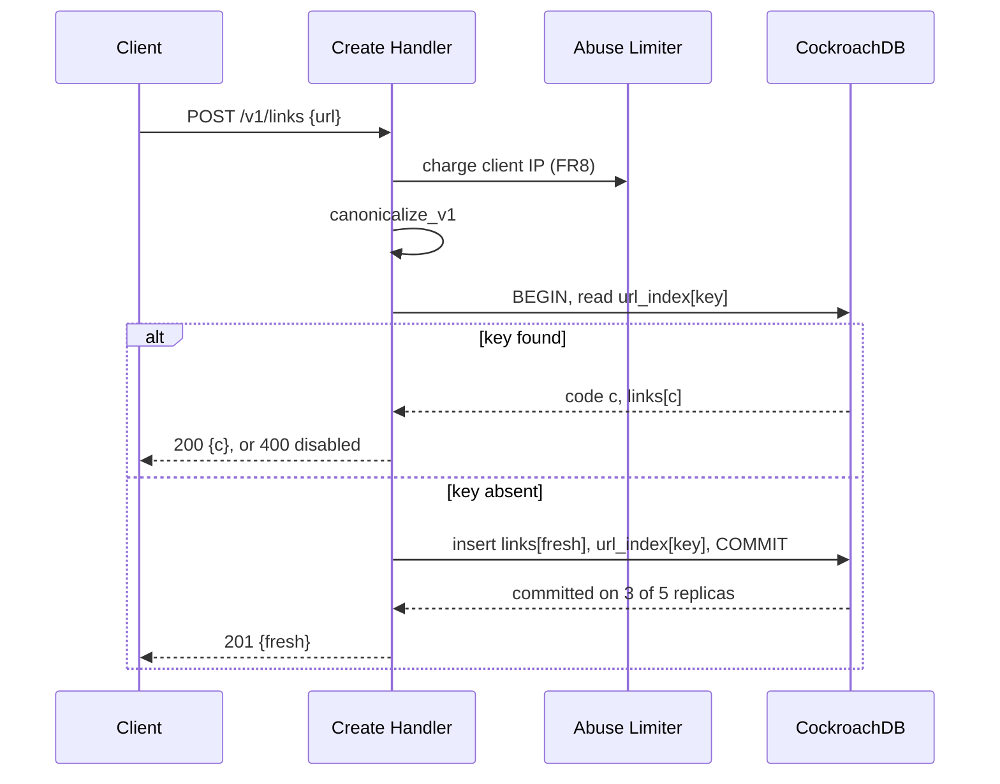
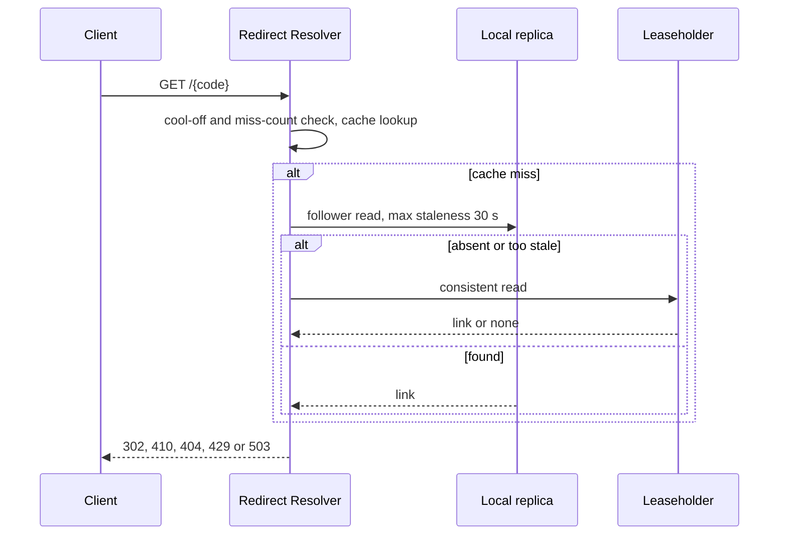

# RFC: URL Shortener

**Status:** Draft · **Author:** @LambdaNotFound

| Name | Sign-off | Comments |
| --- | --- | --- |
| @TBD | - [ ] approved | |

## Background

People share links in text messages, print, QR codes and character-limited posts, where a long URL gets truncated or mistyped. Xu's reference design maps a short code to the long URL, reusing it for a URL already shortened (FR3).

## Terminologies

| Term | Meaning |
| --- | --- |
| **Code** | The 8-character path of a short URL, `https://s.example/<code>`; `s.example` stands for the service's domain. |
| **Submitted URL** | The long URL after FR10's conversion, stored and redirected to. |
| **Canonical form** | The submitted URL after FR4's normalization; its SHA-256 is the **URL key**. |

## Problem Statement

A returned link must survive a region's loss (NFR6), forcing a cross-region write before the reply, and resolve in every region at once (NFR11). Redirects answer within 100 ms at p99 (NFR3) and outlive creation failures (NFR4), forbidding a cross-region round trip per redirect. Equivalent URLs share one code under a race (FR3), 8-character codes stay unguessable at 365 billion links (NFR2, NFR8, NFR12), and a disable takes effect within 5 minutes (FR6).

The forcing question is how to make a link durable across regions before it's returned, yet resolvable locally and consistently everywhere.

## Requirements

### Functional Requirements

| ID | Requirement |
| --- | --- |
| FR1 | Any caller, with no account, can submit a long URL and receive a short URL for it, within the limits of FR7, FR8 and FR9. |
| FR2 | Opening a short URL that is not disabled (FR6), from a client IP that is not in an NFR8 cool-off, redirects the caller to the long URL exactly as it was submitted (FR10) in the request that created the short URL. |
| FR3 | Submitting a long URL that was already shortened returns the existing short URL to every caller, including when the first submissions of that URL arrive at the same moment, unless FR7, FR8 or FR9 rejects the submission. |
| FR4 | Two long URLs count as the same URL throughout this doc when they are equal after RFC 3986 syntax-based and scheme-based normalization (https://www.rfc-editor.org/rfc/rfc3986#section-6.2), and as different otherwise. |
| FR5 | A short URL never expires during the service's 10-year life and never changes its target, and no caller can edit or delete it. |
| FR6 | Only an operator can disable a short URL, and within 5 minutes of the disable being recorded the service stops redirecting it, and so does every cache that honors the service's cache headers. |
| FR7 | Only http and https URLs (the scheme in any case) that are valid under RFC 3986, have a non-empty host, and are at most 2,048 characters long, all judged on the submitted URL as FR10 defines it, are accepted, and any other submission is rejected with the reason (assumed: 2,048 is a common practical limit, not a sourced one). |
| FR8 | Each client IP can submit only a limited number of URLs per hour, repeats of already-shortened URLs included, and submissions over that limit are rejected with the reason (assumed: the design sets the number). |
| FR9 | A submission is rejected with the reason when its host, after FR4 normalization or as a browser resolves it (percent-escapes decoded and IDNA-mapped), is the service's own domain or a subdomain of it, when it contains a user or password part (even an empty one), or when it is the same URL (FR4) as one whose short URL is disabled, from the moment the disable is recorded. |
| FR10 | A submitted URL containing non-ASCII characters is converted to a standard URL, with a punycode host and every other non-ASCII character percent-encoded as UTF-8, before any other rule applies, and the converted form counts as the submitted URL throughout this doc. |

### Non-functional Requirements

| ID | Requirement |
| --- | --- |
| NFR1 | **Scale.** The service absorbs 100 million new short URLs a day and an average of 10 redirects per link created, about 1,160 creations and 11,600 redirects a second (https://bytebytego.com/courses/system-design-interview/design-a-url-shortener), with peaks of 10 times those rates. |
| NFR2 | **Capacity.** Every short URL created over the service's 10-year life, about 365 billion, stays stored, and resolvable unless disabled (FR6). |
| NFR3 | **Redirect latency.** A redirect is answered within 100 ms at the 99th percentile, measured at the service (https://www.hellointerview.com/learn/system-design/problem-breakdowns/bitly). |
| NFR4 | **Redirect availability.** Redirects are available 99.99% of the time, with lookups rejected under NFR8 counted as available, and keep working while creating new short URLs is failing. |
| NFR5 | **Creation.** Creating a short URL completes within 1 second at the 99th percentile and is available 99.9% of the time. |
| NFR6 | **Durability.** A short URL that has been returned to a caller, and a disable that has been recorded, are never lost when a whole region fails. Loss from a bad write, a dropped table or a faulty migration is out of scope. |
| NFR7 | **Correctness.** A short URL never redirects to a long URL that is not the same, per FR4, as the one it was created for. |
| NFR8 | **Security.** A short code cannot be predicted from any other short code, and a client IP that looks up too many codes that do not exist within a window has every lookup rejected for a cool-off period (assumed: the design sets the window, the limit and the cool-off). |
| NFR9 | **Operability.** Operators can see redirect and creation latency and error rates against NFR3, NFR4 and NFR5, are alerted when a target is breached, and can see how long each disable took to take effect across the service. |
| NFR10 | **Compatibility.** A short URL, once issued, keeps the same domain and code for the service's whole 10-year life, and resolves at them unless disabled (FR6). |
| NFR11 | **Read-after-create.** From the moment a short URL is returned to the caller, every server that is serving redirects resolves it with no replication delay, unless it is disabled (FR6). |
| NFR12 | **Length.** Every short code is at most 8 characters long. |

### Out of Scope

- Accounts for callers, so FR3's reuse is global; operators still authenticate (Open Question 3).
- Custom aliases: every code is random (NFR8).
- Expiry, and editing or deleting by callers: FR5 forbids them.
- Click analytics: redirects record NFR9's metrics only.
- Scanning URLs for spam or malware: operators are the only abuse control.
- Legal erasure: a disable stops redirects but keeps the row.

## Estimates

- **Rates.** NFR1: 100,000,000 / 86,400 s = 1,157 creations and 11,574 redirects a second, 11,600 and 116,000 at peak, sizing the regions below.
- **Code space.** 62^8 = 2.18 × 10^14 codes, 0.167% full at NFR2's 365 × 10^9 links: one live code in 598, so inserts rarely retry. Base36 would be 12.9% full, which NFR8 allows, so base62 is chosen for enumeration yield, not forced: 49.5 live codes an hour under base36 against 17.1 a day (Appendix), at Link Creation's cost.
- **Storage (assumed).** At Xu's assumed 100 B URL, rows of 124 B and 40 B total 299 TB with 5 replicas, 3.85 PB at FR7's maximum (Appendix), so the store is range-sharded and the index keys on a 32 B hash.
- **Disable budget.** FR6 allows 300 s. Replica staleness S + cache TTL T = 30 + 60 = 90 s for servers, plus browser `max-age` M = 60 s = 150 s, so expiry alone meets FR6.
- **Headroom and step 4 load (assumed).** A drain moves a region's third onto two, raising each by half, so each region is sized for 116,000 / 2 = 58,000 redirects a second. At an 80% hit rate, 11,600 reach the store, against 1,280 that one server's step 4 confirms (Appendix), so a slow replica drains the region (Draining).

## Proposed Solution

### Overview

This RFC defines a three-region service on CockroachDB, set to survive a region failure, that writes each link in one cross-region transaction before returning it and answers each redirect from a server cache or the local replica, reading consistently only on a local miss. NFR3, NFR4 and NFR5 rest on figures assumed until load-tested. Redirects outlive failed creation through a lease move shorter than S, or quorum loss for at most 90 s, not store overload, a lapsed license or a bad deploy of their shared fleet, and the region holding every leaseholder is unsized (Failure Modes). A wide botnet can fail fresh codes, and one prober can cut off a shared address or prefix for an hour, or for a window in a region whose step 4 fails (Abuse Limiter).

*Diagram: three regions, each with an L4 load balancer, a stateless fleet (Redirect Resolver with cache, Create Handler, Admin API), a counter store and CockroachDB nodes of one 2+2+1 cluster. Arrows: DNS to a healthy region; redirect to cache, local replica, then dashed to leaseholders; create committed across two regions; the Disable Tracker probing servers. Label S, T and M.*

### API

- `POST /v1/links` `{"url"}` returns `201 {"code", "short_url"}`, or `200` with the existing code (FR3), so a retry is safe though charged to FR8 again. Rejections: `400` with `bad_scheme`, `invalid_url`, `too_long`, `own_domain`, `userinfo` or `disabled`; `429 rate_limited` with `Retry-After`; `503`.
- `GET /{code}` returns `302` with `Location` and `Cache-Control: private, max-age=60` (FR2). Disabled is `410`, unknown `404`, both `no-store`; cool-off `429` (NFR8); unconfirmable or shed-limited `503`. Other paths are unknown codes; query strings are ignored.
- `POST /admin/v1/links/{code}/disable` `{"reason"}`, on the internal admin host only, returns `disabled_at`, the first one on a repeat.
- `GET /admin/v1/disables/{code}` returns `disabled_at` and `server_effective_at` (NFR9).

`/v1/links` can't collide with a code, which has no second `/`. Nothing paginates.

### Data model and storage

Access patterns: a point read by code per redirect (116,000 a second at peak, mostly cached); per creation (11,600), a point read by URL key, then a read or two inserts atomic across ranges (FR3); rare disables, tracker scans and cool-off writes, read by each server every second.

```sql
CREATE TABLE links (
  code        STRING(8) PRIMARY KEY,  -- random base62 (NFR8, NFR12)
  url         STRING NOT NULL,        -- submitted URL, never updated (FR5)
  created_at  TIMESTAMPTZ NOT NULL,
  disabled_at TIMESTAMPTZ NULL        -- set once by an operator (FR6)
);
CREATE TABLE url_index (
  url_key BYTES PRIMARY KEY,          -- SHA-256 of canonicalize_v1 output
  code    STRING(8) NOT NULL
);
CREATE TABLE disables (
  code STRING(8) PRIMARY KEY, disabled_at TIMESTAMPTZ NOT NULL,
  operator STRING NOT NULL, reason STRING NOT NULL,
  server_effective_at TIMESTAMPTZ NULL  -- set by the Disable Tracker (NFR9)
);
CREATE TABLE cooloffs (                 -- LOCALITY GLOBAL (Abuse Limiter, NFR8)
  identity BYTES PRIMARY KEY,           -- IPv4 address, or IPv6 prefix and length
  until TIMESTAMPTZ NOT NULL, INDEX (until)
);
```

**MVP choice: CockroachDB in three regions, `SURVIVE REGION FAILURE`, `REGIONAL BY TABLE`,** because 5 replicas placed 2+2+1 make 3-replica commits outlive any one region (NFR6), a transaction makes the two inserts atomic (FR3), bounded-staleness follower reads serve the nearest replica, even partitioned (NFR3, NFR4), and a consistent leaseholder read settles a local miss (NFR11).

**Pros:** the fatal invariants (NFR6, NFR7, FR3) are the database's job. **Cons:** a self-operated cluster, a cross-region round trip on every write, 5× storage, and an assumed Enterprise Free license (Failure Modes).

### Edge and client identity

DNS latency records send clients to the nearest healthy region, with a 60 s TTL and health checks every 10 s, 3 failures to trip, so NFR4 holds 78 drains a year (Appendix). The L4 load balancer passes the peer address by PROXY protocol as FR8 and NFR8's client IP, ignoring `X-Forwarded-For`.

No single IPv6 prefix is one caller: a home gets a /56, a business a /48 and a phone a /64 per connection. So an IPv4 address is one **identity**, and an IPv6 address three, its /64, /56 and /48, limited at 1, 4 and 16 times the base. The cost is IPv6's carrier-grade NAT: one prober's cool-off on a carrier's /56 or /48 rejects up to 256 or 65,536 phones' /64s for an hour, everywhere (Failure Modes).

### Canonicalizer

```rust
pub struct SubmittedUrl(String); // ASCII, FR7-valid; stored and sent in Location
pub struct UrlKey([u8; 32]);     // SHA-256 of the canonical form
pub enum Reject { BadScheme, InvalidUrl, TooLong, OwnDomain, Userinfo }

/// Frozen: url_index keys depend on its output.
pub fn canonicalize_v1(raw: &str) -> Result<(SubmittedUrl, UrlKey), Reject>;
```

1. **Convert (FR10).** Only a host with non-ASCII goes through UTS #46 ToASCII, nontransitional, which maps case and applies NFC; other non-ASCII characters are percent-encoded as UTF-8. An ASCII host keeps its case, and a space stays invalid.
2. **Validate (FR7).** Scheme `http` or `https` in any case, RFC 3986 grammar, a non-empty host, at most 2,048 characters.
3. **Normalize (FR4).** Lowercase scheme and host, uppercase percent-encoding hex, decode unreserved escapes, remove dot-segments, drop the default port, and make an empty path `/`.
4. **Reject (FR9), then hash.** Any `@` in the authority rejects. Neither the normalized host nor its browser form (escapes decoded as UTF-8, then step 1's WHATWG domain-to-ASCII), minus one trailing dot for this check only, may be `s.example` or end in `.s.example`. A host with no browser form fails in browsers, so is judged normalized only. A host the crate's IDNA tables can't map but a browser's can passes FR9.

**Versioning.** Any change to step 3, a bug fix included, re-keys old URLs and gives them second codes (FR3), so v1 is frozen. Its specification is the tests in `src/url-shortener/tests/canonicalize.rs` and `src/url-shortener/src/canon.rs`, which also pin the implementation's ports by value and WHATWG deny list. Rejecting more inputs at step 2 or 4 changes no key: v1 stands, and tests pinning those inputs' acceptance flip. A change is a v2 with a backfill re-keying `url_index`. **Cons:** the parser and IDNA tables become part of the data format for ten years, and v2 has no cutover plan, a residual risk: v2 keys before the backfill ends give a URL a second code (FR3) and let a disabled one pass FR9, v1 keys until it ends race the backfill against live inserts, and a fix merging two v1 keys leaves two codes with no rule for which FR3 returns. Trigger: the first change failing one of those tests, which then needs its own RFC with phases and a merge rule.

### Link Creation

The Create Handler charges FR8 first, so rejections count, then canonicalizes and runs one transaction:

```rust
pub struct Code([u8; 8]); // base62 ASCII from a CSPRNG
pub enum Created { New(Code), Existing(Code) }
pub enum CreateError { Disabled, Integrity, CodeTaken, KeyTaken, Store(StoreError) }

pub trait LinkStore {
    fn create(&self, key: &UrlKey, url: &SubmittedUrl, fresh: Code) -> Result<Created, CreateError>;
}
```

```text
Phase 1, look up: read url_index[key]. Found code c: read links[c].
                  disabled_at set: Disabled (FR9).
                  canonicalize_v1(links.url) yields another key: Integrity,
                  alert, never return c (NFR7). Otherwise Existing(c) (FR3).
Phase 2, insert:  insert links[fresh]. Duplicate code (p <= 0.00167): CodeTaken;
                  the handler draws a new code and retries, at most 5 times.
Phase 3, claim:   insert url_index[key] = fresh. Duplicate key or a serialization
                  conflict: a concurrent first submission won; KeyTaken, and the
                  handler reruns Phase 1 (FR3).
Phase 4, commit:  3 of 5 replicas across two regions (NFR6), then New(fresh).
```

An aborted transaction leaves no rows, and the stored spelling is the winner's, FR2's creating request.



**Pros:** FR3, NFR6 and NFR7 hold by construction, and codes reveal nothing about others (NFR8). **Cons:** each creation pays cross-region round trips; NFR5 is assumed until Task 2's load test. Codes are case-sensitive, a cost to the Problem Statement's media: a mis-cased typed or printed link is another code, whose `404` counts as the reader's miss, and a QR code can't use alphanumeric mode, which lacks lower case, so its symbol is larger. Base36 avoids both at a higher yield (Estimates); base62 loses if typed and printed links outweigh it, and only before launch, since NFR10 freezes issued codes.

### Redirect Resolver

```rust
pub enum Cached { Live(Arc<str>), Disabled } // positive entries only (NFR11)

pub trait LinkReader {
    /// Follower read, nearest replica only; errors past max_staleness.
    fn read_local(&self, code: &Code, max_staleness: Duration) -> Result<Option<Link>, StoreError>;
    /// Consistent read at the leaseholder.
    fn read_consistent(&self, code: &Code) -> Result<Option<Link>, StoreError>;
}
```

```text
Step 1, guard:   not a code: 404, a miss. An identity in cool-off or past its
                 regional miss limit: 429 (NFR8); past its shed limit with
                 no miss: 503.
Step 2, cache:   entry younger than T = 60 s: 302 or 410.
Step 3, local:   read_local(code, S = 30 s), 20 ms timeout. Found: fill, answer.
Step 4, confirm: absent, error or timeout: read_consistent(code), 100 ms
                 timeout, at most F = 64 in flight per server, of which IPs
                 with a miss in their window share 16. Found: fill, answer.
                 Absent: 404, a miss. Error, timeout or over the limit: 503,
                 a shed if step 3 found the code absent.
```

**Why each tier.** Single-flight fill limits a viral code to one store read per server per T. Step 3 keeps the common path in-region (NFR3) and off the write quorum and leaseholders (NFR4, bounded in Failure Modes). Step 4 exists for NFR11: a follower serves reads only at or below its closed timestamp, about 3 s behind by default, so it lacks younger codes, and a local miss is never final or cached. It crosses regions, so NFR3 assumes steps 2 and 3 answer 99% of redirects, given an assumed share of lookups within 3 s of creation; trigger: Task 3's step 4 rate under create-then-open load.

**Staleness (FR6).** An entry reflects the store at most S before its fill and serves for T, and a browser keeps the `302` M more (Estimates). `private` keeps shared caches out, and `302`, unlike `301`, isn't cached heuristically.

**Draining.** Each server's health endpoint fails when a step 3 read of a sentinel code fails or passes 20 ms, or over 5% of step 3 reads in 10 s time out, so the region drains rather than serve a disabled or unseen code (FR6, NFR11). If survivors trip anyway, Route 53 treats all records as healthy once none is, the undrained state.



**Pros:** staleness can only hide a code or a disable, never misdirect, because a URL never changes (FR5). **Cons:** enumeration reaches the leaseholders, up to F per server.

### Abuse Limiter

A regional in-memory counter store charges each identity per submission, `(identity, hour)`, rejected past 100 (FR8), and per miss, `(identity, 10 minutes)`, each limit times the identity's multiple. Step 1 reads the IP's counts in one round trip and rejects once any passes its limit, overshooting by the lookups then in flight (Appendix); the server whose charge crosses it writes a 1-hour cool-off to `cooloffs`, a `GLOBAL` table every region reads consistently and locally. Servers read new rows every second, overlapping 5 s for commit order, so a cool-off holds everywhere within seconds (NFR8).

**Sheds.** A shed of a locally absent code leaks what a `404` does, so it counts. Once the identity has a miss in the window, it counts as one: step 4 is then answering the identity, so a prober outrunning its slots is cooled off. With no miss, as in a step 4 outage, the code may be fresh: past the limit, step 1 answers `503` in that region until the window ends, with no cool-off. NFR4 counts those `503`s, and an attacker can force them on a shared prefix (Appendix).

Counting stays regional: a global counter puts a cross-region write on every miss (NFR3, NFR4). So a client in all three regions gets three times each limit (Appendix). Cool-offs, at most one per identity an hour, suit `GLOBAL`'s slow writes. If the counter store is down or past a 5 ms timeout, step 1 passes and servers count in process and alert; a failed cool-off write holds locally and retries, and a failed read keeps the last set. **Cons:** a counter read on every lookup, up to 5 ms of NFR3; shared addresses and prefixes share limits, a risk the scoping record accepted.

### Disables

One transaction sets `links.disabled_at` and inserts the `disables` row (FR6), committed like a creation (NFR6); the next creation for that URL is rejected in Phase 1 (FR9).

**Disable Tracker (NFR9).** Every 5 s, for each disable lacking `server_effective_at`, a singleton job calls every serving server's debug lookup and records when all answer `410`; the browser tail M is computed, not observed. A disable not in effect within 90 s pages an operator.

### Example

At 09:00:00 a caller in region B submits `HTTPS://Example.com:443/a/../b`, stored as is with canonical form `https://example.com/b`; code `q7Xk2PzA` commits in regions A and B. At 09:00:01 region C's replica lacks it, so step 4 finds it and redirects to the stored spelling. Disabled at 10:00:00, it stops redirecting everywhere by 10:01:30; a resubmission at 10:00:05 fails (FR9).

## Alternatives Considered

### Code generation

- **A counter in base62 (Xu).** Pro: never collides. Con: a code predicts its neighbors (NFR8), and every insert lands on the newest range, a hotspot at 11,600 a second.
- **A counter through a keyed permutation of 62^8.** Pro: no collisions, random-looking codes. Con: in place of one retry in 598, a durable counter that survives region loss and a ten-year secret whose leak inverts every code under that key (NFR8).
- **A truncated hash of the canonical form.** Pro: reuse without an index. Con: at 47.6 bits, n² / 2N = 3.05 × 10^8 URL pairs collide, so a collision path is needed anyway, and anyone can compute a URL's code (NFR8).

### Store

- **One primary region, asynchronous replicas.** Pro: local writes, simplest operations. Con: a region loss drops unreplicated writes, so a returned link can vanish (NFR6).
- **DynamoDB global tables, multi-Region strong consistency.** Pro: managed, RPO zero across three regions, and conditional puts give FR3 without transactions: code item first, then URL key, so a crash or lost race leaves only an unreturned code for an FR4-equal URL (NFR7), which the winner's disable misses. Con: strongly consistent reads cross regions, a round trip per uncached redirect (NFR3); eventually consistent reads have no staleness bound or lag metric, so a lagging replica can serve a disabled code past FR6's 5 minutes.
- **CockroachDB `GLOBAL` tables for `links`.** Pro: every replica reads consistently and locally, so a local miss is final. That deletes step 4, its F slots, the clean and dirty pools, shed counting and the wide-botnet residual, makes NFR11 hold by construction, and lets a disable take effect with no S. Con: every write waits out a commit-wait of about the closed-timestamp lead (800 ms or more past a 150 ms RTT), on top of the creation's own cross-region round trips, and a lost FR3 race reruns Phase 1. That leaves little of NFR5's 1 s p99, assumed until Task 2's load test; if a `GLOBAL` creation fits it on Open Question 1's regions, the choice flips.

### Read path

- **A CDN caching redirects.** Pro: absorbs viral links and cuts latency. Con: edge hits skip the service, so an IP in cool-off still gets redirects (NFR8).

## Failure Modes and Observability

Seven failure modes matter.

- **A region fails.** Each range keeps 3 or 4 of 5 replicas, so reads and writes continue (NFR6). Residual risk: after a 2-replica region's loss, each range's 3 survivors are its quorum, so another failed node leaves the ranges it holds without writes or consistent reads (Two regions fail): their creations (NFR5) and disables stop, and their uncached codes fail everywhere within S (NFR4); a slow node slows writes. Trigger: Task 6's drill failing a node. DNS drains the region in about 90 s; its leases move, pausing creation and step 4 on them. Residual risk: `REGIONAL BY TABLE` homes every leaseholder of `links` and `url_index` in the primary region, which serves all creation and step 4 reads, though Estimates sizes regions for redirects only; when it fails, every lease moves at once onto an unsized survivor. Triggers: Task 2's home-region leaseholder load and Task 6's lease-move pause.
- **Creation fails.** Steps 2 and 3 need neither the write quorum nor a leaseholder, so NFR4's clause holds through a lease move shorter than S, but after quorum loss only for S, and cached codes for S + T = 90 s (Two regions fail). Two residual risks share the redirect path. Store overload: FR8 limits each identity, not their sum, so creations past NFR1's 11,600 a second, doubled by the timed-out retry below, slow every voter step 3 reads until step 3 passes 20 ms in every region, health endpoints fail, and Route 53's fail-open sends uncached lookups to the overloaded leaseholders; trigger: creation rate over 11,600 a second while step 3 latency rises. A bad creation build, on the redirect fleet and deploy it shares, takes redirects down wherever it rolls out; trigger: redirect `5xx` or health failures starting during a rollout.
- **A region is partitioned.** Past S it reads neither locally nor consistently: uncached lookups get `503` until it drains, about 120 s (Appendix).
- **Two regions fail.** Beyond NFR6: creation and disables stop, and redirects fail once caches expire and local reads pass S. The break-glass, a logged operator flag, lifts S, suspending FR6 and NFR11.
- **The store is slow.** A local replica past step 3's 20 ms drains its region (Draining). A slow leaseholder fails fresh and unknown codes with `503`; a client shed past the limit loses that region for the window, or, with a miss of its own, draws the hour's cool-off (Abuse Limiter). Creation retries a timed-out transaction once, safe under FR3.
- **The store's license lapses.** An Enterprise Free cluster is throttled to 5 concurrent open SQL transactions 7 days after telemetry stops or 30 days after expiry (a Trial, 7); every store access is one, so uncached redirects and creation fail everywhere (NFR4, NFR5) until renewal or telemetry restores it (Metrics).
- **A botnet enumerates.** Past 960 first-time misses a second on one server, 576,000 identities per 10 minutes (Appendix), it fills the 48 clean step 4 slots, so fresh codes there get `503` and count as sheds: a residual risk to NFR4 and NFR11, shown by step 4 rejections.

Metrics that track:

- Redirect and creation latency by region and status, and availability (non-`5xx` over all), with burn-rate alerts at 99.99% and 99.9% (NFR3, NFR4, NFR5, NFR9).
- Follower staleness, step 3 timeouts, step 4 rate and rejections over F, cache hit rate; creation rate against NFR1's peak, and rollouts marked on redirect availability.
- Misses, sheds, shed-limit `503`s, active cool-offs, those started mostly by sheds, and counter-store fallback per region; lookups rejected per cool-off, paging when a /56 or /48 cool-off rejects over 16 /64s without misses, which NFR4's count hides.
- `server_effective_at − disabled_at` per disable (NFR9); the tracker's heartbeat age, paging past 1 minute; `Integrity` aborts; license age and telemetry gaps, paging at 11 months and 1 day.

Debug endpoints that:

- Resolve one code through one server's steps 2 to 4, cache untouched: `/internal/lookup/{code}`.

## Open Questions

1. **Which three regions?** Creation and step 4 latency scale with their round trips. Current design: assumed one continent. If wider, measure creation p99 first.
2. **Are the limits and load figures right?** Current design: assumed 100 creations an hour, 50 misses or sheds in 10 minutes, multiples of 4 and 16 at /56 and /48, a 1-hour cool-off, F = 64 with 16 for IPs with misses, an 80% cache hit rate, 50 ms per step 4 read, regions sized for half the peak. If they block real users, raise them; the Appendix prices each.
3. **How do operators authenticate?** Current design: assumed existing single sign-on fronts the admin host. If none exists, the Admin API needs its own.
4. **Does one cluster sustain 11,600 two-range transactions a second plus step 4?** Current design: assumed yes, scaled by nodes. If not, revisit the two-insert transaction first.

## Work Breakdown

| # | Task | Description | Depends on |
| --- | --- | --- | --- |
| 1 | Canonicalizer | `canonicalize_v1` and its frozen golden tests (FR4, FR7, FR9, FR10). | none |
| 2 | Link creation | Schema, the four-phase transaction, codes, a peak load test (FR1, FR3, FR5, NFR1, NFR2, NFR5, NFR6, NFR7, NFR8, NFR12). | Task 1, **CockroachDB cluster** (external, three regions) |
| 3 | Redirect Resolver | Tiers, single-flight cache, bounded fallback, headers (FR2, FR6, NFR3, NFR4, NFR11). | Task 2 |
| 4 | Abuse Limiter | Identities, counters, shed limit, `cooloffs` and its pull, step 4 slot split, fallback (FR8, NFR8). | Task 3 |
| 5 | Disables | Admin API, disable transaction, internal lookup, tracker (FR6, FR9, NFR9). | Task 3 |
| 6 | Deployment | DNS health checks, the health endpoint, PROXY protocol, the fixed domain, a region-isolation drill (drain, lease-move pause, home-region failover, one more node failure) (NFR4, NFR10). | Task 3 |
| 7 | Metrics and alerts | The metrics and alerts above (NFR9). | Tasks 3, 4, 5 |

## Appendix

**Alphabet against density** at 365 × 10^9 links of 8 characters:

```text
alphabet  space           fraction live  one live code per
base32    1.10 × 10^12    33.2%          3 probes
base36    2.82 × 10^12    12.9%          8 probes
base62    2.18 × 10^14    0.167%         598 probes
```

Under base36 a hit charges no miss, so a fast prober's 50 misses take 50 / (1 − 0.1294) = 57.4 probes, and its hour-long cycle (Enumeration under the limits) is 3 × (57.4 + 70) = 382 probes, 382 × 0.1294 = 49.5 live codes an hour.

**Minor rivals.** No server cache: removes T from FR6's budget, but a viral code's reads concentrate on one range's replicas. Push invalidation: takedown in seconds, but a pub/sub fleet that falls back to expiry, which already meets FR6.

**Availability per region drain.** NFR4's 99.99%: 0.0001 × 31,536,000 s = 3,154 s of failed lookups a year, counted per lookup as NFR4's NFR8 clause implies. A partitioned region: up to S = 30 s before its reads fail, then 10 s × 3 health checks to detect, then a 60 s DNS TTL to drain = 120 s; a hard region failure skips S, 90 s. At a third of the traffic, 120 / 3 = 40 s an event, 3,154 / 40 = 78 a year (assumed: regions split traffic evenly and clients honor the TTL).

**Enumeration under the limits.** Step 1 rejects an identity once its regional count passes the limit, so a region answers 50 of its misses per cycle plus the lookups in flight when the 50th is charged. That overshoot is min(r × ℓ, 16n + r × 20 ms) on the n servers a prober reaches, since a dirty identity holds at most 16 step 4 slots a server and its other lookups are in step 3 or already shed. At an assumed r = 1,000 probes a second and ℓ = 20 ms (step 3) + 50 ms (step 4) = 70 ms, it is 70 once n ≥ 4, rising with r and the fleet. A fast prober's cycle is the 1-hour cool-off: 3 × (50 + 70) = 360 probes an hour, 8,640 a day, 14.4 live codes a day at 1 in 598 for an IPv4 address or a lone /64. A prober pinned to one server can also fill the 48 clean slots itself before its first miss lands at ℓ, so up to r × ℓ − 48 = 22 of its lookups are shed while it is missless; they count as sheds, not misses, and never convert, so the bound is 3 × (50 + 70 + 22) × 24 / 598 = about 17.1 live codes a day. A /48 holder at 16 times: 3 × (800 + 70 + 22) × 24 = 64,224 probes, 107.4 live codes a day. Once it has a miss, a prober that outruns its slots (16 / 0.05 s = 320 confirms a second on one server, so at r = 1,000 sheds accrue at 680 a second) has its sheds join the same count. Only an identity that step 4 never answers in the window, through an outage or a clean pool saturated by others, meets the shed limit alone, with the 10-minute window as the cycle and ℓ up to 20 + 100 ms (step 4's timeout): 50 + 120 = 170 probes a window, 1,020 an hour, 1.7 live codes an hour for the event's length.

**Shed limit on a shared prefix.** In that event, an attacker on a shared IPv4 address, or rotating /64s inside a carrier's /48 (800 sheds), puts the prefix on `503`s in that region for the rest of each window. NFR4 pays the prefix's share of the region's redirects: each 1% of all redirects it sends there costs 0.01 × 600 s = 6 s of the yearly 3,154 s per window, for the event's length, shown by shed-limit `503`s. While step 4 answers, the same rotation draws a cool-off instead, the blast radius in Edge and client identity.

**Own-domain inputs** that FR7 and FR9 accepted before the amendment of 11/18/26, each opening at `s.example` in a browser, and the step that now rejects each:

```text
input                        a browser opens                 rejected by
http:///s.example/x          s.example, slashes skipped      step 2, empty host (FR7)
http:s.example/x             s.example, slashes skipped      step 2, no authority (FR7)
http://\u{AD}/s.example/x    s.example, as the hostless      step 2: ToASCII maps the soft hyphen
                             form stored by step 1           (U+00AD) to nothing, an empty host (FR7)
http://%EF%BD%93.example/    s.example, decoded and mapped   step 4, browser form (FR9)
http://s.ex%C2%ADample/      s.example, decoded and mapped   step 4, browser form (FR9)
```

**Step 4 capacity (assumed).** At an assumed 50 ms a consistent read, F = 64 slots confirm 64 / 0.05 = 1,280 a second per server.

**Step 4 under a wide botnet.** An IP whose identities have no miss in a region's window takes a clean slot, and one miss from a /48 dirties every address in it: 48 clean slots / 0.05 s = 960 a second per server, × 600 s = 576,000 distinct IPv4 addresses or IPv6 /48s per server per 10 minutes.

**Storage rows.** `links`: 8 B code + 100 B URL + 16 B timestamps = 124 B; `url_index`: 32 B + 8 B = 40 B. Worst case: (2,072 + 40) B × 365 × 10^9 × 5 = 3.85 PB. Hash saving: (100 − 32) B × 365 × 10^9 × 5 = 124 TB.

## References

- *System Design Interview*, vol. 1, Alex Xu, "Design a URL Shortener" ([course page](https://bytebytego.com/courses/system-design-interview/design-a-url-shortener)), NFR1's rates and the counter rival.
- [Hello Interview: Design a URL Shortener like Bit.ly](https://www.hellointerview.com/learn/system-design/problem-breakdowns/bitly), NFR3 and NFR4's targets.
- [CockroachDB: Multi-Region Survival Goals](https://docs.cockroachlabs.com/docs/stable/multiregion-survival-goals), the 2+2+1 placement behind NFR6.
- [CockroachDB: Follower Reads](https://docs.cockroachlabs.com/docs/stable/follower-reads), the bounded-staleness reads of step 3.
- [CockroachDB docs source: Licensing FAQs](https://github.com/cockroachdb/docs/blob/27e64c5d4481a3c888f8f1f61c540fcba37e0594/src/current/_includes/common/licensing-faqs.md), the license tiers and throttling behind the license failure mode.
- [CockroachDB docs source: Troubleshoot Self-Hosted Setup](https://github.com/cockroachdb/docs/blob/27e64c5d4481a3c888f8f1f61c540fcba37e0594/src/current/v24.3/cluster-setup-troubleshooting.md), the quorum that a range's writes and reads need, behind the post-loss risk.
- [CockroachDB v24.3 generated cluster settings](https://github.com/cockroachdb/cockroach/blob/83539c206ced8ea08b399b55de2e2c7c90c98e8f/docs/generated/settings/settings.html), the 3 s closed-timestamp target behind step 4.
- [CockroachDB: Global Tables](https://docs.cockroachlabs.com/docs/stable/global-tables), the locality of `cooloffs`, rejected for `links`.
- [Amazon DynamoDB: How global tables work](https://docs.aws.amazon.com/amazondynamodb/latest/developerguide/V2globaltables_HowItWorks.html), the managed rival.
- [Amazon Route 53: How Route 53 chooses records when health checking is configured](https://docs.aws.amazon.com/Route53/latest/DeveloperGuide/health-checks-how-route-53-chooses-records.html), DNS behavior when regions are unhealthy.
- [Amazon Route 53: How Route 53 determines whether a health check is healthy](https://docs.aws.amazon.com/Route53/latest/DeveloperGuide/dns-failover-determining-health-of-endpoints.html), the 10 s interval and failure threshold behind the drain time.
- [RFC 9111: HTTP Caching](https://www.rfc-editor.org/rfc/rfc9111), `max-age`, `private` and `no-store`.
- [RFC 3986: URI Generic Syntax](https://www.rfc-editor.org/rfc/rfc3986), FR4's normalization and the userinfo grammar.
- [UTS #46: Unicode IDNA Compatibility Processing](https://www.unicode.org/reports/tr46/), FR10's host conversion.
- [RIPE-690: IPv6 prefix assignment for end-users](https://www.ripe.net/publications/docs/ripe-690/), the /56 and /48 behind the IPv6 identities.
- [RFC 6459: IPv6 in 3GPP Evolved Packet System](https://www.rfc-editor.org/rfc/rfc6459), a phone's /64 per connection.
- *Designing Data-Intensive Applications*, Martin Kleppmann, chapter 5 (reading your own writes) and chapter 9 (linearizability), the theory behind step 4.

<!-- loop state below: not part of the RFC -->

## Evidence

| Claim | Source | Label |
| --- | --- | --- |
| The repo has no prior design, concept note or crate for a URL shortener | `design-doc/url-shortener/scoping.md:85`; `concepts/`, `src/` listings this session (only README.md in each) | observed |
| Xu looks the long URL up first and returns the existing code; assumes 100-byte URLs and a base62 counter | `design-doc/url-shortener/scoping.md:91`, `:93` (Xu, accessed 11/15/26 by scoping) | observed |
| Hello Interview treats reuse as optional and recommends 302 | `design-doc/url-shortener/scoping.md:86`, `:90` | observed |
| 1,157 creations/s, 11,574 redirects/s average; 10× at peak | NFR1: 100,000,000 / 86,400; python run this session | inferred |
| 62^8 = 218,340,105,584,896; 0.167% full; 1 in 598; base36 12.9%; base32 33.2% | NFR2, NFR12; python run this session | inferred |
| 59.9 TB logical, 299 TB with 5 replicas; 3.85 PB worst case; 124 TB saved by hashing | NFR2, FR7, Xu's 100 B URL (assumed), row sizes (assumed); python run this session | assumed |
| SHA-256 collision probability across 365 × 10^9 keys is about 5.8 × 10^-55 | n² / 2^257; python run this session | inferred |
| Truncated 47.6-bit hash gives about 3.05 × 10^8 colliding pairs | n² / 2N with N = 62^8 | inferred |
| SURVIVE REGION FAILURE needs 3 regions, places 5 replicas 2+2+1, stays available for reads and writes through a region outage, write latency rises by at least the RTT to the nearest region | CockroachDB, "Multi-Region Survival Goals", https://docs.cockroachlabs.com/docs/stable/multiregion-survival-goals, read 11/15/26 | observed |
| Every commit has a replica outside any one region | 3-of-5 quorum with at most 2 replicas per region (above) | inferred |
| Bounded-staleness follower reads serve from local replicas under partitions, become increasingly stale, `nearest_only` errors rather than leave the region, and require a single-row primary or covering index read in an implicit transaction | CockroachDB, "Follower Reads", https://docs.cockroachlabs.com/docs/stable/follower-reads, read 11/15/26 | observed |
| GLOBAL tables read a consistent local replica, writes incur commit-wait, suited to read-mostly rarely updated data; lead override guidance of 800 ms and up when RTT exceeds 150 ms | CockroachDB, "Global Tables", https://docs.cockroachlabs.com/docs/stable/global-tables, read 11/15/26 | observed |
| A `GLOBAL` `links` write waits about the closed-timestamp lead, the max clock offset (500 ms by default) plus a propagation allowance, on top of the creation transaction's cross-region round trips, leaving little of NFR5's 1 s p99 | the commit-wait and 800 ms lead guidance in the row above (observed 11/15/26); the 500 ms default and the lead's makeup are from memory, since docs.cockroachlabs.com and www.cockroachlabs.com did not resolve from this session on 11/18/26; measure a `GLOBAL` creation's p99 in Task 2's load test | assumed |
| A `GLOBAL` `links` table removes step 4 and with it the F slots, the clean and dirty pools, shed counting and the wide-botnet residual, makes NFR11 hold by construction, and needs no S for disables | consistent local reads (row above) make a local miss final and a local read current; step 1, step 4, Sheds and Staleness as specified | inferred |
| Base36 yields 49.5 live codes an hour per prober against base62's bound of 17.1 a day: a hit charges no miss, so 50 misses take 50 / (1 − 0.1294) = 57.4 probes, and the hour-long cycle is 3 × (57.4 + 70) = 382 probes, 382 × 0.1294 = 49.5 | the Appendix's cycle (assumed limits and overshoot) and NFR2 densities; python run 11/18/26: 57.43, 382.29, 49.46 | assumed |
| QR alphanumeric mode encodes digits, upper case and nine symbols but no lower case, so a mixed-case URL needs byte mode and a larger symbol | ISO/IEC 18004, from memory, not read this session | assumed |
| `REGIONAL BY TABLE` places a table's leaseholders in its home region, by default the database's primary region; under `SURVIVE REGION FAILURE` the 5 voters spread 2+2+1, so the home region holds the leaseholders and two voters, not every voter | CockroachDB table localities, from memory; docs.cockroachlabs.com and www.cockroachlabs.com did not resolve from this session on 11/18/26; read the Table Localities page | assumed |
| Steps 2 and 3 need neither the write quorum nor a leaseholder, so redirects of locally replicated codes continue for S after either is lost, and a code cached by then for up to T more, S + T = 90 s; past that, quorum loss fails them (Two regions fail) | the Follower Reads row (local reads under partitions, increasingly stale, erroring past the bound), S = 30 s and T = 60 s (Staleness) | inferred |
| A lease move after the home region fails finishes within S = 30 s | none yet; measure the lease-move pause in Task 6's region-isolation drill | assumed |
| Creation overload slows the voters that step 3 reads until it passes 20 ms in every region, draining all three and reaching Route 53's fail-open | FR8 limits per identity, the once-retry, 2+2+1 voters applying every write, Draining, the Route 53 row; that apply load slows follower reads is from memory | assumed |
| The Create Handler and the Redirect Resolver share one fleet and one deploy | the Overview's diagram brief, as specified | inferred |
| The Link Creation sequence diagram parses and draws as described after both `;` became commas | both RFC Mermaid blocks rendered with make-deck's `render_deck.py` and Mermaid 11.4.1 (registry tarball, hash checked by the script): `render_deck: wrote check.pdf, 2 slides`, exit 0, page read as PNG, 11/18/26 | observed |
| The v1 crate as built accepts all five Appendix own-domain inputs: `http:///s.example/x` and `http:s.example/x` unchanged, `http://\u{AD}/s.example/x` as `http:///s.example/x`, and `http://%EF%BD%93.example/` and `http://s.ex%C2%ADample/` with their escapes kept, so Task 1's tests pinning that acceptance flip under A1 | a scratch binary outside the repo calling `url_shortener::canonical_form_v1` on each, `cargo run --offline`, 11/18/26: all `Ok`, forms as listed; the pinning tests `src/url-shortener/tests/canonicalize.rs:412`, `:452` (`cargo test -q -p url-shortener --test canonicalize -- hostless percent_encoded_host`: 2 passed, 11/18/26) | observed |
| `http://\u{AD}/s.example/x` canonicalizes to the hostless `http:///s.example/x`, so step 2's non-empty host rule rejects it after step 1's conversion | `design-doc/url-shortener/impl-review.md:69` (the implementation reviewer's probe), and the scratch binary above, 11/18/26 | observed |
| A browser opens the hostless forms and the escaped hosts of the Appendix at `s.example`: for a special scheme the URL parser skips any run of `/` or `\` after `http:` when there is no base or the base's scheme differs (the special authority slashes and ignore slashes states), so `http:///s.example/x` and `http:s.example/x` take `s.example` as the host; the host parser percent-decodes the host, UTF-8 decodes it, and runs the domain parser, which lowercases an ASCII result and otherwise runs UTS #46 ToASCII nontransitional with CheckBidi and CheckJoiners on | WHATWG URL Standard source, `url.bs` at https://github.com/whatwg/url/blob/47721bbd2d518f249ae63d08b81514c2d13546d8/url.bs, host parser, domain parser, domain parser ToASCII, scheme state and the two slashes states, read 11/18/26 (url.spec.whatwg.org did not resolve from this session); that browsers follow the Standard is assumed | inferred |
| The frozen v1 format includes decisions made in the implementation (ports by value and the WHATWG deny list), each pinned by a test in `tests/canonicalize.rs` or `src/canon.rs`; the third, dot-segments kept in a hostless path, reaches no key once step 2 rejects hostless URLs (A1), so the body no longer lists it | decisions: `design-doc/url-shortener/impl.md:12`, `:14`, `:16`. Ports by value: the GOLDEN rows `src/url-shortener/tests/canonicalize.rs:42` to `:47` and the key-equality cases `:161`, `:162`, `:173`, `:174`. Hostless dot-segments: `hostless_path_never_turns_into_an_authority`, `src/url-shortener/src/canon.rs:518` to `:527`. Deny list: `mapped_delimiters_in_a_host_are_invalid`, `src/url-shortener/src/canon.rs:529` to `:546`. All read 11/18/26; `cargo test -q -p url-shortener --lib -- hostless_path_never_turns_into_an_authority mapped_delimiters_in_a_host_are_invalid`: 2 passed, 11/18/26 | observed |
| DynamoDB MRSC: exactly three regions, RPO zero, conditional writes on the latest version, strongly consistent reads on any replica, transactions not supported | AWS, "How DynamoDB global tables work", https://docs.aws.amazon.com/amazondynamodb/latest/developerguide/V2globaltables_HowItWorks.html, read 11/15/26 and 11/16/26 | observed |
| MRSC writes and strongly consistent reads require cross-Region communication; MRSC publishes no `ReplicationLatency` metric; eventually consistent reads are permitted (FIS note) and the page states no staleness bound for them | same page, read 11/16/26 | observed |
| A crash or lost race in the code-first, then URL-key conditional-put protocol leaves only an unreturned code whose URL is FR4-equal to the winner's | from the two conditional puts and FR4 keying (R1-5) | inferred |
| A lagging MRSC replica can serve a disabled code past FR6's 5 minutes under eventually consistent reads | follows from the absence of any documented staleness bound; not tested | inferred |
| A response with `max-age` may be stored whatever its status; `private` forbids shared caches; `no-store` forbids all caches | RFC 9111 §3, §5.2.2.1, §5.2.2.5, §5.2.2.7, https://www.rfc-editor.org/rfc/rfc9111, read 11/15/26 (fetch summary with quotes) | observed |
| 301 and 308 are heuristically cacheable; 302 is not | RFC 9110 §15.1, §15.4 via `design-doc/url-shortener/scoping.md:95` | observed |
| RFC 3986 normalization steps (case, percent-encoding, dot-segments, default port, empty path) | `design-doc/url-shortener/scoping.md:96` (RFC 3986 §6, accessed 11/15/26 by scoping) | observed |
| Userinfo grammar, `user:password` deprecated; a DNS FQDN may end in one trailing dot | RFC 3986 §3.2.1, §3.2.2, https://www.rfc-editor.org/rfc/rfc3986, read 11/15/26 | observed |
| UTS #46 maps case, applies NFC, and recommends nontransitional processing | UTS #46 v18.0.0, https://www.unicode.org/reports/tr46/, read 11/15/26 | observed |
| FR6 worst case 150 s with S = 30, T = 60, M = 60 | FR6; the three bounds are design choices; arithmetic in Estimates | inferred |
| A follower serves a read only at or below its range's closed timestamp, which lags the current time by a target interval; `kv.closed_timestamp.target_duration` defaults to 3 s, and the side transport advances closed timestamps every 200 ms | CockroachDB docs source, Follower Reads, "How stale follower reads work", https://github.com/cockroachdb/docs/blob/27e64c5d4481a3c888f8f1f61c540fcba37e0594/src/current/v24.3/follower-reads.md; CockroachDB v24.3 generated cluster settings, https://github.com/cockroachdb/cockroach/blob/83539c206ced8ea08b399b55de2e2c7c90c98e8f/docs/generated/settings/settings.html; both read 11/18/26 | observed |
| In the two regions whose nearest replica is a follower, step 3 misses every code for about 3 s after its creation, however well replication keeps up, so those lookups go to step 4 | the row above; step 3 as specified | inferred |
| Follower lag runs near the 3 s closed-timestamp target, well under S = 30 s | the target is observed (row above); per-range lag under load not measured | assumed; measure follower staleness per server after Task 3 |
| Steps 2 and 3 serve at least 99% of redirects within 100 ms; one input is the share of lookups that reach a follower region within about 3 s of their code's creation, all of which go to step 4 (if one link in ten is opened that early, 0.1 × 11,600 = 1,160 step 4 reads a second at peak, the whole 1% of 116,000) | none yet; trigger: the step 4 rate in Task 3's load test run with a create-then-open pattern, with the latency histogram and cache hit rate | assumed |
| Creation transaction completes well under 1 s at p99 across three same-continent regions | none yet; load test in Task 2 | assumed |
| One cluster sustains 11,600 two-range transactions a second | none yet; load test in Task 2 | assumed |
| Step 1's read of the regional counts caps a region's answered lookups of locally absent codes per identity at the limit plus the lookups in flight when it is crossed: once the identity has a miss in the window its sheds count as misses toward the cool-off, so outrunning its own step 4 slots can't avoid it; with no miss its sheds count alone and past the limit draw a regional `503` until the window ends, not a cool-off | from step 1, step 4 and Sheds as specified; each count charged when its lookup ends | inferred |
| A dirty identity pinned to one server outruns its 16 slots past 16 / 0.05 s = 320 confirms a second; at r = 1,000 its sheds accrue at 680 a second, and it holds misses by then, so the shed limit alone never binds while step 4 answers it | step 4 as specified, the assumed 50 ms read and r; R4-1's scenario; python run this session | assumed |
| A shed-limit `503` on a shared prefix costs NFR4 0.01 × 600 s = 6 s of its 3,154 s a year per window for each 1% of all redirects the prefix sends to the region, only while step 4 fails for it | NFR4 counted per lookup (row below), the 10-minute window; the prefix's traffic share is unknown, measure per-prefix traffic after Task 4 | inferred |
| The overshoot is min(r × ℓ, 16n + r × 20 ms), since a dirty identity holds at most 16 step 4 slots on each of n servers: 70 at r = 1,000 probes a second, ℓ = 20 ms (step 3 timeout) + 50 ms (step 4 read) and n ≥ 4, up to 120 for sheds at step 4's 100 ms timeout; it grows with r and n | step 3 and step 4 as specified; r, the 50 ms read and n are assumed; measure step 1 to charge latency after Task 3 | assumed |
| Enumeration yield bounded at about 17.1 live codes a day for an IPv4 address or lone /64 (14.4 before pre-miss sheds), 107.4 for a /48 holder, and 1.7 an hour in a region whose step 4 never answers the identity (an outage, or a clean pool saturated by others); the pre-miss sheds are at most r × ℓ − 48 = 22, since of the lookups sent before the first miss lands at least 48 hold clean slots when one is shed. The sum is an upper bound, not tight: the full overshoot of 70 needs n ≥ 4, where 48n clean slots shed nothing before the first miss, while one server's overshoot is min(70, 16 + 20) = 36 | Appendix arithmetic: 3 × (50 + 70 + 22) × 24 / 598, 3 × (50 + 70) × 24 / 598, 3 × (800 + 70 + 22) × 24 / 598, and 6 × (50 + 120) / 598; python run 11/18/26: 17.10, 14.45, 107.40; a fast prober's cycle being the 1-hour cool-off, or the 10-minute window under the shed limit; python run this session; assumed limits and NFR2 density | assumed |
| Self-hosted CockroachDB from 24.3.0 is under the CockroachDB Software License; its tiers are paid Enterprise, Free (businesses under $10M annual revenue, renewed annually, telemetry required) and a 30-day Trial; a Free or Trial cluster is throttled 7 days without telemetry, a Free one 30 days and a Trial one 7 days after expiry, and Enterprise never throttles; a throttled cluster allows 5 concurrent open SQL transactions | CockroachDB docs source, Licensing FAQs (License options; What is throttling and how does it work?), https://github.com/cockroachdb/docs/blob/27e64c5d4481a3c888f8f1f61c540fcba37e0594/src/current/_includes/common/licensing-faqs.md, read 11/18/26 | observed |
| The design runs an Enterprise Free license | the operator's revenue is not in the brief; paid Enterprise otherwise, a yearly cost and no throttling | assumed |
| A throttled cluster fails uncached redirects and creation in every region at once, since step 3, step 4 and the creation transaction are each a SQL transaction and 5 concurrent ones are far below one server's F = 64 step 4 slots alone | the license row above; steps 3 and 4 and Link Creation as specified | inferred |
| A range needs a quorum of its replicas for both writes and reads, and a range with a majority of its replicas on unavailable nodes "is unavailable and will be unable to process queries" | CockroachDB docs source, Troubleshoot Self-Hosted Setup, "DB Console shows under-replicated/unavailable ranges", https://github.com/cockroachdb/docs/blob/27e64c5d4481a3c888f8f1f61c540fcba37e0594/src/current/v24.3/cluster-setup-troubleshooting.md, read 11/18/26 | observed |
| Under 2+2+1, losing a 2-replica region leaves each range exactly 3 of 5 replicas, its quorum, so one more failed survivor makes the range unavailable to writes and consistent reads, the Two regions fail state for that range: its creations and disables stop (NFR5, FR6), step 4 fails at once for its fresh and unknown codes, and once its closed timestamp falls S behind step 3 errors too, so its uncached codes get `503` in every region within S (NFR4), cached ones up to T more; a slow survivor sets commit latency; losing the 1-replica region leaves 4 | the Multi-Region Survival Goals row; 3-of-5 quorum; the troubleshooting row above; the steps 2 and 3 row (local reads continue under partitions until the staleness bound). The page's "unable to process queries" is general; that bounded-staleness follower reads still serve such a range up to S is from the Follower Reads row, not tested on a quorum-lost range; if they don't, step 3 fails at once, still within S; Task 6's drill failing a node settles it | inferred |
| RIPE-690 recommends a /48 per business and a /56 per residential customer, strongly discourages assigning longer than /56, says a /64 or longer does not conform to IPv6 standards, and names a single /64 per PDP context for cellular phones | RIPE NCC, "RIPE-690: Best Current Operational Practice for Operators: IPv6 prefix assignment for end-users", https://www.ripe.net/publications/docs/ripe-690/, §1, §4.2.2 to §4.2.4, read 11/16/26 | observed |
| A 3GPP network gives each UE's default bearer a unique /64 prefix | RFC 6459, "IPv6 in 3GPP EPS", §3.2, §4.2, §5.2, https://www.rfc-editor.org/rfc/rfc6459, read 11/16/26 | observed |
| Counting IPv6 at /64, /56 and /48 with 1, 4 and 16 times the base gives one /48 holder 16 times an IPv4 caller's quota, against 65,536 times at /64 alone (2^(64 − 48)) | the two rows above; multiples are design choices | inferred |
| A cool-off on a /56 or /48 rejects up to 2^(64 − 56) = 256 or 2^(64 − 48) = 65,536 /64s, each a phone's whole prefix under RFC 6459, for the 1-hour cool-off in every region, and NFR4 counts those rejections as available | RFC 6459 row above, the identity rule and NFR4's NFR8 clause | inferred |
| Carriers place many phones' /64s inside one /56 or /48, so they share the wider prefix's quota and cool-off | RFC 6459 (row above) gives a /64 per UE; how carriers lay those out within a /56 or /48 was not read this session; measure from traffic per prefix after Task 4 | assumed |
| DNS latency records with health checks route to a healthy region, and treat all records as healthy when none is, the floor of a drain cascade | AWS, "How Amazon Route 53 chooses records when health checking is configured", https://docs.aws.amazon.com/Route53/latest/DeveloperGuide/health-checks-how-route-53-chooses-records.html, read 11/15/26 | observed |
| Limits and timeouts: 100 creations/h, 50 misses per 10 min, multiples of 4 and 16 at /56 and /48, 1 h cool-off, F = 64 with 16 slots for IPs with misses, step 3 timeout 20 ms, step 4 timeout 100 ms, a shed limit equal to the miss limit and applying only with no miss in the window, a page past 16 /64s without misses rejected under one /56 or /48 cool-off, counter store timeout 5 ms, health endpoint failing on a sentinel read past 20 ms or at 5% step 3 timeouts in 10 s, 5 s cool-off read overlap, tracker heartbeat page at 1 min | design choices under FR8 and NFR8's (assumed) tags; none yet, tune from Task 3 and 4 load tests | assumed |
| Two concurrent transactions inserting the same primary key end with one commit and the other a duplicate-key or retryable serialization error | memory of CockroachDB's transaction model, not read this session; settle with a concurrency test in Task 2 | assumed |
| Codes are case-sensitive base62 in the URL path, so a mis-cased code is a different code whose `404` counts as a miss | NFR12, the code-space bullet and step 4; the cost for typed, printed and QR links is stated in Link Creation | inferred |
| Route 53 health checks run every 10 s or 30 s; the failure threshold is the number of consecutive checks that flips status; an endpoint is unhealthy when 18% or fewer checkers report healthy | AWS, "How Amazon Route 53 determines whether a health check is healthy", https://docs.aws.amazon.com/Route53/latest/DeveloperGuide/dns-failover-determining-health-of-endpoints.html, and "Values that you specify when you create or update health checks", https://docs.aws.amazon.com/Route53/latest/DeveloperGuide/health-checks-creating-values.html, read 11/16/26 | observed |
| Drain time 90 s for a failed region, 120 s for a partitioned one; 40 s of NFR4 budget an event; 78 events a year | Appendix arithmetic from NFR4, S, the 10 s interval (observed option), a threshold of 3 and a 60 s TTL (design choices); even traffic split and clients honoring the TTL | assumed; measure drain time in Task 6's region-isolation drill |
| NFR4 is counted per lookup, not per wall-clock second | NFR4's clause counting NFR8-rejected lookups as available | inferred |
| Each region sized for half the peak, 116,000 / 2 = 58,000 redirects a second, 1.5 times its 38,667 share, so one drain leaves survivors within capacity; at an 80% hit rate 11,600 a second reach the store | NFR1; the hit rate and the sizing are assumed; load-test a region at 58,000 a second in Task 3 | assumed |
| The counter store serves a read on every lookup, up to 58,000 a second per region, within a 5 ms timeout | none yet; measure in Task 4's load test | assumed |
| A consistent read takes about 50 ms, so F = 64 confirms 1,280 a second per server, and 48 clean slots 960 | none yet; measure step 4 latency per region pair after Task 3 | assumed |
| A wide botnet needs about 576,000 distinct IPv4 addresses or IPv6 /48s per server per 10 minutes to saturate the clean step 4 pool | 960 × 600, one clean probe per identity per region window, a /48's first miss dirtying every address in it; inputs assumed above | assumed |
| `GLOBAL` table writes are slow but rare enough for cool-off starts, at most one per identity an hour | Global Tables row above; the 1-hour cool-off | inferred |
| A cool-off reaches every region within seconds of its write | GLOBAL tables read a consistent local replica (row above) plus a 1 s poll; commit-wait duration not measured | assumed; measure cool-off propagation after Task 4 |
| UTS #46 ToASCII runs only on hosts containing non-ASCII, matching FR10's trigger, so an ASCII host keeps its submitted case | FR10, FR2 | inferred |
| The browser form fails, and the URL fails to parse in a browser, when the domain parser fails, returns the empty string, or yields a forbidden domain code point (`%`, C0 controls, DEL and the forbidden host code points); an undecodable escape becomes U+FFFD, on which the domain parser fails | WHATWG `url.bs` at the commit above, host parser and domain parser steps, and the forbidden domain code point definition, read 11/18/26 | observed |
| idna 1.1.0's `domain_to_ascii_cow` is the WHATWG domain to ASCII algorithm, and `AsciiDenyList::URL` adds the forbidden domain code point check, so step 4's browser form can reuse the mapping step 1 calls | `idna-1.1.0/src/lib.rs:86` to `:105` in the cargo registry (the version in `src/Cargo.lock`), read 11/18/26; `src/url-shortener/src/canon.rs` `convert` calls it with `AsciiDenyList::URL` | observed |
| Decoding then mapping gives `s.example` for `%EF%BD%93.example`, `s.ex%C2%ADample`, `%EF%BC%B3.EXAMPLE` and `%E2%80%8Bs.example`, the empty string for `%C2%AD`, and an error for `s.example%2F.evil.com`, `%FF.example` and `%25` | a scratch binary outside the repo calling `idna::domain_to_ascii_cow(decoded, AsciiDenyList::URL)`, `cargo run --offline`, 11/18/26 | observed |
| The browser-form check changes no key, and neither does step 2's host rule: both only reject, and the key is the SHA-256 of step 3's canonical form, which neither alters | Canonicalizer steps 2 to 4 as specified | inferred |
| Since crate and browsers may ship different Unicode versions of the UTS #46 tables, a host the crate fails to map but a browser maps to `s.example` passes FR9 | none yet; the crate's idna tables against a current browser's are not compared; list the code points whose status differs between the two Unicode versions in Task 1 | assumed |

## Revision log

- R0: first draft.
- R1: cool-off made service-wide through a `GLOBAL` `cooloffs` table; step 4 slots split; health endpoint drains on slow replicas; availability and step 4 arithmetic added; DynamoDB and keyed-permutation rivals restated; ToASCII scoped to non-ASCII hosts; repetition cut; tracker heartbeat metric.
- R2: step 1 rejects on the regional miss count, and step 4 sheds of locally absent codes count as misses; IPv6 counted at /64, /56 and /48 with multiples 1, 4, 16 (RIPE-690, RFC 6459); regions sized for half the peak, sentinel read timed, Route 53 fail-open named as the cascade floor; Appendix yield and botnet figures redone; Estimates availability bullet cut to a pointer; push invalidation moved to Appendix minor rivals; trims to fit 4,000 words.
- R3: overshoot input ℓ taken from steps 3 and 4 (70 ms) and capped at min(r × ℓ, 16n + r × 20 ms), yields redone (14.4 and 104.7 a day); step 4 given a 100 ms timeout; sheds counted apart from misses, with a regional `503` until the window ends instead of a cool-off; prefix cool-off blast radius stated with a paging metric; step 1 wording fixed to "its limit"; Estimates availability pointer moved to Edge, canonicalizer-drift bullet cut as a repeat of Versioning, trims across Background, Problem Statement, Overview, Link Creation, Abuse Limiter and Failure Modes to fit 4,000 words.
- R4: sheds count as misses once an identity has a miss in the window, so a prober outrunning its own step 4 slots reaches the cool-off; the shed limit alone binds only when step 4 never answers the identity (step 1 sketch, Abuse Limiter Sheds); slow-store bullet, Overview caveat and a metric for cool-offs started mostly by sheds added; Appendix shed sentence and overshoot wording corrected, and a shed-limit cost on shared prefixes priced against NFR4; trims across Background, Estimates, Canonicalizer, Draining, Failure Modes and Metrics to fit 4,000 words.
- editorial: adopted
- V1.1: V1-1, V1-2, V1-3, V1-4, V1-5, V1-6, V1-8 answered; edited Overview, Estimates (Code space), Canonicalizer (step 4, Versioning), Link Creation (sequence diagram, Cons), Redirect Resolver (Why each tier), Alternatives Considered (Store, `GLOBAL` tables), Failure Modes and Observability (count, A region fails, new Creation fails, Metrics), Open Questions (5); Evidence rows added and two updated; 3,998 of 4,000 words.
- V1.2: V1.1-1, V1.1-2, V1.1-3, V1.1-4, V1.1-5, V1.1-6 answered; edited Overview (creation caveat), Estimates (Code space), Canonicalizer (Versioning), Link Creation (Cons figure), Failure Modes and Observability (Creation fails), Open Questions (5), Work Breakdown (Task 6), Appendix (base36 cycle); Evidence rows updated for the frozen-format tests, the base36 yield, `REGIONAL BY TABLE` voters, the S + T bound and the drain drill; 4,000 of 4,000 words.
- V2.1: V2-1, V2-2, V2-3, V2-4, V2-5 answered; edited Overview (store sentence merged, license caveat), Estimates (Code space: 17.1 bound, wording), Data model and storage (MVP reasons folded into one sentence, license in Cons), Edge and client identity (source names moved to Evidence), Redirect Resolver (Why each tier: closed-timestamp cause, step 4 share and trigger; Staleness wording; Cons trimmed of the fresh-code clause Why each tier now carries), Disables (wording), Link Creation (Cons wording), Canonicalizer (Versioning trigger wording), Alternatives Considered (`GLOBAL` lead wording), Failure Modes and Observability (count, A region fails, Creation fails wording, The store is slow wording, new The store's license lapses, A botnet enumerates wording, Metrics), Open Questions (5: examples moved to the Appendix), Work Breakdown (Task 6), Appendix (enumeration bound, own-domain inputs table), References (Licensing FAQs, v24.3 settings); Evidence rows added and updated for the closed timestamp, the step 4 share, the license, throttling, the post-loss quorum and the yields; 4,000 of 4,000 words.
- V2.2: V2.1-1 answered; edited Failure Modes and Observability (A region fails: another node loss leaves its ranges without writes or consistent reads, the Two regions fail state, naming NFR4 and NFR5; lead sentence and the drain and V1-3 trigger sentences trimmed to fit), References (Troubleshoot Self-Hosted Setup); Evidence row added for the quorum on writes and reads, post-loss quorum row updated; 4,000 of 4,000 words.
- A1.1: amendment A1 applied; edited Requirements (FR7, FR9 and NFR6 rows copied verbatim from the amendment), Canonicalizer (step 2: a non-empty host; step 4: the browser form of the host, escapes decoded and mapped by the WHATWG domain-to-ASCII, judged beside the normalized host, with its IDNA-table con; Versioning: rejections at step 2 or 4 change no key and stay v1, hostless dot-segments dropped from the pinned choices and "the implementation's choices:" trimmed to fit), Open Questions (5 closed by the amendment and removed), Appendix (own-domain inputs table now lists five inputs and the rejecting step); Evidence rows added for the WHATWG host and slashes parsing, the browser-form failure cases, idna's WHATWG entry point, the mapping probe, the no-key claim and the IDNA-table risk, and updated for the crate's acceptance, the soft hyphen, the browser claim and the frozen format; V2-4 answered under Amendment A1; 4,000 of 4,000 words.

## Objection responses

### Round 1

- R1-1 | accepted. Counting stays regional, but a regional count past 50 writes the cool-off to `cooloffs`, a `GLOBAL` table each server reads locally every second, so an IP cooled off in one region is rejected in all three within seconds (Abuse Limiter, Data model). Kill reason restated: a global counter costs a write per miss, while cool-off starts are rare enough for `GLOBAL`'s commit-wait. The in-process fallback still writes cool-offs; a failed write holds on that server and retries, a failed read keeps the last set. Appendix yield updated to 150 probes per 70 minutes, 5.2 live codes a day per IP. No brief correction needed.
- R1-2 | accepted. Step 4 reserves 16 of F's 64 slots for IPs whose regional miss count is nonzero, read from the counter store before step 4, so a repeating prober can't crowd out fresh codes. What remains is a botnet whose IPs probe once per window: past 960 first-time misses a second per server (about 576,000 distinct IPs per server per 10 minutes at an assumed 50 ms read), fresh codes there get `503`, stated as a residual risk against NFR4 and NFR11 (Failure Modes, Appendix).
- R1-3 | accepted. Estimates sizes the uncached share at an assumed 80% hit rate: 7,733 lookups a second per region at peak against 1,280 a second per server in step 4. Because absorbing that depends on an unfixed fleet size, the health endpoint also fails when over 5% of a server's step 3 reads in 10 s time out, so a slow local replica drains its region like a partition (Redirect Resolver, Failure Modes).
- R1-4 | accepted. Health checks every 10 s with a threshold of 3 and a 60 s TTL give a 90 s drain for a failed region and 120 s for a partitioned one (S first). Counted per lookup, as NFR4's NFR8 clause implies, an event costs 40 s of the 3,154 s yearly budget, so it holds 78 a year, assumed until a region-isolation drill measures it (Estimates, Appendix, Evidence).
- R1-5 | accepted. The rival now carries its steel-manned FR3 protocol (code item first, then URL key, both conditional; an orphan is unreturned and FR4-equal, though the winner's disable misses it). The deciding con is the read path, from the AWS page read 11/16/26: MRSC strongly consistent reads require cross-Region communication (NFR3), and eventually consistent reads have no stated staleness bound and MRSC publishes no replication-lag metric, so FR6's bound can't be enforced on a local read.
- R1-6 | accepted. The con now names the rival's real costs, a durable region-safe counter and a ten-year secret whose leak lets anyone invert codes (NFR8), set against one retry in 598.
- R1-7 | accepted. Canonicalizer step 1 runs ToASCII only on a host containing non-ASCII, matching FR10's trigger; an ASCII host keeps its submitted case, and step 3 lowercases it for the key only, so the Example and FR2 agree.
- R1-8 | accepted. Staleness now points to the Estimates arithmetic, the Overview's restatements of Disables, Partitions and Latency are cut to one sentence of caveats, the Latency paragraph is folded into Why each tier, and drain and step 4 arithmetic live in the Appendix. Word count 3,998 of 4,000 after the additions.
- R1-9 | accepted. Metrics now include the tracker's heartbeat age, paging past 1 minute, so a stopped tracker can't silently drop NFR9's timings.

### Round 2

- R2-1 | accepted. Step 1 now reads the IP's regional miss counts in the same round trip step 4 already used, and answers `429` once any identity passes its limit, so a region stops answering an identity at its 50th miss plus the lookups in flight at that moment, whatever its probe rate or the `GLOBAL` propagation gap; `cooloffs` then only carries the hour-long cool-off to the other regions. A step 4 error, timeout or shed after step 3 found the code absent now counts as a miss, so saturating the 16 shared slots no longer hides probes (Redirect Resolver step 1 and step 4, Abuse Limiter). Appendix restated with its assumed probe rate: overshoot r × ℓ = 10 at 1,000 probes a second and 10 ms, a 60-minute cycle for a fast prober, 180 probes an hour and 7.2 live codes a day per IPv4 address or lone /64. Costs stated: a counter read on every lookup, up to 5 ms of NFR3, failing open; and a legitimate client shed during a botnet is charged a miss (Failure Modes).
- R2-2 | accepted. The /64 premise was wrong: RIPE-690 (read 11/16/26) recommends a /56 per home and a /48 per business and says a /64 or longer does not conform, while RFC 6459 (read 11/16/26) gives a phone a /64 per connection, so no single prefix length is one caller. An IPv6 address now counts as three identities, its /64, /56 and /48, limited at 1, 4 and 16 times the base for both FR8 and the miss count, and a limit or cool-off on any of them applies (Edge and client identity, Abuse Limiter, `cooloffs.identity`). A /48 holder gets 16 times an IPv4 caller's quota instead of 65,536 times; the shared-quota cost is that phones a carrier packs into one /56 share 4 times one caller's quota, stated as IPv6's carrier-grade NAT and left assumed in Evidence. Appendix: a /48 holder's yield is 97.5 live codes a day; the wide-botnet threshold is now 576,000 distinct IPv4 addresses or IPv6 /48s, since a /48's first miss dirties every address in it. No brief correction: FR8 and NFR8 say "client IP", and scoping left IPv6 handling to the design.
- R2-3 | accepted. Estimates now sizes each region for half the peak, 58,000 redirects a second, 1.5 times its share, so one drain leaves the survivors within capacity (assumed until Task 3's load test). The sentinel read now fails past the same 20 ms, so a slow replica stays drained with no traffic, while a load-induced trip clears when its load leaves. The cascade floor is named: if survivors trip anyway, Route 53 treats every record as healthy once none is (Evidence, observed 11/15/26), which is the undrained state (Redirect Resolver, Draining; Failure Modes).
- R2-4 | accepted. The Estimates availability bullet now carries only the result and a pointer, with the arithmetic in the Appendix alone. Further cuts to fit R2-1 to R2-3: push invalidation moved to the Appendix's minor rivals, the partition sentence folded into its Failure Modes bullet, and tightening across Estimates, Overview and Alternatives. Word count 4,000 of 4,000.

### Round 3

- R3-1 | accepted. ℓ now comes from the path a miss takes before it is charged: step 3's 20 ms timeout plus an assumed 50 ms step 4 read, 70 ms; step 4 now has a stated 100 ms timeout, so a shed's ℓ is at most 120 ms. The overshoot is min(r × ℓ, 16n + r × 20 ms), slightly tighter than the suggested min(r × ℓ, 16n), since lookups still in step 3 aren't held by step 4's slots: 70 at r = 1,000 once n ≥ 4, and it grows with r and the fleet. Yields redone: 3 × (50 + 70) × 24 / 598 = 14.4 live codes a day for an IPv4 address or lone /64, 3 × (800 + 70) × 24 / 598 = 104.7 for a /48 holder (Appendix, Evidence). "Whatever the probe rate" is gone from the Abuse Limiter.
- R3-2 | accepted, narrowed rather than only stated. A shed of a locally absent code still counts, since a `503` leaks "absent locally" as a `404` does, but it counts apart from misses: past the limit in sheds, step 1 answers `503` in that region until the 10-minute window ends, and no cool-off starts (Abuse Limiter, Sheds; step 1 sketch). A legitimate client opening fresh codes through a slow leaseholder, a pre-S partition or a botnet loses at most one window of that region's redirects, counted against NFR4 so burn-rate alerts see it, rather than an hour everywhere that NFR4 hides; the slow-store and botnet bullets now say so, and "costs fresh and unknown codes only" is gone. The probe bound holds: R2-1's prober that fills the 16 shared slots is stopped at the shed limit, and in a region with no working step 4 its cycle shrinks to the window, 6 × (50 + 120) / 598 = 1.7 live codes an hour for the outage's length (Appendix). The bar-raiser's other narrowing, charging sheds only after a confirmed miss, was rejected: a prober that never gets a `404` (every step 4 read shed during an outage) would then probe step 3 uncounted for the outage's length, which reopens R2-1. Shed-limit `503`s are a metric.
- R3-3 | accepted, as a stated cost with a trigger, not a narrowing. Edge and client identity now states the blast radius: one prober's cool-off on a carrier's /56 or /48 rejects up to 256 or 65,536 phones' /64s for an hour, in every region; the Overview caveat carries it. Metrics count lookups rejected per cool-off and page when a /56 or /48 cool-off rejects over 16 /64s without misses of their own, since NFR4's count hides them. Narrowing was weighed and rejected: if a wider-prefix cool-off spared /64s with no misses, a /48 holder rotating /64s would get each fresh /64's own limit, up to 65,536 × 50 misses an hour against the 800 the /48 limit allows, which gives up the rotation bound R2-2 added. The page threshold of 16 is assumed (Evidence limits row).
- R3-4 | accepted. The Abuse Limiter now reads "rejects once any passes its limit".

### Round 4

- R4-1 | accepted, with the bar-raiser's first variant reshaped. A shed of a locally absent code now counts as a miss once the identity has a miss in the window: a confirmed miss shows step 4 is answering this identity, so a shed is then its own load, not an outage. A prober that outruns its 16 dirty slots (320 confirms a second on one server; at r = 1,000 sheds accrue at 680 a second) has misses by then, so its sheds and misses fill one count and it reaches the hour's cool-off at 50 plus the in-flight overshoot, and the Appendix yields of 14.4 and 104.7 live codes a day hold unchanged rather than rising to 79 or 120. Only an identity step 4 never answers in the window, through an outage or a clean pool others saturate, meets the shed limit alone: regional `503` to the window's end, no cool-off, 1.7 live codes an hour for the event (Appendix, corrected; step 1 sketch; Abuse Limiter Sheds). The bar-raiser's slot-refusal variant was not taken as written: the 16 dirty slots are shared, so charging a refusal as a miss would cool off a legitimate dirty client whose slots another prober filled, while the confirmed-miss rule charges every shed of a dirty identity without asking whose load caused it. That rule's own cost is stated: a legitimate client with one `404` that is shed 49 more times in a window, during a slow leaseholder or dirty-slot contention, gets the hour's cool-off, which NFR4 counts as available, so cool-offs started mostly by sheds are now a metric (slow-store bullet, Metrics). On shared prefixes: while step 4 answers, one host on a carrier /48 is cooled off at its /64's 50 and can't push the /48 to its 800, and rotation draws R3-3's stated cool-off; only while step 4 fails can an attacker rotating /64s put the /48 on a region's `503`s for each window, costing NFR4 6 s of its 3,154 s a year per window for each 1% of all redirects the prefix sends there (Appendix, Overview caveat). Cuts to fit: Draining's restatement of the headroom, the Rates bullet's repeat of the counter rival's hotspot, and small trims elsewhere; 4,000 of 4,000 words.

### Review 1

- V1-1 | accepted. Both `;` in the Link Creation sequence diagram are now commas (`BEGIN, read url_index[key]` and `insert links[fresh], url_index[key], COMMIT`). Both RFC Mermaid blocks were rendered with make-deck's `render_deck.py` on Mermaid 11.4.1, exit 0, and the page read back draws the FR3 race path as the text says (Evidence).
- V1-2 | accepted, narrowed as the user chose. The claim is now that NFR4's clause covers creation failing from a lost write quorum or lost leaseholders, since steps 2 and 3 need neither: redirects continue through a lease move shorter than S and for S after quorum loss (Why each tier, Failure Modes "Creation fails", Overview). Store overload (FR8 caps each identity, not the sum; the once-retry doubles attempts; every voter step 3 reads slows; drain and Route 53 fail-open) and a bad creation deploy on the shared fleet are recorded as residual risks with triggers: creation rate over 11,600 a second while step 3 latency rises, and redirect `5xx` or health failures starting during a rollout; Metrics gain the creation rate and rollout markers. No separate fleet and no admission control, per the user.
- V1-3 | accepted as a residual risk, per the user. "A region fails" now says `REGIONAL BY TABLE` homes every leaseholder of `links` and `url_index` in the primary region, which carries all creation and step 4 reads while Estimates sizes regions for redirects only, and that its failure moves every lease at once onto an unsized survivor, pausing creation and step 4. Trigger: home-region leaseholder load in Task 2's load test and the lease-move pause in Task 6's drill. The locality placement is from memory, since the CockroachDB docs did not resolve this session (Evidence, assumed).
- V1-4 | accepted. The `GLOBAL` rival is restated at full strength: consistent local reads make a local miss final, removing step 4, the F slots, the clean and dirty pools, shed counting and the wide-botnet residual, making NFR11 hold by construction and dropping S from disables. The intended-use argument is gone; it is killed on commit-wait (about the closed-timestamp lead, with the docs' 800 ms guidance past a 150 ms RTT) plus the creation's own cross-region round trips and FR3 reruns against NFR5's 1 s p99, assumed until Task 2's load test, and the choice flips if a `GLOBAL` creation fits on Open Question 1's regions.
- V1-5 | accepted. Estimates now says NFR8 allows base36 and base62 is chosen for enumeration yield, 46.6 live codes an hour per prober under base36 against 14.4 a day under base62, not forced. Link Creation's Cons carry the cost: a mis-cased typed or printed code is another code whose `404` counts as a miss, and a QR code can't use alphanumeric mode, so its symbol is larger; base62 loses if those links outweigh the yield, and only before launch (NFR10).
- V1-6 | accepted as a residual risk, per the user. Versioning's Cons now state that v2 has no cutover plan and how each order breaks (second codes under FR3, a disabled URL past FR9, the backfill racing live inserts, no merge rule for two codes), with the trigger: the first change that fails a golden test, which then needs its own RFC with phases and a merge rule.
- V1-8 | accepted. Open Question 5 records the FR7 and FR9 brief corrections: hostless URLs, percent-encoded hosts and the soft-hyphen host, with "Current design: accepted per the literal text", and that rejecting them later re-keys nothing; Canonicalizer step 4 points to it. Versioning now names the golden tests in `src/url-shortener/tests/canonicalize.rs` as v1's frozen specification, including choices the implementation made. The two pinned tests passed this session.

### Review 1 check 1

- V1.1-1 | accepted. Versioning now names v1's specification as the tests in `src/url-shortener/tests/canonicalize.rs` and `src/url-shortener/src/canon.rs`, and lists the three pinned choices: ports by value, hostless dot-segments and the WHATWG deny list. The Evidence row now cites each choice to the lines that pin it: the port GOLDEN rows and key-equality cases in `canonicalize.rs`, and the unit tests `hostless_path_never_turns_into_an_authority` and `mapped_delimiters_in_a_host_are_invalid` in `canon.rs`, both of which passed this session. The trigger reads "fails one of those tests", so it covers both files.
- V1.1-2 | accepted. "Creation fails" now says NFR4's clause holds through a lease move shorter than S, and after quorum loss only for S, with cached codes for S + T = 90 s; the Overview says redirects outlive a lease move shorter than S, or quorum loss for at most 90 s. The Evidence row for steps 2 and 3 carries the same bound.
- V1.1-3 | accepted. Task 6 now includes a region-isolation drill timing the drain, the lease-move pause and the home region's failover, so V1-3's trigger and the lease-move and drain-time Evidence rows have an owner; the drain row now points at Task 6's drill.
- V1.1-4 | accepted. Open Question 5 reads "Current design: assumed accepted per the literal text.", the spec's shape, in fewer words than the suggested text to stay inside the budget.
- V1.1-5 | accepted, recomputed rather than hedged. Under base36 a hit charges no miss, so 50 misses take 50 / 0.8706 = 57.4 probes and the hour-long cycle is 3 × (57.4 + 70) = 382 probes, 49.5 live codes an hour. Estimates and Link Creation's Cons now say 49.5; the arithmetic sits in the Appendix under the alphabet table and in the Evidence row. The comparison's direction and the decision are unchanged.
- V1.1-6 | accepted. The Evidence row now says `REGIONAL BY TABLE` homes a table's leaseholders, and under `SURVIVE REGION FAILURE` its 5 voters spread 2+2+1, so the home region holds the leaseholders and two voters; still assumed, since www.cockroachlabs.com refused the connection from this session (proxy 403, 11/18/26). The body claims only leaseholders and is unchanged.

### Review 2

- V2-1 | accepted, as the user chose. Why each tier now names the cause: a follower serves reads only at or below its closed timestamp, about 3 s behind by default (`kv.closed_timestamp.target_duration` = 3 s, advanced every 200 ms, read this session from the v24.3 docs source and generated settings), so it lacks codes younger than that whatever the replication lag. NFR3's 99% now rests on a named assumed input, the share of lookups within 3 s of creation, with the trigger the bar-raiser proposed: Task 3's step 4 rate under a create-then-open load. The Evidence row for the 99% points at that input, with the bar-raiser's 0.1 × 11,600 = 1,160 illustration. The `target_duration` lever is not added, per the user.
- V2-2 | accepted, as the user chose. The store's Cons name the license the design assumes, Enterprise Free (the operator's revenue is not in the brief, so labeled assumed in Evidence). A new Failure Modes bullet states the throttle from the Licensing FAQs, read this session: 5 concurrent open SQL transactions, 7 days after telemetry stops or 30 days after expiry, 7 for a Trial, which fails uncached redirects and creation in every region (NFR4, NFR5) until renewal or telemetry restores it. Metrics page on license age at 11 months and on a day's telemetry gap; the Overview's caveat names a lapsed license. The failure-mode count is now seven.
- V2-3 | accepted as a residual risk, as the user chose. "A region fails" now says each range keeps 3 or 4 of 5 replicas, and after a 2-replica region's loss writes continue with no tolerance for another node: each range's 3 survivors are its quorum, so one more failed or slow node stops or slows its writes. Trigger: a node failure injected in Task 6's region-isolation drill, which Task 6 now lists. No re-replication plan, per the user; up-replication after `server.time_until_store_dead` (5 minutes in the v24.3 settings) is not claimed either way. A node loss also ends consistent reads of the range once its lease lapses, the Two regions fail state for that range; the bullet says only writes, as the user worded it.
- V2-4 | deferred. A pending amendment narrows NFR6 to region loss; this pass leaves NFR6's row verbatim from the brief as signed, and the amendment's own pass will carry the reworded row and any sentence that states it. Until then the design is unchanged on backups, as V1-7 was.
- V2-5 | accepted, as the user chose. The Appendix no longer says "these bounds hold": a prober pinned to one server can fill the 48 clean slots before its first miss lands, so up to r × ℓ − 48 = 22 lookups are shed while it is missless and never convert, and the bound is 3 × (50 + 70 + 22) × 24 / 598 = about 17.1 live codes a day; the /48 bound gets the same term, 107.4. Estimates and the base36 Evidence row now cite 17.1. One note for the lead: the bound is true but loose. The full overshoot of 70 needs n ≥ 4 servers, where 48n clean slots shed nothing before the first miss, while one server's overshoot is min(70, 16 + 20) = 36 with at most 2 pre-miss sheds at the assumed 20 ms and 50 ms, so the tight figure at the assumed inputs stays 14.4. The Evidence row says so.

Cuts to fit the budget, each a restatement or wording change: Overview store sentence merged into the first and the code-alphabet clause dropped (Terminologies and Link Creation state it); MVP reasons folded into one sentence; RIPE-690 and RFC 6459 names moved to Evidence and References; Redirect Resolver Cons drop the fresh-code clause, now stated with its window in Why each tier; Open Question 5's three examples moved to an Appendix table; wording trims in Code space, Link Creation Cons, Staleness, Disables, Versioning, the `GLOBAL` rival, Creation fails, The store is slow, A botnet enumerates and Metrics.

### Review 2 check 1

- V2.1-1 | accepted, the objection's main fix, as the user chose: the writes-only wording was not deliberate. "A region fails" now says that after a 2-replica region's loss another failed node leaves the ranges it holds without writes or consistent reads, the Two regions fail state for those ranges: their creations (NFR5) and disables stop, and their uncached codes fail everywhere within S (NFR4); a slow node slows writes. V2-3 stays a residual risk with the same trigger, Task 6's drill failing a node. "Within S" covers both cases: step 4 fails at once for fresh and unknown codes, and step 3's follower reads last until the range's closed timestamp falls S behind, or fail at once if a quorum-lost range serves no follower reads, which the drill settles. A new observed Evidence row cites the v24.3 troubleshooting page, read this session at the docs commit the design already cites ("requires a quorum of the replicas to be available in order to allow both writes and reads to the range"; a range without a majority "is unavailable and will be unable to process queries"), and the post-loss quorum row now carries the reads and the redirect consequence; References gain the page. To stay at 4,000 words, three sentences in the same section were trimmed with their meaning kept: "metrics follow" after the count, "onto the survivors" and "until they do" in the drain sentence, and V1-3's trigger, now "Task 2's home-region leaseholder load and Task 6's lease-move pause".

### Amendment A1

- V2-4 (V1-7) | accepted through A1, deferred to it in V2.1. The amended NFR6 covers region loss only and puts loss from a bad write, a dropped table or a faulty migration out of scope, so the design stays without backups or a restore drill and gains no failure mode for it. The NFR6 row now carries the amended text verbatim; no other sentence stated the old "even when" scope (Problem Statement, the MVP choice, Phase 4 and "A region fails" all claim region loss only). An Out of Scope bullet restating it was drafted and cut to stay at 4,000 words, since the row says it.
- Open Question 5 is closed by A1: FR7 now requires a non-empty host (Canonicalizer step 2) and FR9 judges the browser form of the host too (step 4). The Appendix table lists the five inputs and the step that now rejects each; two are new to it, `http:s.example/x` (no authority, read in the WHATWG URL Standard source) and `http://s.ex%C2%ADample/` (a soft hyphen inside an escaped label, found by probing the crate's IDNA mapping), both accepted by the crate as built.
