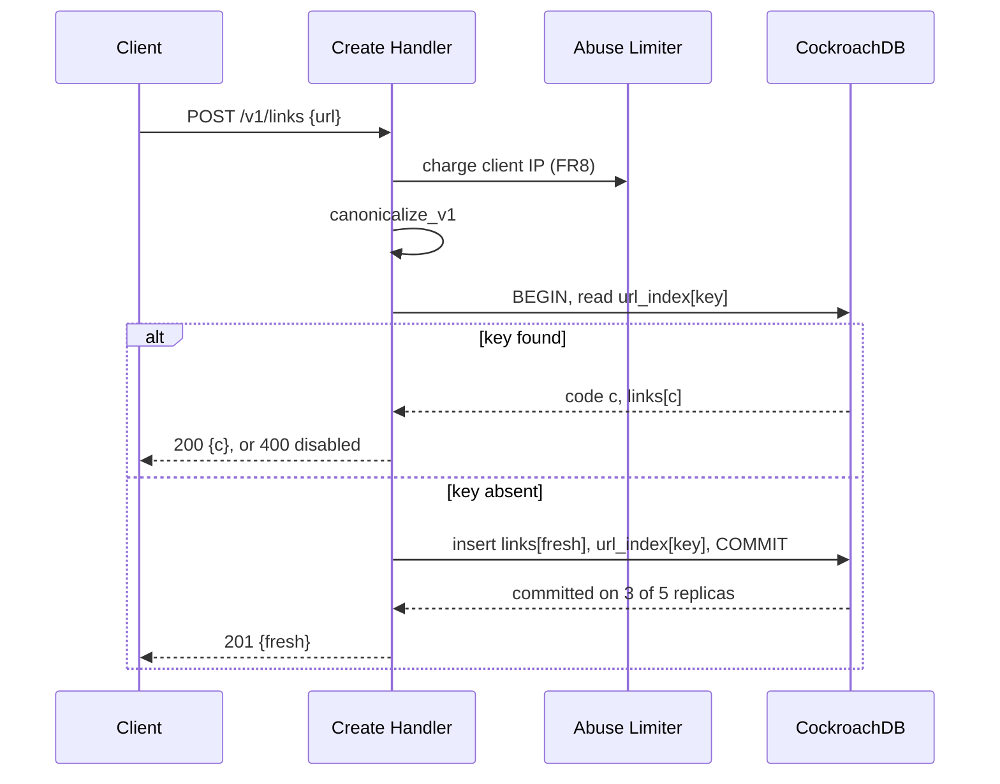
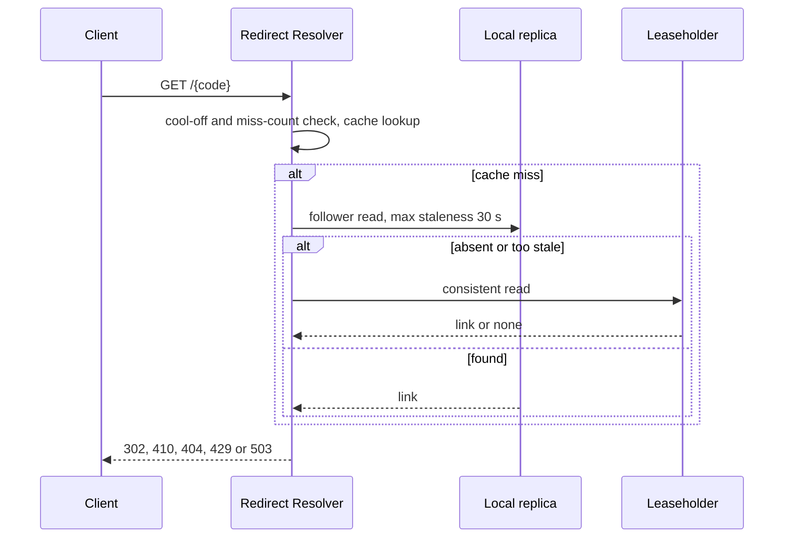

# RFC: URL Shortener

**Status:** Draft · **Author:** @LambdaNotFound

| Name | Sign-off | Comments |
| --- | --- | --- |
| @TBD | - [ ] approved | |

## Background

People share links in text messages, print, QR codes and character-limited posts, where a long URL gets truncated or mistyped. Xu's reference design maps a short code to the long URL, reusing it for a URL already shortened (FR3).

## Terminologies

| Term | Meaning |
| --- | --- |
| **Code** | The 8-character path of a short URL, `https://s.example/<code>`; `s.example` stands for the service's domain. |
| **Submitted URL** | The long URL after FR10's conversion, stored and redirected to. |
| **Canonical form** | The submitted URL after FR4's normalization; its SHA-256 is the **URL key**. |

## Problem Statement

A returned link must survive a region's loss (NFR6), forcing a cross-region write before the reply, and resolve in every region at once (NFR11). Redirects answer within 100 ms at p99 (NFR3) and outlive creation failures (NFR4), forbidding a cross-region round trip per redirect. Equivalent URLs share one code under a race (FR3), 8-character codes stay unguessable at 365 billion links (NFR2, NFR8, NFR12), and a disable takes effect within 5 minutes (FR6).

The forcing question is how to make a link durable across regions before it's returned, yet resolvable locally and consistently everywhere.

## Requirements

### Functional Requirements

| ID | Requirement |
| --- | --- |
| FR1 | Any caller, with no account, can submit a long URL and receive a short URL for it, within the limits of FR7, FR8 and FR9. |
| FR2 | Opening a short URL that is not disabled (FR6), from a client IP that is not in an NFR8 cool-off, redirects the caller to the long URL exactly as it was submitted (FR10) in the request that created the short URL. |
| FR3 | Submitting a long URL that was already shortened returns the existing short URL to every caller, including when the first submissions of that URL arrive at the same moment, unless FR7, FR8 or FR9 rejects the submission. |
| FR4 | Two long URLs count as the same URL throughout this doc when they are equal after RFC 3986 syntax-based and scheme-based normalization (https://www.rfc-editor.org/rfc/rfc3986#section-6.2), and as different otherwise. |
| FR5 | A short URL never expires during the service's 10-year life and never changes its target, and no caller can edit or delete it. |
| FR6 | Only an operator can disable a short URL, and within 5 minutes of the disable being recorded the service stops redirecting it, and so does every cache that honors the service's cache headers. |
| FR7 | Only http and https URLs (the scheme in any case) that are valid under RFC 3986 and at most 2,048 characters long, both judged on the submitted URL as FR10 defines it, are accepted, and any other submission is rejected with the reason (assumed: 2,048 is a common practical limit, not a sourced one). |
| FR8 | Each client IP can submit only a limited number of URLs per hour, repeats of already-shortened URLs included, and submissions over that limit are rejected with the reason (assumed: the design sets the number). |
| FR9 | A submission is rejected with the reason when its host, after FR4 normalization, is the service's own domain or a subdomain of it, when it contains a user or password part (even an empty one), or when it is the same URL (FR4) as one whose short URL is disabled, from the moment the disable is recorded. |
| FR10 | A submitted URL containing non-ASCII characters is converted to a standard URL, with a punycode host and every other non-ASCII character percent-encoded as UTF-8, before any other rule applies, and the converted form counts as the submitted URL throughout this doc. |

### Non-functional Requirements

| ID | Requirement |
| --- | --- |
| NFR1 | **Scale.** The service absorbs 100 million new short URLs a day and an average of 10 redirects per link created, about 1,160 creations and 11,600 redirects a second (https://bytebytego.com/courses/system-design-interview/design-a-url-shortener), with peaks of 10 times those rates. |
| NFR2 | **Capacity.** Every short URL created over the service's 10-year life, about 365 billion, stays stored, and resolvable unless disabled (FR6). |
| NFR3 | **Redirect latency.** A redirect is answered within 100 ms at the 99th percentile, measured at the service (https://www.hellointerview.com/learn/system-design/problem-breakdowns/bitly). |
| NFR4 | **Redirect availability.** Redirects are available 99.99% of the time, with lookups rejected under NFR8 counted as available, and keep working while creating new short URLs is failing. |
| NFR5 | **Creation.** Creating a short URL completes within 1 second at the 99th percentile and is available 99.9% of the time. |
| NFR6 | **Durability.** A short URL that has been returned to a caller, and a disable that has been recorded, are never lost, even when a whole region fails. |
| NFR7 | **Correctness.** A short URL never redirects to a long URL that is not the same, per FR4, as the one it was created for. |
| NFR8 | **Security.** A short code cannot be predicted from any other short code, and a client IP that looks up too many codes that do not exist within a window has every lookup rejected for a cool-off period (assumed: the design sets the window, the limit and the cool-off). |
| NFR9 | **Operability.** Operators can see redirect and creation latency and error rates against NFR3, NFR4 and NFR5, are alerted when a target is breached, and can see how long each disable took to take effect across the service. |
| NFR10 | **Compatibility.** A short URL, once issued, keeps the same domain and code for the service's whole 10-year life, and resolves at them unless disabled (FR6). |
| NFR11 | **Read-after-create.** From the moment a short URL is returned to the caller, every server that is serving redirects resolves it with no replication delay, unless it is disabled (FR6). |
| NFR12 | **Length.** Every short code is at most 8 characters long. |

### Out of Scope

- Accounts for callers, so FR3's reuse is global; operators still authenticate (Open Question 3).
- Custom aliases: every code is random (NFR8).
- Expiry, and editing or deleting by callers: FR5 forbids them.
- Click analytics: redirects record NFR9's metrics only.
- Scanning URLs for spam or malware: operators are the only abuse control.
- Legal erasure: a disable stops redirects but keeps the row.

## Estimates

- **Rates.** NFR1: 100,000,000 / 86,400 s = 1,157 creations and 11,574 redirects a second, 11,600 and 116,000 at peak, sizing the regions below.
- **Code space.** 62^8 = 2.18 × 10^14 codes, 0.167% full at NFR2's 365 × 10^9 links: one live code in 598, so inserts rarely retry. Base36 would be 12.9% full (Appendix). NFR8 allows that, so base62 is chosen for enumeration yield, not forced: at the Appendix's cycle, 49.5 live codes an hour under base36 against 14.4 a day under base62. Its cost is in Link Creation.
- **Storage (assumed).** At Xu's assumed 100 B URL, rows of 124 B and 40 B total 299 TB with 5 replicas, 3.85 PB at FR7's maximum (Appendix), so the store is range-sharded and the index keys on a 32 B hash.
- **Disable budget.** FR6 allows 300 s. Replica staleness S + cache TTL T = 30 + 60 = 90 s for servers, plus browser `max-age` M = 60 s = 150 s, so expiry alone meets FR6.
- **Headroom and step 4 load (assumed).** A drain moves a region's third onto two, raising each by half, so each region is sized for 116,000 / 2 = 58,000 redirects a second. At an 80% hit rate, 11,600 reach the store, against 1,280 that one server's step 4 confirms (Appendix), so a slow replica drains the region (Draining).

## Proposed Solution

### Overview

This RFC defines a three-region service that writes each link in one cross-region transaction before returning it, and answers each redirect from a server cache or the local replica, reading consistently only when that replica lacks the code. The store is CockroachDB, set to survive a region failure; codes are 8 random base62 characters. NFR3, NFR4 and NFR5 rest on figures assumed until load-tested. Redirects outlive failed creation through a lease move shorter than S, or quorum loss for at most 90 s, not store overload or a bad deploy of their shared fleet, and the region holding every leaseholder is unsized (Failure Modes). A wide botnet can fail fresh codes, and one prober can cut off a shared address or prefix for an hour, or for a window in a region whose step 4 fails (Abuse Limiter).

*Diagram: three regions, each with an L4 load balancer, a stateless fleet (Redirect Resolver with cache, Create Handler, Admin API), a counter store and CockroachDB nodes of one 2+2+1 cluster. Arrows: DNS to a healthy region; redirect to cache, local replica, then dashed to leaseholders; create committed across two regions; the Disable Tracker probing servers. Label S, T and M.*

### API

- `POST /v1/links` `{"url"}` returns `201 {"code", "short_url"}`, or `200` with the existing code (FR3), so a retry is safe though charged to FR8 again. Rejections: `400` with `bad_scheme`, `invalid_url`, `too_long`, `own_domain`, `userinfo` or `disabled`; `429 rate_limited` with `Retry-After`; `503`.
- `GET /{code}` returns `302` with `Location` and `Cache-Control: private, max-age=60` (FR2). Disabled is `410`, unknown `404`, both `no-store`; cool-off `429` (NFR8); unconfirmable or shed-limited `503`. Other paths are unknown codes; query strings are ignored.
- `POST /admin/v1/links/{code}/disable` `{"reason"}`, on the internal admin host only, returns `disabled_at`, the first one on a repeat.
- `GET /admin/v1/disables/{code}` returns `disabled_at` and `server_effective_at` (NFR9).

`/v1/links` can't collide with a code, which has no second `/`. Nothing paginates.

### Data model and storage

Access patterns: a point read by code per redirect (116,000 a second at peak, mostly cached); per creation (11,600), a point read by URL key, then a read or two inserts atomic across ranges (FR3); rare disables, tracker scans and cool-off writes, read by each server every second.

```sql
CREATE TABLE links (
  code        STRING(8) PRIMARY KEY,  -- random base62 (NFR8, NFR12)
  url         STRING NOT NULL,        -- submitted URL, never updated (FR5)
  created_at  TIMESTAMPTZ NOT NULL,
  disabled_at TIMESTAMPTZ NULL        -- set once by an operator (FR6)
);
CREATE TABLE url_index (
  url_key BYTES PRIMARY KEY,          -- SHA-256 of canonicalize_v1 output
  code    STRING(8) NOT NULL
);
CREATE TABLE disables (
  code STRING(8) PRIMARY KEY, disabled_at TIMESTAMPTZ NOT NULL,
  operator STRING NOT NULL, reason STRING NOT NULL,
  server_effective_at TIMESTAMPTZ NULL  -- set by the Disable Tracker (NFR9)
);
CREATE TABLE cooloffs (                 -- LOCALITY GLOBAL (Abuse Limiter, NFR8)
  identity BYTES PRIMARY KEY,           -- IPv4 address, or IPv6 prefix and length
  until TIMESTAMPTZ NOT NULL, INDEX (until)
);
```

**MVP choice: CockroachDB in three regions, `SURVIVE REGION FAILURE`, `REGIONAL BY TABLE`,** because:

- NFR6: 5 replicas placed 2+2+1, so 3-replica commits outlive any one region.
- FR3: a transaction makes the two inserts atomic.
- NFR3, NFR4: bounded-staleness follower reads serve a row from the nearest replica, even partitioned.
- NFR11: a consistent read at the leaseholder settles a local miss.

**Pros:** the fatal invariants (NFR6, NFR7, FR3) are the database's job. **Cons:** a self-operated cluster, a cross-region round trip on every write, and 5× storage.

### Edge and client identity

DNS latency records send clients to the nearest healthy region, with a 60 s TTL and health checks every 10 s, 3 failures to trip, so NFR4 holds 78 drains a year (Appendix). The L4 load balancer passes the peer address by PROXY protocol as FR8 and NFR8's client IP, ignoring `X-Forwarded-For`.

No single IPv6 prefix is one caller: RIPE-690 gives a home a /56 and a business a /48, and a phone gets a /64 per connection (RFC 6459). So an IPv4 address is one **identity**, and an IPv6 address three, its /64, /56 and /48, limited at 1, 4 and 16 times the base. The cost is IPv6's carrier-grade NAT: one prober's cool-off on a carrier's /56 or /48 rejects up to 256 or 65,536 phones' /64s for an hour, everywhere (Failure Modes).

### Canonicalizer

```rust
pub struct SubmittedUrl(String); // ASCII, FR7-valid; stored and sent in Location
pub struct UrlKey([u8; 32]);     // SHA-256 of the canonical form
pub enum Reject { BadScheme, InvalidUrl, TooLong, OwnDomain, Userinfo }

/// Frozen: url_index keys depend on its output.
pub fn canonicalize_v1(raw: &str) -> Result<(SubmittedUrl, UrlKey), Reject>;
```

1. **Convert (FR10).** Only a host with non-ASCII goes through UTS #46 ToASCII, nontransitional, which maps case and applies NFC; other non-ASCII characters are percent-encoded as UTF-8. An ASCII host keeps its case, and a space stays invalid.
2. **Validate (FR7).** Scheme `http` or `https` in any case, RFC 3986 grammar, at most 2,048 characters.
3. **Normalize (FR4).** Lowercase scheme and host, uppercase percent-encoding hex, decode unreserved escapes, remove dot-segments, drop the default port, and make an empty path `/`.
4. **Reject (FR9), then hash.** Any `@` in the authority rejects. The normalized host, minus one trailing dot for this check only, must not be `s.example` or end in `.s.example`. Three inputs pass this check yet open at `s.example` (Open Question 5).

**Versioning.** Any change to step 3, a bug fix included, re-keys old URLs and gives them second codes (FR3), so v1 is frozen. Its specification is the tests in `src/url-shortener/tests/canonicalize.rs` and `src/url-shortener/src/canon.rs`, which also pin the implementation's choices: ports by value, hostless dot-segments and the WHATWG deny list. A change is a v2 with a backfill re-keying `url_index`. **Cons:** the parser and IDNA tables become part of the data format for ten years, and v2 has no cutover plan, a residual risk: v2 keys before the backfill ends give a URL a second code (FR3) and let a disabled one pass FR9, v1 keys until it ends race the backfill against live inserts, and a fix merging two v1 keys leaves two codes with no rule for which FR3 returns. Trigger: the first change that fails one of those tests, which then needs its own RFC with phases and a merge rule.

### Link Creation

The Create Handler charges FR8 first, so rejections count, then canonicalizes and runs one transaction:

```rust
pub struct Code([u8; 8]); // base62 ASCII from a CSPRNG
pub enum Created { New(Code), Existing(Code) }
pub enum CreateError { Disabled, Integrity, CodeTaken, KeyTaken, Store(StoreError) }

pub trait LinkStore {
    fn create(&self, key: &UrlKey, url: &SubmittedUrl, fresh: Code) -> Result<Created, CreateError>;
}
```

```text
Phase 1, look up: read url_index[key]. Found code c: read links[c].
                  disabled_at set: Disabled (FR9).
                  canonicalize_v1(links.url) yields another key: Integrity,
                  alert, never return c (NFR7). Otherwise Existing(c) (FR3).
Phase 2, insert:  insert links[fresh]. Duplicate code (p <= 0.00167): CodeTaken;
                  the handler draws a new code and retries, at most 5 times.
Phase 3, claim:   insert url_index[key] = fresh. Duplicate key or a serialization
                  conflict: a concurrent first submission won; KeyTaken, and the
                  handler reruns Phase 1 (FR3).
Phase 4, commit:  3 of 5 replicas across two regions (NFR6), then New(fresh).
```

An aborted transaction leaves no rows, and the stored spelling is the winner's, FR2's creating request.



**Pros:** FR3, NFR6 and NFR7 hold by construction, and codes reveal nothing about others (NFR8). **Cons:** each creation pays cross-region round trips; NFR5 is assumed until Task 2's load test. Codes are case-sensitive, a cost the Problem Statement's own media pay: a mis-cased typed or printed link is another code, whose `404` counts toward the reader's miss limit, and a QR code can't use alphanumeric mode, which lacks lower case, so its symbol is larger. Base36 avoids both at 49.5 live codes an hour per prober (Estimates); base62 loses if typed and printed links outweigh that yield, and only before launch, since NFR10 freezes issued codes.

### Redirect Resolver

```rust
pub enum Cached { Live(Arc<str>), Disabled } // positive entries only (NFR11)

pub trait LinkReader {
    /// Follower read, nearest replica only; errors past max_staleness.
    fn read_local(&self, code: &Code, max_staleness: Duration) -> Result<Option<Link>, StoreError>;
    /// Consistent read at the leaseholder.
    fn read_consistent(&self, code: &Code) -> Result<Option<Link>, StoreError>;
}
```

```text
Step 1, guard:   not a code: 404, a miss. An identity in cool-off or past its
                 regional miss limit: 429 (NFR8); past its shed limit with
                 no miss: 503.
Step 2, cache:   entry younger than T = 60 s: 302 or 410.
Step 3, local:   read_local(code, S = 30 s), 20 ms timeout. Found: fill, answer.
Step 4, confirm: absent, error or timeout: read_consistent(code), 100 ms
                 timeout, at most F = 64 in flight per server, of which IPs
                 with a miss in their window share 16. Found: fill, answer.
                 Absent: 404, a miss. Error, timeout or over the limit: 503,
                 a shed if step 3 found the code absent.
```

**Why each tier.** Single-flight fill limits a viral code to one store read per server per T. Step 3 keeps the common path in-region (NFR3) and off the write quorum and the leaseholders, so redirects outlive creation failing from their loss (NFR4, bounded in Failure Modes). Step 4 exists for NFR11: a code returned a moment ago may not be on this replica yet, so a local miss is never final or cached. It crosses regions, so NFR3 assumes steps 2 and 3 answer 99% of redirects.

**Staleness (FR6).** An entry filled at t reflects the store at t − S or later and serves until t + T, and a browser keeps the `302` M more (Estimates). `private` keeps shared caches out, and `302`, unlike `301`, isn't cached heuristically.

**Draining.** Each server's health endpoint fails when a step 3 read of a sentinel code fails or passes 20 ms, or over 5% of step 3 reads in 10 s time out, so the region drains rather than serve a disabled or unseen code (FR6, NFR11). If survivors trip anyway, Route 53 treats all records as healthy once none is, the undrained state.



**Pros:** staleness can only hide a code or a disable, never misdirect, because a URL never changes (FR5). **Cons:** a fresh code's first lookups cross regions, and enumeration reaches the leaseholders, up to F per server.

### Abuse Limiter

A regional in-memory counter store charges each identity per submission, `(identity, hour)`, rejected past 100 (FR8), and per miss, `(identity, 10 minutes)`, each limit times the identity's multiple. Step 1 reads the IP's counts in one round trip and rejects once any passes its limit, overshooting by the lookups then in flight (Appendix); the server whose charge crosses it writes a 1-hour cool-off to `cooloffs`, a `GLOBAL` table every region reads consistently and locally. Servers read new rows every second, overlapping 5 s for commit order, so a cool-off holds everywhere within seconds (NFR8).

**Sheds.** A shed of a locally absent code leaks what a `404` does, so it counts. Once the identity has a miss in the window, it counts as one: step 4 is then answering the identity, so a prober outrunning its slots is cooled off. With no miss, as in a step 4 outage, the code may be fresh: past the limit, step 1 answers `503` in that region until the window ends, with no cool-off. NFR4 counts those `503`s, and an attacker can force them on a shared prefix (Appendix).

Counting stays regional: a global counter puts a cross-region write on every miss (NFR3, NFR4). So a client in all three regions gets three times each limit (Appendix). Cool-offs, at most one per identity an hour, suit `GLOBAL`'s slow writes. If the counter store is down or past a 5 ms timeout, step 1 passes and servers count in process and alert; a failed cool-off write holds locally and retries, and a failed read keeps the last set. **Cons:** a counter read on every lookup, up to 5 ms of NFR3; shared addresses and prefixes share limits, a risk the scoping record accepted.

### Disables

One transaction sets `links.disabled_at` and inserts the `disables` row (FR6), committed like a creation (NFR6); the next creation for that URL reads it in Phase 1 and is rejected (FR9).

**Disable Tracker (NFR9).** Every 5 s, for each disable lacking `server_effective_at`, a singleton job calls every serving server's debug lookup and records when all answer `410`; the browser tail M is computed, not observed. A disable not in effect within 90 s pages an operator.

### Example

At 09:00:00 a caller in region B submits `HTTPS://Example.com:443/a/../b`, stored as is with canonical form `https://example.com/b`; code `q7Xk2PzA` commits in regions A and B. At 09:00:01 region C's replica lacks it, so step 4 finds it and redirects to the stored spelling. Disabled at 10:00:00, it stops redirecting everywhere by 10:01:30; a resubmission at 10:00:05 fails (FR9).

## Alternatives Considered

### Code generation

- **A counter in base62 (Xu).** Pro: never collides. Con: a code predicts its neighbors (NFR8), and every insert lands on the newest range, a hotspot at 11,600 a second.
- **A counter through a keyed permutation of 62^8.** Pro: no collisions, random-looking codes. Con: in place of one retry in 598, a durable counter that survives region loss and a ten-year secret whose leak inverts every code under that key (NFR8).
- **A truncated hash of the canonical form.** Pro: reuse without an index. Con: at 47.6 bits, n² / 2N = 3.05 × 10^8 URL pairs collide, so a collision path is needed anyway, and anyone can compute a URL's code (NFR8).

### Store

- **One primary region, asynchronous replicas.** Pro: local writes, simplest operations. Con: a region loss drops unreplicated writes, so a returned link can vanish (NFR6).
- **DynamoDB global tables, multi-Region strong consistency.** Pro: managed, RPO zero across three regions, and conditional puts give FR3 without transactions: code item first, then URL key, so a crash or lost race leaves only an unreturned code for an FR4-equal URL (NFR7), which the winner's disable misses. Con: strongly consistent reads cross regions, a round trip per uncached redirect (NFR3); eventually consistent reads have no staleness bound or lag metric, so a lagging replica can serve a disabled code past FR6's 5 minutes.
- **CockroachDB `GLOBAL` tables for `links`.** Pro: every replica reads consistently and locally, so a local miss is final. That deletes step 4, its F slots, the clean and dirty pools, shed counting and the wide-botnet residual, makes NFR11 hold by construction, and lets a disable take effect with no S. Con: every write waits out a commit-wait of about the closed-timestamp lead, the maximum clock offset plus a propagation allowance (the docs suggest 800 ms or more past a 150 ms RTT), on top of the creation's own cross-region round trips, and a lost FR3 race reruns Phase 1. That leaves little of NFR5's 1 s p99, assumed until Task 2's load test; if a `GLOBAL` creation fits it on Open Question 1's regions, the choice flips.

### Read path

- **A CDN caching redirects.** Pro: absorbs viral links and cuts latency. Con: edge hits skip the service, so an IP in cool-off still gets redirects (NFR8).

## Failure Modes and Observability

Six failure modes matter; metrics follow.

- **A region fails.** Each range keeps 3 of 5 replicas, so reads and writes continue (NFR6); DNS drains the region onto the survivors in about 90 s, and any leases it held move, pausing creation and step 4 on them until they do. Residual risk: `REGIONAL BY TABLE` homes every leaseholder of `links` and `url_index` in the primary region, which serves all creation and step 4 reads besides its own redirects, though Estimates sizes regions for redirects only. When it fails, every lease moves at once onto a survivor sized for none of them. Trigger: home-region leaseholder load in Task 2's load test, and the lease-move pause in Task 6's drill.
- **Creation fails.** Steps 2 and 3 need neither the write quorum nor a leaseholder, so NFR4's clause holds through a lease move shorter than S, but after quorum loss only for S, and cached codes for S + T = 90 s (Two regions fail). Two causes sharing the redirect path are residual risks. Store overload: FR8 limits each identity, not their sum, so many identities past NFR1's 11,600 a second, doubled by the timed-out retry below, slow every voter step 3 reads until step 3 passes 20 ms in every region, health endpoints fail, and Route 53's fail-open sends uncached lookups to the overloaded leaseholders; trigger: creation rate over 11,600 a second while step 3 latency rises. A bad creation deploy: the Create Handler shares the redirect fleet and deploy, so a crash or bad build takes redirects down wherever it rolls out; trigger: redirect `5xx` or health failures starting during a rollout.
- **A region is partitioned.** Past S it reads neither locally nor consistently: uncached lookups get `503` until it drains, about 120 s (Appendix).
- **Two regions fail.** Beyond NFR6: creation and disables stop, and redirects fail once caches expire and local reads pass S. The break-glass, a logged operator flag, lifts S, suspending FR6 and NFR11.
- **The store is slow.** A local replica past step 3's 20 ms drains its region (Draining). A slow leaseholder fails fresh and unknown codes with `503`; a client shed past the limit loses that region until its window ends, or, with a miss of its own, gets the hour's cool-off (Abuse Limiter). Creation retries a timed-out transaction once, safe under FR3.
- **A botnet enumerates.** Clean IPs share step 4's other 48 slots with fresh codes. Past 960 first-time misses a second on a server, 576,000 identities per 10 minutes (Appendix), fresh codes there get `503` and count as sheds: a residual risk to NFR4 and NFR11, shown by step 4 rejections.

Metrics that track:

- Redirect and creation latency by region and status, and availability (non-`5xx` over all), with burn-rate alerts at 99.99% and 99.9% (NFR3, NFR4, NFR5, NFR9).
- Follower staleness, step 3 timeouts, step 4 rate and rejections over F, cache hit rate; creation rate against NFR1's 11,600 a second peak, and rollouts marked on redirect availability.
- Misses, sheds, shed-limit `503`s, active cool-offs, those started mostly by sheds, and counter-store fallback per region; lookups rejected per cool-off, paging when a /56 or /48 cool-off rejects over 16 /64s without misses, which NFR4's count hides.
- `server_effective_at − disabled_at` per disable (NFR9); the tracker's heartbeat age, paging past 1 minute; `Integrity` aborts.

Debug endpoints that:

- Resolve one code through one server's steps 2 to 4, cache untouched: `/internal/lookup/{code}`.

## Open Questions

1. **Which three regions?** Creation and step 4 latency scale with their round trips. Current design: assumed one continent. If wider, measure creation p99 first.
2. **Are the limits and load figures right?** Current design: assumed 100 creations an hour, 50 misses or sheds in 10 minutes, multiples of 4 and 16 at /56 and /48, a 1-hour cool-off, F = 64 with 16 for IPs with misses, an 80% cache hit rate, 50 ms per step 4 read, regions sized for half the peak. If they block real users, raise them; the Appendix prices each.
3. **How do operators authenticate?** Current design: assumed existing single sign-on fronts the admin host. If none exists, the Admin API needs its own.
4. **Does one cluster sustain 11,600 two-range transactions a second plus step 4?** Current design: assumed yes, scaled by nodes. If not, revisit the two-insert transaction first.
5. **Should FR7 and FR9 reject URLs a browser opens at the service's own domain?** The literal text admits three: hostless URLs such as `http:///s.example/x`, which FR7's RFC 3986 grammar allows; percent-encoded hosts such as `http://%EF%BD%93.example/`, which FR9 judges escaped while a browser decodes and maps them to `s.example`; and a host of only a soft hyphen (U+00AD) before `/s.example/x`, which ToASCII maps to nothing, giving the hostless shape. These are the redirect loops FR9 exists to stop. Current design: assumed accepted per the literal text. Rejecting them after an amendment is a validation rule that re-keys nothing.

## Work Breakdown

| # | Task | Description | Depends on |
| --- | --- | --- | --- |
| 1 | Canonicalizer | `canonicalize_v1` and its frozen golden tests (FR4, FR7, FR9, FR10). | none |
| 2 | Link creation | Schema, the four-phase transaction, codes, a peak load test (FR1, FR3, FR5, NFR1, NFR2, NFR5, NFR6, NFR7, NFR8, NFR12). | Task 1, **CockroachDB cluster** (external, three regions) |
| 3 | Redirect Resolver | Tiers, single-flight cache, bounded fallback, headers (FR2, FR6, NFR3, NFR4, NFR11). | Task 2 |
| 4 | Abuse Limiter | Identities, counters, shed limit, `cooloffs` and its pull, step 4 slot split, fallback (FR8, NFR8). | Task 3 |
| 5 | Disables | Admin API, disable transaction, internal lookup, tracker (FR6, FR9, NFR9). | Task 3 |
| 6 | Deployment | DNS health checks, the health endpoint, PROXY protocol, the fixed domain, a region-isolation drill (drain, lease-move pause, home-region failover) (NFR4, NFR10). | Task 3 |
| 7 | Metrics and alerts | The metrics and alerts above (NFR9). | Tasks 3, 4, 5 |

## Appendix

**Alphabet against density** at 365 × 10^9 links of 8 characters:

```text
alphabet  space           fraction live  one live code per
base32    1.10 × 10^12    33.2%          3 probes
base36    2.82 × 10^12    12.9%          8 probes
base62    2.18 × 10^14    0.167%         598 probes
```

Under base36 a hit charges no miss, so a fast prober's 50 misses take 50 / (1 − 0.1294) = 57.4 probes, and its hour-long cycle (Enumeration under the limits) is 3 × (57.4 + 70) = 382 probes, 382 × 0.1294 = 49.5 live codes an hour.

**Minor rivals.** No server cache: removes T from FR6's budget, but a viral code's reads concentrate on one range's replicas. Push invalidation: takedown in seconds, but a pub/sub fleet that falls back to expiry, which already meets FR6.

**Availability per region drain.** NFR4's 99.99%: 0.0001 × 31,536,000 s = 3,154 s of failed lookups a year, counted per lookup as NFR4's NFR8 clause implies. A partitioned region: up to S = 30 s before its reads fail, then 10 s × 3 health checks to detect, then a 60 s DNS TTL to drain = 120 s; a hard region failure skips S, 90 s. At a third of the traffic, 120 / 3 = 40 s an event, 3,154 / 40 = 78 a year (assumed: regions split traffic evenly and clients honor the TTL).

**Enumeration under the limits.** Step 1 rejects an identity once its regional count passes the limit, so a region answers 50 of its misses per cycle plus the lookups in flight when the 50th is charged. That overshoot is min(r × ℓ, 16n + r × 20 ms) on the n servers a prober reaches, since a dirty identity holds at most 16 step 4 slots a server and its other lookups are in step 3 or already shed. At an assumed r = 1,000 probes a second and ℓ = 20 ms (step 3) + 50 ms (step 4) = 70 ms, it is 70 once n ≥ 4, rising with r and the fleet. A fast prober's cycle is the 1-hour cool-off: 3 × (50 + 70) = 360 probes an hour, 8,640 a day, 14.4 live codes a day at 1 in 598 for an IPv4 address or a lone /64. A /48 holder at 16 times: 3 × (800 + 70) × 24 = 62,640 probes, 104.7 live codes a day. A prober that outruns its slots (16 / 0.05 s = 320 confirms a second on one server, so at r = 1,000 sheds accrue at 680 a second) already has misses, so its sheds join the same count and these bounds hold. Only an identity that step 4 never answers in the window, through an outage or a clean pool saturated by others, meets the shed limit alone, with the 10-minute window as the cycle and ℓ up to 20 + 100 ms (step 4's timeout): 50 + 120 = 170 probes a window, 1,020 an hour, 1.7 live codes an hour for the event's length.

**Shed limit on a shared prefix.** In that event, an attacker on a shared IPv4 address, or rotating /64s inside a carrier's /48 (800 sheds), puts the prefix on `503`s in that region for the rest of each window. NFR4 pays the prefix's share of the region's redirects: each 1% of all redirects it sends there costs 0.01 × 600 s = 6 s of the yearly 3,154 s per window, for the event's length, shown by shed-limit `503`s. While step 4 answers, the same rotation draws a cool-off instead, the blast radius in Edge and client identity.

**Step 4 capacity (assumed).** At an assumed 50 ms a consistent read, F = 64 slots confirm 64 / 0.05 = 1,280 a second per server.

**Step 4 under a wide botnet.** An IP whose identities have no miss in a region's window takes a clean slot, and one miss from a /48 dirties every address in it: 48 clean slots / 0.05 s = 960 a second per server, × 600 s = 576,000 distinct IPv4 addresses or IPv6 /48s per server per 10 minutes.

**Storage rows.** `links`: 8 B code + 100 B URL + 16 B timestamps = 124 B; `url_index`: 32 B + 8 B = 40 B. Worst case: (2,072 + 40) B × 365 × 10^9 × 5 = 3.85 PB. Hash saving: (100 − 32) B × 365 × 10^9 × 5 = 124 TB.

## References

- *System Design Interview*, vol. 1, Alex Xu, "Design a URL Shortener" ([course page](https://bytebytego.com/courses/system-design-interview/design-a-url-shortener)), NFR1's rates and the counter rival.
- [Hello Interview: Design a URL Shortener like Bit.ly](https://www.hellointerview.com/learn/system-design/problem-breakdowns/bitly), NFR3 and NFR4's targets.
- [CockroachDB: Multi-Region Survival Goals](https://docs.cockroachlabs.com/docs/stable/multiregion-survival-goals), the 2+2+1 placement behind NFR6.
- [CockroachDB: Follower Reads](https://docs.cockroachlabs.com/docs/stable/follower-reads), the bounded-staleness reads of step 3.
- [CockroachDB: Global Tables](https://docs.cockroachlabs.com/docs/stable/global-tables), the locality of `cooloffs`, rejected for `links`.
- [Amazon DynamoDB: How global tables work](https://docs.aws.amazon.com/amazondynamodb/latest/developerguide/V2globaltables_HowItWorks.html), the managed rival.
- [Amazon Route 53: How Route 53 chooses records when health checking is configured](https://docs.aws.amazon.com/Route53/latest/DeveloperGuide/health-checks-how-route-53-chooses-records.html), DNS behavior when regions are unhealthy.
- [Amazon Route 53: How Route 53 determines whether a health check is healthy](https://docs.aws.amazon.com/Route53/latest/DeveloperGuide/dns-failover-determining-health-of-endpoints.html), the 10 s interval and failure threshold behind the drain time.
- [RFC 9111: HTTP Caching](https://www.rfc-editor.org/rfc/rfc9111), `max-age`, `private` and `no-store`.
- [RFC 3986: URI Generic Syntax](https://www.rfc-editor.org/rfc/rfc3986), FR4's normalization and the userinfo grammar.
- [UTS #46: Unicode IDNA Compatibility Processing](https://www.unicode.org/reports/tr46/), FR10's host conversion.
- [RIPE-690: IPv6 prefix assignment for end-users](https://www.ripe.net/publications/docs/ripe-690/), the /56 and /48 behind the IPv6 identities.
- [RFC 6459: IPv6 in 3GPP Evolved Packet System](https://www.rfc-editor.org/rfc/rfc6459), a phone's /64 per connection.
- *Designing Data-Intensive Applications*, Martin Kleppmann, chapter 5 (reading your own writes) and chapter 9 (linearizability), the theory behind step 4.

